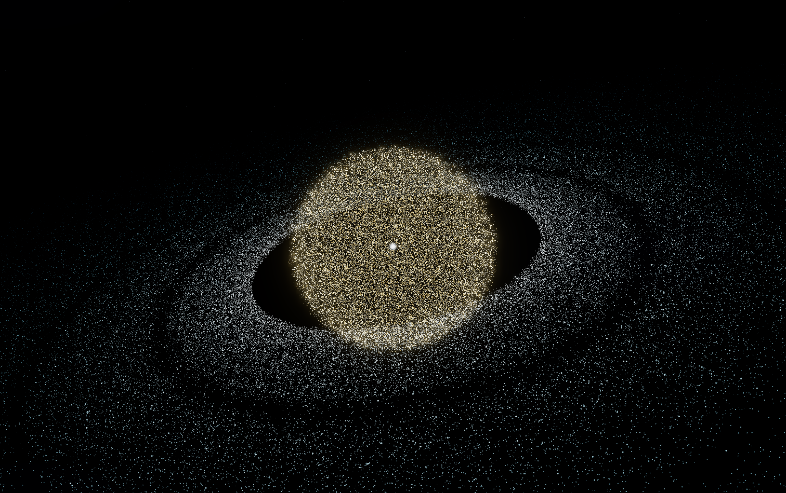

# 屏幕注意力分析助手 · 视线实验台

普通笔记本摄像头在本机估计视线，提供桌面注视圈、眼手交互和主动开启的屏幕注意力记录，只作厘米级的块区域分析。

## 30 秒开始

已安装环境：Mac 双击 **启动悬浮层.command**；Windows 双击 **启动悬浮层-Windows.cmd**。首次安装需 Python 3.12，在项目根目录执行：

| Mac | Windows PowerShell |
| --- | --- |
| `python3.12 setup_mvp.py --overlay` | `py -3.12 setup_mvp.py --overlay` |

首次下载依赖和模型不保证 30 秒完成。[安装与完整用法](docs/使用手册.md) · [Windows 排错](docs/Windows安装说明.md) · [现有 Release](https://github.com/shenzeyu070918-eng/monocular-gaze-mvp/releases)（v1.0.0 已发布，含 M0–M9，不含 M10）。[在线星系预览](https://shenzeyu070918-eng.github.io/monocular-gaze-mvp/galaxy/?preview) · [合成海报报告（非实测）](https://shenzeyu070918-eng.github.io/monocular-gaze-mvp/report.html)。无需摄像头，M10报告仅样式示例。

## 3 分钟验收路径

1. **不打开摄像头**：已安装环境运行 `.venv/bin/python tools/preview_galaxy.py`（Windows 为 `.venv\Scripts\python.exe` 加同一脚本），打开打印的 `?preview` 地址；鼠标模拟视线，O/F 张手/握拳，B 打散。
2. **本机链路**：启动悬浮层 → 控制面板九点校准 → 独立精度核对 → 查看 B 组结果。
3. **主动记录（Mac）**：开始图片刺激物或屏幕注意力会话 → 暂停/恢复 → 结束，检查本地整理结果。首次权限/安装另计，[完整验收](docs/验收入口.md)。

## 功能

| 入口 | 当前 main 状态 |
| --- | --- |
| 视线悬浮层、九点校准 | Python 本机运行，托盘/面板/系统热键；独立 A/B 核对 |
| 热力图 | 后台累加、按需查看及本地导出，不表示看了什么内容 |
| 眼手星系 | 浏览器 WebGL 粒子；预览不访问摄像头，实时链路数值本地传递 |
| 屏幕注意力记录 | M9 Mac 单用户验收通过；主动记录、AOI、绑定及本地统计 |
| 分析报告 | M10 [PR #17](https://github.com/shenzeyu070918-eng/monocular-gaze-mvp/pull/17) 已恢复开发。验收与钥匙串设置见 [M10 使用说明](docs/m10-report.md) |

## 精度与已知限制

九点校准后定位约 **1.3–2.5 cm** 为已报告条件下的量级，非精度保证；边缘、坐姿和校准时效会影响表现，只能作块级分析。M9 四轮硬归属 **80.4% / 85.3% / 76.2% / 66.7%**；仅第四轮完整验收通过，距 60% 门槛仅 **6.7 个百分点**。Mac 单用户结果不代表 Windows、多人或长期稳定性；Windows 屏幕采集/OCR未实现。[分组数字与边界](docs/验收入口.md) · [原验证记录](验证记录.md)。

## 目录结构

`gaze_core/` 公共计算 · `overlay/` 桌面 · `static/` 网页/星系 · `tools/` 离线工具 · `config/` 配置 · `docs/` 方案/操作 · [shenzeyu070918-eng/](shenzeyu070918-eng/README.md) 个人成果 · `data/` 本地数据（忽略）。

## 开发方式

本项目由本人独立完成（100%）；本人负责需求定义、方案与技术取舍、验收标准设计、实机测试与验收；代码实现借助 AI 编程工具（Codex 等）完成，每个里程碑都经过本人审核与实机验证。实际已测/未测范围以上述记录为准，第三方来源不计作本人原创。[任务与提交方式](docs/开发与贡献记录.md) · [工作大纲](docs/ROADMAP.md) · [版本记录](CHANGELOG.md)。

## 数据与隐私

摄像头/人脸图像不保存、不上传；数值录制、档案和本机配置不进 git。仅主动 M9 会话可在本地保存屏幕场景与 OCR，支持应用排除、暂停和整会话删除；默认不记录窗口标题。点击默认关闭，只监听鼠标按下，不记录键盘。M10 可选 AI 尚未合并，逐次确认例外不等于默认上传。[详细约定](AGENTS.md)。

## 致谢与第三方协议

自有代码 [MIT](LICENSE)；保留 [THIRD_PARTY_LICENSE.txt](THIRD_PARTY_LICENSE.txt) 与 vendor 原许可。感谢 ptgaze/ETH-XGaze、MediaPipe、three.js、Qt 等开源项目；仓库组织参考 [bear-run](https://github.com/gf199lin/bear-run)。[许可范围与来源](docs/第三方与许可.md)。
