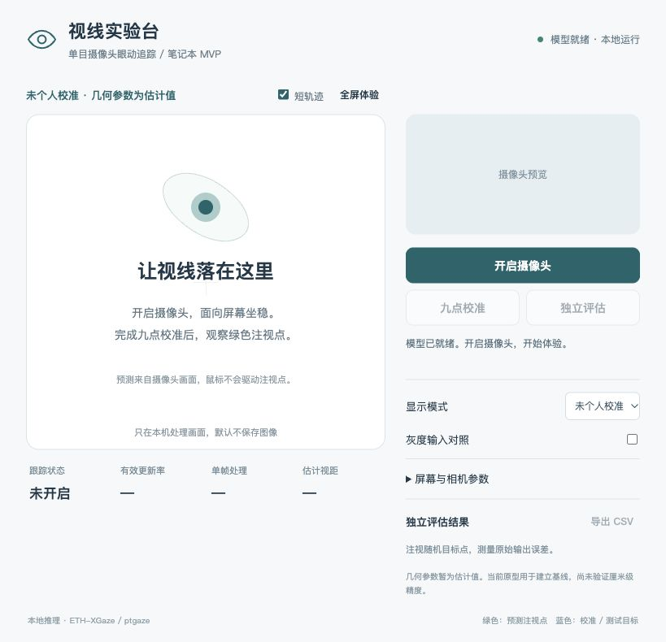

# 视线实验台 — 单目摄像头笔记本 MVP

普通笔记本摄像头 → 本机三维视线估计 → 应用内注视点 → 九点个人校准 → 独立评估与 CSV 导出。首个测试版本 **v0.1.0** 是同学试用基线；当前开发分支为 **M8b（眼手星系，实机待验收）**，保留 M5 点击粗校准、M6 按需热力图及 M7 内置屏投影适配。已报告的 Mac 核对与性能结果见验证记录；尚未完成双机或项目精度验收。

**这是下载后在各自电脑运行的应用。GitHub 仓库页面不直接运行眼动模型；无需把摄像头画面传到云端。**

- [测试操作与记录指南](docs/测试操作与记录指南.md)
- [可复制填写的测试记录模板](docs/测试记录模板.md)
- [版本记录](CHANGELOG.md) · [已完成的验证](验证记录.md)



## M8b：眼手星系

### 粒子行星与独立画面预览

画面方向已获用户确认；正式入口已使用同一套粒子行星渲染。下面的独立预览无需相机、个人档案或眼动数据，可先检查配色、颗粒、视角和投影效果。

在项目目录运行（使用已有虚拟环境）：

```sh
# Mac
./.venv/bin/python -m tools.preview_galaxy
```

```powershell
# Windows
.\.venv\Scripts\python.exe -m tools.preview_galaxy
```

用 Chrome 打开 **http://127.0.0.1:8768/?preview**。底部按钮可切换「粒子行星 / 螺旋星系 / 文字」、斜视/俯视/近景、暂停、重播约2秒开场及全屏。文字读取 `galaxy.text`。新增模拟按钮：凝视中心（停留推近）、鼠标模拟视线、关闭视线、张手/握拳/无手与恢复静止；局部按键 **O/F/N** 对应张手/握拳/无手，**G** 切换鼠标视线，**B** 触发一次打散并自动收回；预览切场景也经过散开/汇聚。模拟输入为15 Hz，复用正式的采集时间停留与手势平滑，不打开摄像头。`?preview&debug` 显示浏览器实际rAF帧率与渲染提交耗时；提交耗时不等于GPU完成耗时。预览只绑定本机，不启动WebSocket或摄像头，资源均在本地；终端 Ctrl+C 结束服务。

画面使用GPU顶点着色器直接计算轨道/翻涌：默认8万体积球粒子、15万宽环粒子，暖金/青白配色、距离缩小/变暗、开普勒差速与少量游离。辉光克制，经过HDR色调映射；银河为两条对数主旋臂（默认螺距角15°），附少量短支臂；指数星盘中30%的盘面粒子为弥散星盘（不含核球/亮团），宽度与亮度随半径变化、外缘逐渐变淡变碎。更大的扁暖金核球、青白蓝/少量紫色旋臂、零星粉品红亮团及内侧尘埃暗带共同形成层次。尘埃用降低采样密度和发光亮度近似，不做真实吸收。图案整体刚性旋转，只有沿对数旋臂很小且有界的周期漂移；手势加速只加快整体相位，运行多久都不应卷成同心环。文字填满笔画并在笔画内流动。球体有边缘增亮和小核心；星环内缘白而密、向外渐暗转青蓝，默认两道浅环缝。约1.5%的颗粒更大、更亮并带微光晕与慢闪烁。参数集中在 `galaxy.visual`，真实GPU/投影性能待测。预览与正式入口均启用下文的自动降档，静帧截图保持原粒子数。

固定种子/时间的截图可复现（需要Chrome与已有overlay依赖；先保持预览服务运行，在另一个终端执行）：

```sh
./.venv/bin/python -m tools.render_planet_check
# Windows: .\.venv\Scripts\python.exe -m tools.render_planet_check
```

输出都在忽略提交的 `data/reference/`：`render_check.png`（斜视）、`render_closeup.png`（近景）、`render_galaxy.png`、`render_text.png`；原参考图存在时另生成 `render_comparison.png` / `.html`，浏览器可打开 **http://127.0.0.1:8768/comparison** 并排查看。该命令用独立无头Chrome/SwiftShader，只截取自身画布及用户提供的参考图，不读取真实桌面或摄像头；`render_check.json`记录渲染错误和逐场景运动检查，不用软件渲染成绩代替Mac实机性能。静态复查可用 `?preview&still&clean&t=8&scene=planet&view=oblique`。新增 `data/reference/render_check/` 的 **12张交互截图**（planet/galaxy/text × base/scatter/well/zoom）、`contact-sheet.png` 和 `manifest.json`；浏览器打开 **http://127.0.0.1:8768/render-check** 查看。每组固定时间和镜头角度，仅推近改变距离；工具核对甩散/引力井/推近确实改变像素、握拳回到同一时刻的动态原形。银河和文字另输出 `*-scatter-return.gif`（两秒、10fps合成采样，非游戏帧率）、`*-scatter-return.png` 拼帧、`*-views.png`，以及四角/上下边缘在默认距离与最坏推近下的24张PNG；同一时刻在不同历史帧后重复绘制应完全一致，检查历史拖影。银河另有 `galaxy-face.png`（正面）、`galaxy-oblique.png`（默认斜视）、`galaxy-times.png`（8/60/300/600秒两视角拼图）和 `galaxy-stability.json`。工具通过transform feedback读取**正式顶点着色器**输出的主臂粒子，去除统一旋转/有界漂移后比较螺距与分半径角分布；任一变化超过 `galaxy_stability_tolerance_deg`（默认2°）即非零退出。另检验默认最大手势加速对应的motionTime=2400秒；这是设置着色器时间的合成检查，不是连续运行40分钟的实机测量。预览可选「银河正面」，或用 `?preview&still&clean&scene=galaxy&view=face&t=600`。

新增检查产物：`render_check/galaxy-default.png`、`galaxy-fly-in.png`、`text-letter-focus.png`、`assembly.gif`/`.png`，以及三个场景的 `*-eye-burst.gif`/`.png`。闭眼序列由真实Python判定器喂入合成采集帧状态生成；`active-checks.json`记录聚光灯开启前后GPU顶点位置不变、整字母刚性变换、汇聚门控和手/闭眼取最大值检查。这些序列是离线合成采样，不是实机帧率。

### 眼手交互入口

已有项目环境先运行 `python3.12 setup_mvp.py --overlay`（Windows：`py -3.12 setup_mvp.py --overlay`），安装本地WebSocket依赖并校验/下载Hand Landmarker权重。之后可断网运行；three.js 0.180.0、GPU粒子与辉光模块已放在仓库本地，许可见 `static/galaxy/vendor/NOTICE.md`。浏览器不申请相机权限，Python与手势使用同一相机帧。

1. 用悬浮层启动脚本打开面板，完成匹配当前条件的Python九点校准（已有匹配粗校准也可进入）。面板「眼控 Demo」或原生 `Ctrl+Alt+D` 默认选择「眼手星系」，Qt星空保留为备用，沟通板保留代码。
2. 先看Qt练习页中心靶点，完成本次会话的漂移修正；不改档案。随后程序打开独立Chrome窗口，定位内置屏并请求全屏。**点击「进入星系」**确认真实客户区；刘海下面的较小客户区可用，不假设内容覆盖完整内屏。点击时再尝试一次会话内偏移刷新：取点击前300ms的原始视线，复用M4取样/筛选，用同批已个人修正但未滤波的位置中位数对齐按钮中心。总偏移超过3cm、样本不足、屏幕未实测或时钟不可靠时保留练习偏移；不写档案。进入后约2秒粒子由四散汇聚成行星，再响应视线与手势。
3. 行星原有运镜、引力井和手势参数保持。银河默认按视口取景，最紧边界铺到110%，旋臂更宽更亮；水平视线带动银盘绕自身法线±45°旋转，竖直仍只调俯仰±8°、观察夹角至少20°。银河/文字的推近命中区在屏幕空间取以投影核心为中心的圆，半径=max(世界核心投影半径×zoom_core_scale, 误差圈像素半径×2.5, 视口高×12%)；行星仍按原球体命中。凝视1.5秒后“飞入银心”：距离拉到当前默认距离的0.5倍，辉光随推近增强，允许外缘出画，核心仍居中。文字仍是yaw±4°/pitch±3°，推近保留90%取景约束。银河/文字的视线反馈改为聚光灯：误差半径投影范围内提亮、轻闪和略增点尺寸，默认吸引强度为0，粒子位置不被局部拉扯。文字按字形区间分配编号，命中的整字母用弹簧平滑提亮、浮起并放大8%，不局部扭曲。三场景蓄力均有300ms离开宽限（冻结、不补计），推近后要离开1.6倍命中范围超过400ms才拉回；行星退出范围使用放大的球体。核心细进度环显示蓄力，推近到位后淡出，只有真实新采集帧增加进度。
4. 伸手连续被识别3帧后自动接管；张手甩散、握拳收回当前动态轨道/字形，挥手临时加速、双手距离缩放。银河与文字散开距离比上一版加倍，旋涡更强；文字仍用独立种子随机方向、限制z位移与点尺寸，不积累历史帧。手消失超过500 ms退出接管。**不用手也能打散**：先保持正常睁眼，脸在且连续闭眼至少600 ms，睁眼那一帧触发；约2.5秒后自动汇聚，触发间隔至少3.5秒。网页局部 **B** 键触发同一包络。手势与包络取较大值，不叠加。短眨眼、丢脸或采集断档不会触发。
5. 默认凝视**左边缘**切上一个，**右边缘**切下一个；判定条各占视口宽12%、整高，停留1.5秒，边缘细光条按进度填充。`scene_switch_mode: edges / corners / off` 可选择旧角落模式（默认关闭）或关闭凝视切换；角落模式仍向前循环。沿用误差半径/原20%区域距离取大的屏外椭圆容差，仅夹回命中、不改坐标；同区域抖动不重计，300ms短暂离开/眨眼/无脸宽限冻结，采集断档清零。网页局部 **→ / 空格** 下一场景、**←** 上一场景继续保留。切换先让旧形状散成星尘0.5秒，再让新几何从混沌汇聚1.6秒；完成前忽略视线、手势及换景/B键，不排队补触发。Python统一管理目标、来源和场景版本，直到网页确实画完并确认后才解除角落冷却；慢页面不会提前解锁。开场约2秒也不响应交互。不安装全局键盘监听，不记录键名或键盘输入。
6. 页面按Esc退出并恢复进入前的悬浮层状态。原生 `Ctrl+Alt+R`/面板可关闭网页回到练习。摄像头暂停、屏幕条件变化时取消Demo；退出关闭本次回环服务、手势模型和专用Chrome，不关闭用户的浏览器窗口。

找不到Chrome时会提示并使用默认浏览器：手动移到内置屏，点击进入全屏；切换完成后**再点击一次**核对视口。保持页面100%缩放。移动窗口、缩放或客户区变化后需重点击；不在内屏内会明确拒绝。默认浏览器可能不能被自动关闭，退出后手动关本次页面。连接/WebGL2/浮点渲染失败可切回Qt星空；缺手势模型或识别失败仅关闭手势，保留视线体验并提示原因。

可在忽略提交的 `config/local.yaml` 中覆盖：

```yaml
galaxy:
  text: BME                    # 可改为队名/课题名，1–80字
  visual:
    planet_particles: 80000
    ring_particles: 150000
    low_particle_count: 100000
    camera_distance: 7.8         # 行星默认距离
    close_distance: 3.6          # 行星推近距离
    galaxy_view_fill: 1.1        # 银盘按视口自动取景，最紧边界铺到110%
    galaxy_fly_ratio: 0.5        # 飞入银心：默认距离的0.5倍
    galaxy_zoom_bloom_gain: 0.65
    galaxy_pitch_deg: 15         # 对数旋臂螺距角，典型展示范围12–18°
    galaxy_arm_width: 0.7
    galaxy_diffuse_fraction: 0.30 # 盘面比例，不含核球和粉色亮团
    galaxy_bulge_fraction: 0.22
    galaxy_bulge_radius: 0.32     # 银河半径的倍数
    galaxy_bulge_flattening: 0.55
    galaxy_knot_fraction: 0.009
    galaxy_dust_depth: 0.7
    galaxy_drift_fraction: 0.006  # 沿旋臂有界漂移，不累积卷绕
    galaxy_stability_tolerance_deg: 2
    text_distance: 7.8
    text_close_distance: 5.8      # 还会按视口比例自动拉远，避免裁字
    text_viewport_fraction: 0.9
    text_point_size_max: 2.5
    rim_strength: 3.5
    bright_fraction: 0.015
    ring_gap_centers: [2.25, 3.3] # 球半径的倍数；[]关闭环缝
  interaction:
    yaw_range_deg: 35
    pitch_range_deg: 35
    galaxy_rotation_range_deg: 45 # 绕银盘法线，不绕相机
    galaxy_pitch_range_deg: 8
    galaxy_min_pitch_deg: 20
    galaxy_zoom_core_ratio: 0.35
    text_yaw_range_deg: 4        # 文字围绕正面、无翻滚
    text_pitch_range_deg: 3
    scatter_distance: 4.0        # 行星环：球半径的倍数
    scatter_height: 1.2
    galaxy_scatter_distance: 2.4 # 银河半径的倍数
    galaxy_scatter_height: 0.35
    galaxy_scatter_swirl: 0.9
    text_scatter_distance: 2.0   # 单位为半字宽，默认散开约1字宽
    text_scatter_height: 0.08    # 垂直文字平面，最多0.04字宽
    text_scatter_curl: 0.4
    text_scatter_stagger: 0.35   # 沿手势包络的种子错峰比例，不是秒
    text_well_brightness: 1.0
    well_attraction: 0.12
    well_brightness: 0.65
    well_radius_scale: 1.5
    galaxy_well_attraction: 0    # 聚光灯默认不改变粒子位置
    text_well_attraction: 0
    galaxy_well_brightness: 0.9
    spotlight_size_gain: 0.2
    spotlight_twinkle: 0.08
    text_letter_scale: 1.08
    text_letter_lift: 0.12       # 世界坐标单位，不是厘米
    text_letter_brightness: 1.25
    text_letter_spring_hz: 2
    blink_hold_ms: 600
    burst_duration_ms: 2500
    burst_cooldown_ms: 3500
    camera_spring_hz: 0.7
    zoom_dwell_ms: 1500
    zoom_leave_grace_ms: 300
    zoom_release_ms: 400
    zoom_exit_ratio: 1.6
    zoom_error_scale: 2.5
    zoom_viewport_ratio: 0.12
    zoom_core_scale: 1.0
    zoom_feedback_fade_ms: 400
    scene_switch_mode: edges    # corners可选；off关闭凝视换景
    edge_ratio: 0.12
    entry_window_ms: 300
    entry_max_correction_cm: 3.0
    entry_clock_max_rtt_ms: 100
    corner_ratio: 0.2
    corner_leave_grace_ms: 300
  pixel_ratio: 1.5
  min_pixel_ratio: 0.75
  low_fps: 50
  low_fps_s: 3
  intro_s: 2
  transition_scatter_s: 0.5     # 旧场景散成星尘
  transition_s: 1.6             # 新场景从混沌汇聚
```

默认23万粒子，连续3秒低于50 fps先降至10万（球/环数量比例保留、亮度部分补偿），仍慢时逐次降低像素比，最低0.75；不自动升档，隐藏页不参与降档计时。旧 `galaxy.particle_count`、顶层旧辉光/物理参数，以及 `visual.galaxy_distance/galaxy_close_distance` 仅为旧配置兼容保留；银河实时距离由 `galaxy_view_fill/galaxy_fly_ratio` 决定。新版视觉使用 `galaxy.visual`，眼手控制使用 `galaxy.interaction`。本轮目标是Mac上23万粒子约120 FPS；是否达标仍需在实际刷新率/投影条件下复测，不用无头截图的FPS代替。

启动 `./.venv/bin/python overlay.py --demo-debug`（Windows用 `.venv\Scripts\python.exe`），再进入眼手星系，可看到FPS/帧间隔P90、当前实际粒子数/像素比/降档次数、视线点、视口边界，以及**模型状态、当前检测手数、张开度、接管状态、手势检测耗时**。手势图标亮表示已接管，暖色表示检测到手但仍在确认；灰色可通过debug区分“模型加载/检测失败”“模型就绪但没有手”“帧已过期”。缺模型时先重跑 `setup_mvp.py --overlay`；模型就绪但0手时把整只手掌/手指放在摄像头可见范围，检查光照，记录实际手数/张开度及问题，不降低阈值冒充通过。

调试参数会沿Python启动链路给Chrome页面附上 `?debug`；页面只移除令牌片段，保留查询参数，无需刷新补加。Qt练习页的调试视线点、中心十字和窗口边界不应遮住练习靶点。网页debug还显示未裁剪的视口uv、带符号越界量、边缘（或配置的角落）、区域内/宽限/冷却状态、有效停留毫秒数/进度及最近清零原因（离开 / 断档 / 冷却 / 无效）。`galaxy.interaction.corner_leave_grace_ms`默认300，设0关闭宽限；圆弧尺寸/边距/淡出时间也在该配置下。

闭眼判定复用引擎已有的 `blink`：先检测到脸，再以左右眼EAR平均值低于 `inference.blink_threshold`（默认0.14）判为闭眼。只按连续闭眼采集帧首尾的时间差计时，不把睁眼前的间隔补算为闭眼；断档超过 `galaxy.stale_ms`（默认400 ms）、无脸或异常会取消蓄力，必须再次观察到睁眼才能重试。闭眼计时/触发次数/最近未触发原因和切换锁定状态显示在 `?debug` 中。浏览器只插值包络，不能自行生成闭眼证据。协议升级为v5，Python和页面需同时更新；旧页面请退出Demo后重新进入，不能用刷新丢失令牌的方式重连。

进入偏移的时钟以服务端发送/收到探针的单调时刻中点，对齐浏览器 `performance.now()` / 点击事件时间戳；往返超过100ms不采用，半往返时间只作为对齐不确定度，不能称为实测传输延迟。以此换算的点击时刻截取capture_ns前窗，拒收未来/过旧时刻，不取换算点击时刻之后的帧（对齐仍受探针不确定度约束）。M4的min_frames、覆盖、有效率、头姿、注视稳定性和离群筛选保持原值；未引入全局点击监听。等待进入时才保留短期数值缓冲，进入后停止采样、退出清空。debug显示采用/保留原因、候选/当前偏移cm、样本数，启动日志与退出的 `data/performance/*-galaxy.json` 记录同样摘要，不写点击位置或样本序列。

“处理+接收后”时间为Python处理耗时加浏览器接收后的等待，不含跨时钟无法直接测量的网络传输，不能称为端到端延迟。停留仅用采集时间；rAF只做视觉平滑，不增加采样证据。退出的 `data/performance/*-galaxy.json`记录实际推理帧率、手势耗时中位/P90及检测/接管帧数、浏览器逐秒FPS/长帧/档位和渲染提交中位/P90。渲染提交耗时包含该次降档重建，但不等于GPU完成耗时；不把rAF帧率当推理帧率，也不把无头软件渲染当Mac GPU成绩。

没有视频、骨架图、摄像头或屏幕截图经过本地桥或写入日志。桥只在Demo期间监听127.0.0.1，随机令牌随会话失效；本次网页点击排除出点击拟合。实机验收清单见 `验证记录.md`，数据协议与线程说明见 `docs/m8b-galaxy-design.md`。

## 首次安装

M3a 最小窗口可先独立验证（不打开摄像头、不加载模型）：

```sh
# Mac：进入项目文件夹，使用已有项目虚拟环境
./.venv/bin/python -m pip install -r requirements-overlay.txt
./.venv/bin/python overlay.py --diagnostic
```

屏幕底部居中显示「未校准 · 窗口诊断（无摄像头）」，状态条底边默认离完整屏幕底边 90 逻辑像素，四角有编号标记。诊断模式的状态条常驻，不自动淡出。保持单块内置屏环境；有外接屏时先断开。菜单栏托盘提供显示/隐藏和退出。可加 `--duration 30` 在指定秒数后自动退出，方便先检查窗口是否会挡住操作。

Mac 托盘使用透明背景的黑色模板圆环（含 @2x），由系统按深浅色外观着色。**刘海机型菜单栏图标太多时，系统仍可能隐藏或遮住托盘图标**；模板图标不能增加菜单栏可用空间。可先收起其他菜单栏图标或切换菜单较少的前台应用，再检查圆环。启动终端会打印 `isSystemTrayAvailable`、`tray.isVisible()` 和 `tray.geometry()`；可用且 visible 为 True 只表示程序已请求显示，不保证没有被刘海或其他图标遮住，geometry 为空也不能单独证明创建失败。请保留这些原值用于排查。

**看不到托盘时可使用控制面板，或切回启动程序的终端按 Ctrl+C 退出**，无需点击托盘。终端启动时会显示「按 Ctrl+C 退出」；正常采集仍等待工作线程和摄像头清理。Mac 默认启动即显示面板。真实采集模式支持下文的原生系统热键；无摄像头诊断可用 Ctrl+C 或 `--duration` 自动退出，不注册热键。

Mac 优先验证：在标记和文字下面点击、拖动、滚动；切换浏览器、编辑器、不同桌面空间和另一个应用的全屏模式，检查悬浮层仍可见、下方应用保持焦点且正常操作。记录 macOS/芯片、启动命令、每项通过或失败。终端显示完整逻辑尺寸与 DPR；刘海机型应核对完整屏（例如 1512×982），不是扣除菜单栏后的工作区。保存四角截图时不要包含摄像头画面；刘海物理遮挡不改变坐标范围。诊断模式不触发摄像头权限，不提供真实校准或核对，也不能代替真实采集测试。

## M3b：启动悬浮层与控制面板

已有项目环境可按上方命令只安装悬浮层依赖；完整安装可使用 `python3.12 setup_mvp.py --overlay`（Windows 为 `py -3.12 setup_mvp.py --overlay`，RTX 5070 沿用 `--torch-build cu130`）。网页的原安装、启动入口保持原用途。

```sh
# Mac：先结束诊断；关闭网页摄像头，再启动真实 Python 采集
./.venv/bin/python overlay.py --control-panel
# 或双击「启动悬浮层.command」
```

```powershell
# Windows：本轮尚未实机验证
.\.venv\Scripts\python.exe -m pip install -r requirements-overlay.txt
.\.venv\Scripts\python.exe overlay.py --diagnostic
.\.venv\Scripts\python.exe overlay.py
# 或双击「启动悬浮层-Windows.cmd」
```

正常模式直接使用 OpenCV、`camera.index`、预热/重试/黑屏检查以及 M2 默认显示参数，显示时钟仅取读帧的 `capture_ns`。Mac 本机仍需在忽略提交的 `config/local.yaml` 中选择 `devices/mbp.yaml` 和 `camera.index: 1`；index 0 曾实测为黑屏设备。也可用 `--config <文件>` 选择独立配置。网页与 OpenCV 可能占用同一摄像头，请停止一路再切换；不会自动把网页档案用于悬浮层。

没有条件匹配的 Python 档案时，悬浮层显示 **「未校准」**。匹配后显示「九点」，个人修正只进入显示链路，仍采用 M2 眼跳检测和 One Euro；眨眼、失跟或结果超过 `stale_ms` 会让最后有效位置淡出，眼跳不另加位置动画。半径优先取当前条件、当前矩阵最近一次完整 B 组核对的逐目标等权平均误差；无合格核对时使用 `overlay.radius_cm` 配置示意值，屏幕未实测时改用 `fallback_radius_px` 逻辑像素。状态条和面板始终注明半径来源，不把配置值当作精度。

正常模式的状态条在启动或收到有效提示后显示 4 秒，再按 `overlay.fade_ms` 淡出隐藏。眨眼、丢脸、画面无效或过期等状态需持续 `overlay.label_debounce_s`（默认 1 秒）才重新显示；短暂异常不换状态条文字、不重启计时。异常恢复正常跟踪时，若状态条可见，立即从当前透明度进入淡出，跳过剩余保持时间；已隐藏则保持隐藏。启动、暂停、恢复、出错和屏幕变化立即提示，用户操作不受防抖影响；托盘提示始终实时更新。文字用 `QFontMetrics` 测量宽度，左右各留 12 逻辑像素，过长时限制在屏幕内并省略末尾。状态条仅更新新旧所在区域，淡出不影响注视圈。可在 `config/local.yaml` 中覆盖以下选项：

```yaml
overlay:
  label_position: bottom_center  # bottom_center / bottom_right / top_left
  label_bottom_inset_px: 90     # 底部两种位置距完整屏幕底边的逻辑像素
  label_padding_px: 12          # 左右各自的逻辑像素内边距
  label_autohide_s: 4           # 0 表示常驻；--diagnostic 始终常驻
  label_debounce_s: 1.0         # 短暂异常的持续时间门槛；0 表示不防抖
```

`top_left` 沿用左上 40 逻辑像素位置；`bottom_right` 距右边默认 40 逻辑像素，两者的侧边距可用 `label_inset_px` 调整。Mac 实测时核对默认状态条在 Dock 上方、不再遮住左上红黄绿按钮；自然眨眼时应在启动约 4 秒后淡出并保持隐藏，持续离开镜头超过 1 秒才重新提示，回到镜头后不续时。分别触发暂停/恢复，检查立即重新显示，再用 `label_autohide_s: 0` 检查常驻。

托盘和面板共用同一套操作：当前模式、九点校准、精度核对、手动加载 web 档案、停用修正、录制、显示/隐藏、暂停/恢复、打开网页和退出。`overlay.panel_on_start` 可设 `auto / always / never`，默认 `auto`：**macOS 等同 always，不依赖托盘几何**；Windows 在托盘不可用或延迟复查不可见/高度为 0 时打开面板。`never` 禁止自动弹出，`--control-panel` 可强制打开。延迟复查仍打印原始 isVisible/geometry，不能据此判断刘海下图标可见。关闭面板仅隐藏，可通过已成功注册的热键重开。

真实模式使用 macOS Carbon `RegisterEventHotKey`、Windows `RegisterHotKey`，只接收已注册组合；无全键盘监听，不申请「输入监控」权限。默认 `Ctrl+Alt+G` 显示/隐藏、`Ctrl+Alt+P` 暂停/恢复、`Ctrl+Alt+C` 九点、`Ctrl+Alt+O` 打开面板（Mac 为 Control+Option，字母指 ANSI 对应物理键）。在 `overlay.hotkeys` 的 `toggle / pause / calibrate / panel` 下覆盖，支持 Ctrl、Alt/Option、Shift、Meta/Command/Win 加一个字母或数字，空字符串禁用该项。与输入法或其他应用冲突时，终端、状态条及面板逐项列出失败组合和系统错误，其他组合继续可用；修改配置后重启。退出时注销热键；任务就绪限制同面板按钮。

每次收到已注册热键时，终端先打印「收到热键：<动作>」。Mac 打开面板会激活 accessory 应用，将面板移到当前桌面空间并原生前置；面板已经可见时也会再次前置。若 Control+Option+O 无反应，先检查是否出现「收到热键：控制面板」：没有日志需核对注册或组合冲突；有日志但没前置时保留原生前置错误输出，用于排查。

隐藏悬浮层不停止采集；暂停会取消任务、结束录制，停止采集/推理线程并由采集线程释放摄像头，保留模型供恢复；退出才释放模型。初始化与退出仍在后台控制线程执行，失败可重试。打开网页会先暂停悬浮层摄像头，再打开配置的本机地址（网页服务须已启动）。注视圆环及原始、校准和核对坐标不裁剪；热力图单独采用下文的1 sigma边缘容差规则。

九点校准和精度核对只在单块内置屏的独立全屏窗口进行；任务期间关闭穿透层显示，Esc、窗口关闭、退出全屏、暂停或错误均可取消，完成/取消后恢复穿透层。九点、补看与核对取样期间临时取消 `inference.max_fps` 上限，结束或中断后恢复任务前的实际上限（默认 15），不改写 local.yaml，以免限帧减少各目标样本。校准复用网页的九点、稳定等待、停留和最小有效帧数配置，取各点原始坐标中位数拟合；核对复用相同独立点位与 `evaluate()`，报告 A/B、中央/边缘、带符号偏移、缩放斜率及三维射线角误差，核对点永不参与拟合。两者按 `capture_ns` 归属取样窗口，不用滤波输出。首次九点未完成时取消不保存，原有档案保留。

完成九点后，面板显示九个**校准点自身拟合残差**：将各点原始中位位置经过本次仿射矩阵，与该校准目标比较；这不是独立 B 组精度，也不用于圆环半径。尺寸实测时用厘米，超过 `overlay.calibration_redo_cm`（默认 2.0）会询问「是否补看这些点」。同意只重看标出的点，将每点新旧稳定样本合并、重新取中位数，再等权拟合九点；**最多一轮，不引入非线性映射**。拒绝提示，或补看时按 Esc/关闭/退出全屏，会保留首次完整结果；暂停、错误、条件变化或退出则终止本次候选保存。屏幕未实测时只显示逻辑像素残差，不将 2 cm 当作像素阈值，也不据此自动提示补看。仍可主动重新开始完整九点。

JSONL 新增严格数值 `calibration_quality` 事件：`phase` 为 initial/final/redo_cancelled，`quality` 含 unit、round（0/1）、threshold、九个 points（target_id、目标、raw_median、corrected、residual、sample_count、redo）及 mean/maximum。档案 `calibration.quality` 保存最终选用结果；内部原始样本只用于这次合并，不写入档案，不包含图像。初次及补看距离样本一起求中位数。任务和补看借用同一录制会话，独立核对仍应另做。

Python 档案写入被 Git 忽略的 `data/profiles/python/<设备名>.json`，含 `pipeline: python`、矩阵、时间、坐标说明、条件、`calibration` 和 `latest_check`；无设备文件时名称取 `overlay.profile_name`。新九点档案另含 `coordinate_version: 2`：旧档案未记录全屏窗口实际客户区，无法判定是否受刘海下移影响，因此不再自动加载，提示「坐标换算已更新，请重新九点校准」，不自动改写文件或沿用旧核对半径。新点击粗校准档案也写版本2；旧粗校准直接使用原生全局点击坐标与原始视线拟合，未经过任务窗口的错误换算，仍按原条件匹配兼容。网页档案格式不变。

设备指纹仅计算内参、畸变、标定分辨率、屏幕尺寸/分辨率、摄像头偏移等语义字段，改注释、排版、日期或 RMS 不使档案失效。匹配还要求实际摄像头编号/分辨率、灰度、实际内参与去畸变、完整逻辑屏/DPR和实测几何一致；首帧条件就绪后才自动加载，并按 `profile_poll_s` 检查替换/删除，错误会卸载修正并说明原因。运行中设备文件参数改变需重启，不把旧引擎当作新内参。

旧无 `pipeline` 档案按 web，新网页档案标为 web，原路径与网页流程不变。手动 web 加载必须确认裁切、内参、时间戳差异风险，不改写为 Python 档案，也不使用网页 B 组半径。面板显示「九点 · …分钟前」，时间仅显示，不自动过期。校准及核对稳定窗口内估计人脸到屏幕距离的中位数（当前引擎 `distance_cm`，面部中心到屏幕平面的垂直距离）写入档案和 `evaluation_summary`；缺失写 null，只记录，不作距离拦截或警告。

录制开关无需重开摄像头。任务借用已有手动会话，否则自动开启并在结束后关闭，始终只有一个会话；录制失败在面板和状态条提示，手动开关回到关闭。JSONL 写原始帧、target、calibration、calibration_quality、evaluation_summary 和 end，不写图像。Python 帧用 `capture_ns`；新事件的 `event_ns` 为单调时钟，目标取首次绘制提交时刻，实际扫描显示可能稍晚。`server_ns` 保留为入队时刻；回放新事件优先 event_ns、旧事件回落 server_ns，不伪填 browser_time_ms。

连续 `no_face` 达到 `overlay.idle_after_s` 后，以 `idle_fps` 限制 OpenCV 读帧调用频率；发现人脸后恢复原读取方式。首次重新发现人脸最多需等下一个低频读帧周期；不是预测恢复。该设置不保证驱动改变硬件帧率或达到某个 CPU 数字，须实测。默认不开录制，不写图像、屏幕或输入数据。

Mac 首次使用前检查「系统设置 → 隐私与安全性 → 摄像头」中的终端权限；未决定时 OpenCV 可能触发系统请求，允许后若预热已超时，可从托盘恢复，必要时重启终端。已拒绝/受限时启动会给出中文指引，不将权限问题误报为标定结果。M3a 不需要也不申请「输入监控」权限。

M7允许投影镜像和扩展桌面，但始终只绑定物理内置屏对应的逻辑区域，不把外接主屏当作内置屏。内置屏不可用（例如合盖）时拒绝启动；运行中则暂停并隐藏。内置屏身份、逻辑几何与DPR未变时，插拔外屏不暂停；改变时取消当前任务、结束录制、清空旧热图与点击条件缓存，暂停完成后可恢复摄像头并重新九点校准，无需退出程序。状态条和面板提示「屏幕设置已变化，请重新九点校准」。Windows识别和独占全屏覆盖仍待实机；四种屏幕情形及验证步骤见下方M7说明。

M3b 实机检查清单见 `验证记录.md`。当前默认推理配置如下；这是 Mac 实测后的选择，Windows 待测。可在本机 `config/local.yaml` 中覆盖同名项，保留已有相机/设备设置：

```yaml
inference:
  device: auto     # auto / cpu / mps / cuda；Mac auto 仍选 CPU，有可用 CUDA 时选 CUDA
  num_threads: 2   # Mac 实测选择；旧 cpu_threads 仍可用，同层两者冲突时报错
  max_fps: 15      # Mac 实测选择；null 不限制，有限正数只限制 Python 推理启动频率
```

显式 MPS 不可用时回到 CPU 并打印原因，实际设备写入录制；算子不支持等推理错误会明确停止，不偷偷以 CPU 逐算子回退冒充 MPS。请取消 `PYTORCH_ENABLE_MPS_FALLBACK=1` 后再测。采集仍只保留最新帧、暂停可中断帧率等待；帧时间仍为真实 `capture_ns`，显示继续 One Euro，不插值。网页同步流程不受 max_fps 限制。

关闭悬浮层和网页摄像头后，在 Mac 运行（相机输入仅在内存中，数量有上限，不保存画面）：

```sh
./.venv/bin/python tools/compare_inference.py --frames 20 --warmup 3 --threads 2 4 --output data/inference-comparison.json
```

测速与悬浮层共用相机打开及配置步骤，按 `camera.index / backend / width / height` 请求画面。每帧实际分辨率必须与配置完全一致；没有匹配的标定设备文件、长宽比不符或推理内参回退时直接报错停止，不继续测速或生成不合条件的报告。报告保存实际分辨率及内参元信息。`--output` 只接受项目 `data/` 下的文件路径（被 Git 忽略）；目录自动创建，只写数值 JSON。结束时终端打印设备、线程数、engine 与 model_forward 中位/P90（ms）、有效帧数简表；失败/跳过显示原因，不以零代替未测值。不带 `--output` 时保留原有标准输出 JSON，简表写到标准错误流。

工具让 CPU2/4、MPS2/4 处理同一组原始帧，并让各网络处理同一组 CPU 基准归一化人脸块；预热后输出实际设备、状态/有效数、完整引擎耗时、网络前向耗时、含预处理/传输的人脸块路径耗时（中位数/P90），以及相对 CPU 基准的原始坐标和模型弧度输出绝对差。MPS 前后同步；无脸时没有固定人脸块数据，差异为空，不给精度结论。MPS 不可用标为 skipped，执行失败标为 failed，不生成假成绩。完整引擎含 MediaPipe 检测/归一化和几何处理，网络前向比较才是同一张量输入口径。输出差异不是对真实目标的精度。

`num_threads` 只约束 [PyTorch 算子内 CPU 并行](https://docs.pytorch.org/docs/main/generated/torch.set_num_threads.html)，不等于进程总线程数；此前 cpu_threads 已为 4，用户实测却约 63 线程。线程池还来自 MediaPipe 的任务/推理执行器（含 TensorFlow Lite/XNNPACK）、OpenCV 及其底层并行库、Qt/macOS 事件与图形服务，另有采集/推理/录制/控制线程。**63 个线程的实际数量分项尚未提供，不能断言每库各有多少线程**。本轮用户报告了 sample 的线程归属比例，与进程 CPU 分开列于验证记录，不把比例换算成线程数量。用活动监视器同时记录 CPU、% GPU、线程总数，必要时通过「取样进程」按调用栈归属各库；对比 num_threads=2/4 和 max_fps=null/不同正数时，保持设备、输入、显示/录制及其他程序条件一致，记录采样时长、耗时/有效率、主观响应和功耗。当前默认取舍仅依据 Mac，Windows 与其他设备仍需单独实测。

排查悬浮层主线程开销时，可在项目目录运行：

```sh
./.venv/bin/python overlay.py --profile-seconds 10
```

相机产生结果、初始档案匹配检查完成后开始计时，只剖析主线程的 `tick` 与状态条定时回调。到时按累计时间打印 cProfile 前 30 项，并分别报告每种回调的次数、墙钟耗时中位数和 P90（ms）；同时保存 `.prof`、前 30 项 `.txt` 和统计 `.json` 到被忽略的 `data/performance/`。结束剖析后悬浮层继续运行，可用原退出方式关闭；提前退出会明确标记未满指定时长，尚未就绪不会生成测速数字。诊断模式不使用该参数。

Python 3.12 的 cProfile 使用全局监控事件，这里在原生回调入口过滤后台线程，避免把推理或录制调用计入主线程。剖析自身有额外开销（含线程过滤及启停），前后比较必须使用同一剖析方式，不能将回调耗时直接换算为整进程 CPU 百分比或未剖析时的真实耗时；CPU 仍需另行实机测量。输出仅含统计、配置与函数路径，不包含图像、函数参数值或屏幕内容。性能缓存保留默认 16 ms 界面刷新间隔；推理上限由前述配置及任务临时不限速规则决定，相机条件变化、档案文件变化、过期消隐与任务计时继续生效。

## M4：点击采集与隐式校准离线实验

点击采集默认关闭。正常启动悬浮层后，控制面板和托盘均提供「点击采集」开关；面板持续显示开关状态、已记录及排除次数。已记录数只统计后台写线程成功写入并 flush 的非排除点击，队列中的点击不提前计数。关闭开关停止鼠标监视；暂停、出错或退出也会清理。独立开关会开启或借用数值录制，但正式实验应使用下面的完整会话流程。

macOS 使用 NSEvent 全局监视器，只订阅左/右/其它鼠标按下；本地监视器只标记本程序点击，原事件照常传递。Windows 使用独立消息线程的 `WH_MOUSE_LL`，只处理按下消息并传给下一钩子。两者都不安装键盘钩子，不采集键盘、窗口标题、应用名、屏幕内容或图像。仅保存时间、内置屏全屏归一化位置、按键类型及必要的时钟/排除标记；内屏外直接丢弃。本程序面板、任务窗口等点击写入 `excluded` / `exclusion_reason`，不进入拟合。拖动只使用按下位置，不采集轨迹。

当前 Mac 的独立鼠标短测在辅助功能、输入监控均未授权时收到了左/右键按下，没有请求权限；这只验证该机器的原生鼠标监视方式，新增会话全流程及其它键仍待实测。摄像头权限沿用上节说明，不要为鼠标采集额外授予键盘输入监控权限。依据与具体环境见验证记录；Windows 尚未实机验证。

正式采集先只做本人在 Mac 上的一组实验，建议使用实测屏幕尺寸、匹配 Python 设备文件及既定相机分辨率：

1. 在控制面板选择「开始点击采集会话（先九点）」。默认重新做一次九点，接受或取消补看后，等待完整档案保存、重新匹配成功才开始采集。若当前匹配的 Python 档案不到 300 秒，界面允许明确选择复用；默认仍是重做。B 的矩阵、校准时间与开始时年龄写进 `click_session`，旧档案不会静默成为参考线。
2. 确认「点击采集：开启」后自然使用电脑 20–30 分钟；不要为拟合刻意追点。会话期间默认取消推理限帧，`click_session.max_fps: null`，结束采集后恢复常规 `inference.max_fps`（默认 15）。该设置与九点/核对任务的全速规则独立；显示仍使用 One Euro，不插值。可在 local.yaml 中覆盖会话上限，但应在报告中保留配置和实际帧率。
3. 选择「结束采集并核对」，采集立即停止并恢复上限，随后提示做一次独立全屏精度核对。该核对的未滤波、未裁剪原始帧作为 A/B/C 公共测试集；所有方法使用同一批 frame_id。选择稍后或取消核对可重试，也可「中止点击会话」；中止不能形成已完成实验。
4. 核对完成后实验结束。九点、自然点击与末尾核对保持在同一个 JSONL 中，通过 `experiment_id` 明确划界；若借用手动录制，只释放实验持有者，请再关闭手动录制以写出最终 `end`。没有完整 end、公共核对或 B 时间的文件会保留不可分析原因，不补造测试集。

会话记录位于被 Git 忽略的 `data/sessions/`。实验会在录制中保存 `collection_start_ns / collection_end_ns`、推理帧数与实际帧率；实际帧率由采集期间所有推理结果的 `capture_ns` 间隔计算，**包含无脸、眨眼等无效结果**，不是配置的上限或有效帧率。报告还会用文件中的原始帧重新核对该值。

### 点击与帧的时钟

Python 帧仍使用 OpenCV `read()` 返回时取得的 `capture_ns`，所有点击最终转换到同一 `perf_counter_ns` 时间轴的 `event_ns`。`received_ns` 是原生回调入口时间；`native_timestamp` 在 Mac 是 NSEvent 启动后秒数，在 Windows 是展开回绕后的鼠标事件毫秒数。Mac 用 `NSProcessInfo.systemUptime()`，Windows 用当前 `MSLLHOOKSTRUCT.time` 与 `GetTickCount64()`，分别与前后夹取的单调时钟建立偏移；不混用服务器时间、墙上日期或 `GetMessageTime()`。映射定期复核，时钟跳变、睡眠恢复等不可靠区间回退到回调收到时间。

`timestamp_source` 明确区分 `native_mapped / callback_received`。原生映射可信时，`callback_delay_estimate_ns` 记录收到时间减映射事件时间，`clock_uncertainty_ns` 记录夹取与原生时钟分辨率带来的不确定度。回退时不把收到时间冒称真实按下时间：未知延迟写 null，报告单列来源降级比例。Windows 毫秒单位不意味着 1 ms 精度，使用系统计时分辨率估计；无法取得可靠分辨率时也回退。JSONL 的 `server_ns` 只表示录制入队时间，不参与点击窗口取样。

### 离线实验命令与输出

先关闭手动录制，确认文件结束，再用实际文件名替换以下示例中的路径；命令在项目目录运行：

```sh
./.venv/bin/python tools/replay.py "data/sessions/替换为会话文件名.jsonl"
./.venv/bin/python tools/implicit_calib_experiment.py "data/sessions/替换为会话文件名.jsonl" --output reports/implicit_calibration.md
```

Windows 后续验证时将 Python 入口换成 `.\.venv\Scripts\python.exe`；其余参数相同。可在位置参数中一次给多个文件。`--config` 选择实验 YAML，默认 `config/implicit_experiment.yaml`；正式采集前冻结候选窗口、阈值、最近 N、固定种子、重复次数和区间设置，不看公共核对结果再改。可复制到 `data/` 保留本轮配置。`--no-plots` 只生成 Markdown、JSON、CSV；不传录制文件时只生成无成绩说明，不填任何结果。

多人/多机时另在 data/ 写匿名清单，并加 `--manifest data/implicit-manifest.json`，格式为 `{"recordings":[{"file":"会话文件名.jsonl","subject":"participant-1","machine":"mac-1"}]}`。单人单机可以不传清单；没有至少三人或 Windows 数据也能正常分析，报告如实标明样本量和外推限制。请勿在匿名标签中写真实姓名。

工具只读录制，不读取或改写个人档案，不把 C 接入实时显示。每个点击前窗口取 raw 中位数；扫描窗口时检查有效比例、M2 注视稳定性、头姿、位置离散与覆盖度。`duplicate_radius_cm / duplicate_ms` 默认 1 cm / 500 ms，同一首按位置和时间范围内的双击/连点合并为一个样本，不链式延长；原始按下记录仍保留。按数量 5、10、20、40、全部，以及最终完成的末尾核对开始前最近 N 分钟分别比较；固定种子重复无放回抽取，报告中位数和配置分位区间，区间只描述子集抽样变化。

三级模型为偏移、轴向缩放加偏移、完整仿射，采用稳健拟合；C 直接从未校准 raw 拟合，不能叠加 B。窗口、模型和最近 N 只用点击训练数据的时间分块交叉验证选择，末尾核对不参与选择或拟合。A 为核对 raw、B 为开始时九点矩阵、C 为点击矩阵；均复用 `evaluate()` 按目标先取稳定帧中位数、再目标等权，保留中央/边缘、偏移和斜率。厘米只用实测屏幕几何；旧录制或缺条件时报告原因，不伪造可比成绩。

输出 Markdown 及同名数值 JSON/CSV、图片，包含点击数量曲线、最近时间曲线、训练窗口扫描和 3×3 点击计数覆盖图；覆盖图不计算注视停留热力图。逐窗口报告全部点击的剔除比例、互斥主原因及无脸/眨眼等诊断；稳健拟合离群率另用已筛选训练点击作分母。`reports/implicit_calibration*` 与 data/ 已被 Git 忽略，个人报告不提交；`--output` 只接受 data/ 或该报告名前缀下的 Markdown 路径。仓库保留[空白报告模板](docs/templates/implicit_calibration.md)，不预填成绩。

正式采集前登记的 M5 判定保持固定：同一次末尾核对中，预选的「全部点击」或「最近 N 分钟」C 整体平均误差 ≤ B，判为值得做；若两者均未达到，且两种 C 均比 B 差至少 0.5 cm（含边界），判为点击不能替代九点，M5 改成「九点 + 点击微调」；其余或缺少可比较结果报告证据不足。不从多个测试结果中挑最好的模型、窗口或 N 来改变判定。

面板与公共核对重算汇总要求结构、键名、列表顺序、文字、布尔和空值一致；有限数值使用相对 `1e-9`、绝对 `1e-12` 容差，避免浮点求和顺序误判。JSON 保留旧字段名 `panel_recomputed_exactly`，其含义为上述容差比较通过。

报告另列「非预登记探索分析（不参与 M5 判定）」：九点校正后点击残差的水平/垂直中位数及中位绝对误差；B 加点击中位数偏移（全部、核对前最近 10 分钟、采集开始后前 10 分钟）；仅点击中位数偏移、不叠加 B。使用前置筛选/连点合并后的样本和同一公共核对，不额外要求预登记模型的空间覆盖度；无样本时写不可用。残差定义为点击目标减预测，校正量向右/向下为正；二维中位绝对误差为残差长度的中位数。探索成绩不参与 M5 判定，也不改档案或实时显示。

## M5：点击自动粗校准

从控制面板或托盘开启「点击自动粗校准」，默认关闭。它使用已有的macOS NSEvent / Windows WH_MOUSE_LL鼠标按下监听，不监听键盘；与M4点击录制共享一个监听实例。控制面板内容可滚动，小屏也能操作全部按钮。

先配置当前设备的实测屏幕宽高。在线样本是点击前窗口内**未滤波、未裁剪raw的中位数**，复用M4的去重、筛选与RANSAC offset：默认至少10次有效点击、最终拟合内点不少于10且覆盖至少3个3×3网格后应用；之后在最近120次有效点击上滚动拟合（基于单次会话的暂定值，待实机独立核对）。有效点击数、剔除数、实际使用的内点数分开显示，“已用N次点击”指当前拟合的内点数。偏移单位为实测厘米，右/下为正。

**九点始终优先，C偏移不叠加到九点。** 开关开启时可学习候补粗校准；想查看C效果，选择「停用九点修正」，已有匹配C就接管，没有则继续显示未校准并等待合格点击。有意手动加载的web九点保持原确认流程。关闭自动粗校准会停止学习并撤下C，保留九点和粗校准结果文件。暂停停止鼠标采样，恢复后重新建立帧窗口；九点、补看与精度核对期间冻结学习/偏移，不用任务目标训练。

```yaml
autocal:
  enabled: false
  window_ms: [300, 0]
  max_fps: inference  # 继承inference.max_fps，默认15
  min_clicks: 10
  max_clicks: 120     # 基于单次会话暂定，待实机独立核对
  min_occupied_cells: 3
  sampling_config: implicit_experiment.yaml
```

所有设置可由local.yaml覆盖。去重距离/时间、min_frames、有效率、头姿、稳定性与RANSAC阈值仍来自M4配置，未放宽。`max_fps: null`表示**开启学习期间全速推理**；`inference`表示继承inference.max_fps，正数表示单独上限。当前默认采用 `[300, 0] + inference`（继承默认15fps）。**这是查看回放结果后的事后修正**：用户澄清原意为“15fps不比全速差超过0.15cm”，以(c)-(a)带符号均值差≤0.15cm为单侧条件，全部与最近40次两项均通过。原绝对差规则曾判定保留200ms全速，原判定和修正原因完整保留在验证记录，不将事后规则写成预登记结论。120次容量也是基于同一会话的暂定选择，不能当作独立验证。

**CPU说明**：默认学习继承inference上限（默认15fps），即使九点优先也会学习候补C；关闭后沿用原inference上限。若在local.yaml显式设`autocal.max_fps: null`则学习期间全速，CPU占用可能增加，实际代价仍待测。15fps配200ms可能因不足M4最少4帧而大量拒收；不会为提高接受率降低筛选标准。新的CPU/GPU和实际帧率需实机记录，没有预填性能数字。

录制关闭时，点击位置只在短期内存缓冲和最近K个训练样本中保留，不打开JSONL、不写入点击或帧；**仍按要求原子保存不含点击位置的粗校准结果**到 `data/profiles/python/<设备名>.click_offset.json`。文件只含版本/类型、pipeline、全屏归一化二维偏移、实际使用点击数、时间和条件指纹，不存点击位置、训练样本或核对点。录制开启时沿用M4的click格式，并记录实际应用的C矩阵与核对摘要。data/继续被Git忽略。

启动时预读匹配的结果，用户重新打开开关后即可接上；不恢复旧点击位置，新窗口重新积累到门槛后再更新。条件复用九点的实际相机编号/分辨率/内参/去畸变、设备语义指纹和屏幕几何；条件改变会拒绝旧C并清空旧条件样本。只改设备文件注释不会失配。C档案与九点分文件保存，不覆盖九点。

粗校准下的「精度核对（A/C）」使用原14个独立目标与原始取样，逐目标中位数后等权汇总，包含中央/边缘、偏移、角度和斜率；结果写入JSONL并显示C，九点下仍是A/B。圆环/热图优先用**同一条件、同一偏移版本**的完整C核对平均误差，否则注明配置示意值。C核对半径仅在本次运行内保留；偏移更新或重启后回退示意值，最小档案不保存核对数据。热图沿用按需查看与同源sigma，界面和导出明确标注粗校准，不把C写成B。

### 只读回放比较

```sh
./.venv/bin/python tools/replay_autocal.py "data/sessions/替换为完整M4会话文件.jsonl" --output data/autocal/replay-local
```

Windows替换为 `.\.venv\Scripts\python.exe`。输出目录必须是data/下不存在的新子目录；生成report.md / report.json，不修改输入或档案，也不自动改默认配置。工具按capture_ns排序隔帧丢弃训练帧来模拟约15fps；报告列原始/模拟的实际fps。三组为原始帧+[200,0]、隔帧+[200,0]、隔帧+[300,0]，各报全部点击/最近40次、筛除原因、RANSAC内外点、最终偏移与C成绩；另外追加c组合最近120次，明确标为事后回放。

原六组及追加的c/120使用**同一批完整末尾核对帧**，不降采样公共测试集。报告分别比较同样本的在线/批量结果，以及不同滚动容量相对M4原始全部点击的差异，避免把样本不同算成实现不一致。保留原绝对差规则及其历史判定，同时输出**事后修正**的单侧规则：全部与最近40次两种口径的(c)-(a)带符号均值差都≤0.15cm且完整可比才通过；改善不作为失败，不可比仍失败，不四舍五入判定。c/120不用于重写原六组的帧率比较。单人、Mac、单会话结论不能外推为多人精度，仍需实机独立核对。

## M8：眼控交互 Demo

通过控制面板/托盘的「眼控 Demo…」选择**沟通板 / 星空凝视**，也可按 `Ctrl+Alt+D`（Mac 为 Control+Option+D）。打地鼠已从菜单移除，旧的 `app: game` 数值录制仍可回放。需摄像头运行且当前生效、条件匹配的 Python 九点 B 或点击粗校准 C；网页手动档案不用于 Demo。每位新观众先重新完成悬浮层九点，不把上一位仍匹配的档案当作其个人校准。

### 沟通板与练习修正

Demo 默认**不画视线圆环**，改为被注视的按钮整块高亮并显示粗进度环，避免追逐抖动圆环。默认有效停留 **800 ms** 触发；离开按钮在150 ms宽限内冻结，超过则重置；眨眼/丢脸冻结，超过400 ms重置。重复、过期或无新帧不累计，冻结时间不补算；触发后冷却800 ms，再重新累计完整停留。

默认先进入带中心小靶点的单按钮练习页，提示「看着中间的点」。练习停留结束时，取**最后600 ms有效滤波坐标的中位数**，至少5帧且覆盖500 ms；用「靶点 − 中位位置」作为本次 Demo 的整体偏移。样本不足继续练习；实测屏幕尺寸下修正量超过3 cm时不应用，并提示重新九点。未实测尺寸时无法检查厘米上限，因此仅提示、不应用修正。面板显示「已修正 x.x cm」。

偏移**只在本次 Demo 内存中存在，不写个人档案**。按 `Ctrl+Alt+R`（Mac Control+Option+R）或面板「重新练习修正」可重做：从未叠加本次偏移的滤波坐标重新估计，新结果替换旧结果，不逐次相加；结束 Demo 清除。星空重练期间暂停本局计时与动画，完成后继续。`demo.practice: false` 可跳过初始练习，此时不自动添加漂移修正。

当前按钮独享粘滞命中区：向四周扩大对应误差半径的0.5倍，绘制尺寸不变；`demo.hit_expand_ratio: 0` 关闭，尚未进入的按钮不会提前命中。按钮每轴至少为对应误差半径3倍，间距至少1倍；空间不足则减少每页数量，不缩小按钮。厘米仅用实测屏幕尺寸，否则用标明来源的逻辑像素示意半径。

沟通板六项文字可配置，默认我想喝水 / 我不舒服 / 请叫护士 / 开灯 / 是 / 否。文字与按钮命中中心对齐，选择后全屏居中显示并朗读；Mac用系统`say`，Windows用SAPI，异步执行，不生成音频文件。语音不可用时保留文字，不退出。**Esc随时退出；应用触发后1秒内按Esc，同时撤销最后一次选择并按操作定义记为误触**。这不能识别未撤销的错误意图。

### 星空凝视

全屏深色星空默认约2000个星点/粒子，动画目标60 fps。真实视线采样仍沿用原推理帧率；临界阻尼弹簧只平滑绘制光点，不改变命中、取样或统计，也不让插值路径自动显影。光晕每轴半径为当前误差半径的1.5倍，附近星点聚拢、变亮，离开后散回；眨眼/丢脸后光晕淡出。

有效采集位置在误差半径范围内稳定1.5秒，绽放一次粒子烟花，随后冷却1秒。默认藏4个自绘星座，可配置3–5个；覆盖率按星点圆盘与连线走廊的实际足迹面积计算，不以外包矩形的空白面积为分母。被真实采集位置照亮的面积超过70%后，连线逐渐亮起并显示名字。一局60秒，结束显示找到数量，再用5秒快放内存中的视线轨迹；插值、重复帧、无脸或眨眼不增加发现/绽放证据。轨迹不写录制或性能文件。

NumPy粒子更新、快照和批量绘制数据准备在后台线程；Qt主线程使用批量QPainter点绘和缓存光晕。回放结束后停止动画更新与定时重绘，退出时join后台线程；沟通板不启用60 Hz动画。优先采用QPainter，是否需要OpenGL由真实投影性能决定，尚不宣称达到60 fps或8 ms目标。

可在被忽略的 `config/local.yaml` 覆盖：

```yaml
overlay:
  presentation: true
  hotkeys:
    demo: Ctrl+Alt+D
    demo_practice: Ctrl+Alt+R
demo:
  dwell_ms: 800
  show_gaze_ring: false
  hit_expand_ratio: 0.5  # 改为0做关闭对照，修改配置后重启
  practice: true
  practice_window_ms: 600
  practice_min_samples: 5
  practice_min_span_ms: 500
  practice_max_correction_cm: 3
  labels: ['我想喝水', '我不舒服', '请叫护士', '开灯', '是', '否']
starfield:
  particle_count: 2000
  animation_fps: 60
  frame_budget_ms: 8     # 完整paintEvent中位目标，待Mac实测
  round_s: 60
  replay_s: 5
  constellation_count: 4
```

### 坐标诊断、性能与录制

`./.venv/bin/python overlay.py --demo-debug` 在 Demo 中显示漂移修正前/后点、按钮中心十字与窗口边界。坐标使用**完整内屏归一化 → 全局逻辑坐标 → 实际窗口客户区坐标**：先按完整逻辑屏换算，再减去窗口实际全局原点，不把视线缩放到较小客户区，不重复乘DPR。刘海Mac的原生全屏可能给出例如全局原点(0,32)、尺寸1512×950的客户区，内屏仍为1512×982；只要窗口完全位于内屏内，就是合法几何，无需覆盖菜单栏。按钮、练习靶点与星空布置在实际可见客户区；练习中心先转回完整内屏归一化坐标，不能把这32像素当作坐姿漂移。

九点、补看和独立核对的目标仍是完整内屏归一化坐标，绘制时同样减去实际窗口全局原点；录制的target坐标不改为客户区坐标。开始前检查全部目标圆是否完整可见，目标超出客户区就拒绝开始并说明原因，不悄悄移点或缩放。任务首次实际绘制的客户区原点/尺寸与内屏几何写入`data/logs/`启动日志。校准与核对继续只采原始、未滤波、未裁剪输出。全屏切换尚未完成或坐标不合法时暂停命中/取样；连续超过`overlay.coordinate_warning_s`（默认1秒）就在Demo或任务窗口明确显示原因，Esc可取消。

更新后请在刘海Mac重新九点、按需补看并做独立A/B核对，再进入两种Demo。历史九点成绩保留原值，但旧版目标显示坐标存在偏差，不能直接当作新版坐标下的精度依据。实际客户区几何、5%边缘目标整圆可见、菜单栏/全屏Space和镜像/扩展投影仍须按[验证记录](验证记录.md)复测；本轮未采集新精度或性能数字。

星空关闭时一次性写入 `data/performance/*-stars.json`：后台更新/快照准备、星空实际QPainter绘制、**完整paintEvent**各自的中位/P90，以及实际帧率、长帧或超预算帧数。完整paintEvent包含背景、文字和调试绘制；`update_plus_draw`只是不同线程的耗时相加，不代表完整帧墙钟耗时或屏幕呈现延迟。`frame_budget_ms: 8`是目标，不能用调用`update()`的耗时宣称通过。沿用`--profile-seconds 10`检查普通主线程回调，另记录Python和WindowServer CPU/GPU及投影模式；这些数值均待实测。

仅已有录制开启时追加`demo_selection`/`demo_summary`和`starfield_event`/`starfield_summary`，不自动开录、不另建会话。星空只写烟花计数、星座数字编号、发现用时及局汇总；不写轨迹、粒子数组、星座名字、沟通文字、语音、键盘信息、屏幕或摄像头图像。练习偏移不写个人档案。选择记录按`selection_id`关联triggered与confirmed/undo；提前停录的null误触标记保留为待确认，不能当作无误触。

- `capture_ns`：参与选择的OpenCV读帧返回时刻，与滤波一致。
- `event_ns`：同一单调时钟上的实际选择、撤销或星空事件时刻。
- `dwell_ms`：有效在按钮内采集间隔，不含冻结/宽限。
- `selection_ms`：首次进入按钮到触发，包含冻结/宽限，不包含进入前寻找按钮的时间。

退出恢复进入前悬浮层、面板和热图查看状态，不清空热图。暂停、相机错误、条件变化会结束Demo；自身点击继续按`own_ui`排除。演示模式仍可面板切换，九点成功保存后的3秒提示、精简终端和`--verbose`行为不变；校准/核对原始取样、热图和点击算法不变。

实机清单见[验证记录](验证记录.md)：同一校准与投影条件下，粘滞关闭/开启各20次，人工记录成功率、误触和成功项平均选择时间；不把所有触发算成功。补测练习修正、全屏Space、完整星空、真实语音及Python/WindowServer开销，Mac与Windows分别记录，不预填成绩。实现与数据格式见[设计说明](docs/m8-demo-design.md)。

## M7：投影与展示基础

本次只做热图渲染、内置屏投影适配和Windows启动脚本；不加入演示模式、截屏、OCR或AI上传。校准/核对计算、热图时长累加/衰减/核尺度、点击筛选与拟合不变。

| 屏幕情况 | 行为 |
|---|---|
| 只有内置屏 | 正常启动，使用匹配档案 |
| 镜像 | 核实内置屏物理身份，再绑定镜像源对应的Qt逻辑屏；投影自然显示镜像内容。分辨率/DPR等失配时提示重新九点，不拒绝整个程序 |
| 扩展 | 只在内置屏绘制和追踪，外屏点击丢弃，即使外屏是系统主屏也不改选它 |
| 合盖外接或内置屏不可用 | 启动拒绝并说明原因；运行中暂停、隐藏，不降级到外屏 |

macOS使用Quartz在线显示器、CGDisplayIsBuiltin、镜像源关系和物理厂商/型号/序列标识，再将AppKit的逻辑几何/名称/DPR与Qt交叉核对；不是仅按屏幕数量或active判断。Windows沿用WMI内置连接类型，按设备接口身份对应具体GDI/Qt屏幕；连接类型信息进程内缓存，拓扑复查使用实时活动接口，不能仅按主屏、顺序或分辨率猜测。

拓扑检查只响应屏幕事件；overlay.screen_debounce_ms默认300，screen_retry_count默认3，有限重试等待Quartz/AppKit/Qt一致。内置QScreen移除时先隐藏，避免Qt将可见圆环搬到外屏。几何不变时继续原校准与统计，仅必要时刷新原生点击坐标适配；几何变化则暂停并撤下失配B/C，更新窗口/目标屏/档案条件，旧热图清空，录制结束。点击开关/任务按原取消协议收尾；用户恢复后可直接重做九点，不重启程序。

查看热图的每次后台渲染（快照、插值、配色、比较及必要的QImage转换）计时，逐行写data/performance/*-heatmap-render.jsonl，包含render_ns、render_ms、图片尺寸、渲染比例与抖动强度；没有图像或输入内容。关闭查看后不生成渲染记录，文件仅在首次查看时创建。沿用overlay.py --profile-seconds 10测主线程，JSON上下文给出渲染日志路径；导出的regions.json另记本次标量插值/配色耗时，不与WindowServer合成耗时混用。

生成同源对照（只读录制中最后一次完整核对，输出必须是data/heatmaps/下新子目录）：

```sh
./.venv/bin/python tools/compare_heatmap_render.py data/sessions/20261021T123220.096998Z-c5ebe1b4.jsonl --output data/heatmaps/m7-compare-local
```

synthetic与recorded_final_check目录各有before、after_no_dither、after_dither全图、对应_crop_4x局部以及comparison.png并排图。三版使用相同浮点网格、固定空白背景和同一局部四倍放大；manifest记录末尾task_id、14个目标、录制和网格哈希、局部范围及单次离线耗时。没有截图、摄像头画面或当前档案读取；对照文件不进Git。最终观感、投影及CPU/GPU请按验证记录实测。

Windows悬浮层启动脚本先切UTF-8；overlay.py非零退出时pause保留报错，正常退出不暂停。具体平台依据与待测风险见docs/m7-demo-design.md。

## M6：屏幕区域热力图

**热力图表示「看了屏幕的哪个区域」，不表示「看了什么内容」；窗口切换和滚动会让同一位置对应不同内容。** 不截屏，不叠加桌面内容，不保存摄像头或人脸画面。数据和个人导出均在被 Git 忽略的 data/ 下。

### 实时开关与导出

先更新悬浮层依赖（包含 PNG 导出所需的 Matplotlib），正常启动后完成或加载条件匹配的 Python 九点：

```sh
./.venv/bin/python -m pip install -r requirements-overlay.txt
./.venv/bin/python overlay.py --control-panel
```

控制面板与托盘共用「热力图累加开/关」「查看/隐藏热力图」「清空热力图」「导出当前会话热力图」。默认模式为 **后台累加、按需查看**：**Ctrl+Alt+H** 开关后台累加，开启时不绘制；**Ctrl+Alt+V** 按一次叠加查看，再按一次隐藏。Mac 对应 Control+Option+H / V。可在 `overlay.hotkeys.heatmap_toggle` / `heatmap_view` 覆盖，空字符串禁用；沿用系统热键注册，不监听全部键盘。冲突或失败在面板逐项显示。

未查看时不生成/传递热图图片、不调用悬浮层更新，后台累加不会额外触发悬浮层重绘；从查看切回隐藏时仅重绘一次清除旧图。圆环仍按原逻辑更新。查看期间默认 **1 Hz** 在后台生成和接收半逻辑分辨率图片，只有图片或可见标记变化才请求重绘。`display_mode: continuous` 在开启累加时自动查看，同样默认1 Hz，也可手动隐藏。暂停停止贡献，不把暂停时间当注视；热图保留，数值继续按时间衰减，清空才重置累计区域统计与起点。普通隐藏悬浮层不等于关闭热力图采集。

默认关闭；没有匹配的Python九点或已生效的M5点击粗校准时提示「未校准，位置可能偏差约10cm」并拒绝默认开启。C模式允许开启并标注粗校准，历史含C贡献时保留标记到清空。这是已有实测风险说明，不是对当前用户的新测量。`allow_uncalibrated: true` 可强制开启，界面及导出持续标记未校准；即使后来匹配档案，已有未校准贡献的标记保留到清空。手动web档案不当作自动匹配的Python校准。

```yaml
heatmap:
  enabled: false
  allow_uncalibrated: false
  grid_width: 160
  update_hz: 4.0       # 后台空闲/断帧检查；不是显示刷新率
  display_mode: on_demand  # on_demand / continuous
  view_update_hz: 1.0  # 两种模式的查看刷新率
  alpha_threshold: 0.15  # 当前最大热量的15%以下完全透明
  render_scale: 0.5      # 先放大浮点标量场到半逻辑分辨率，再配色
  dither_strength: 0.5   # 透明度量化级的峰峰值；0关闭，范围[0,1]
  half_life_s: 60.0
  max_opacity: 0.4     # 不允许超过 0.4；圆环始终在热图上面
  regions: null       # 默认 3×3
  target_neighborhood_sigma: 1.0
```

以上可写入 local.yaml 覆盖。自定义区域示例：`regions: [{id: left, rect: [0, 0, 0.5, 1]}, {id: right, rect: [0.5, 0, 1, 1]}]`，使用内置屏全屏归一化矩形，不能重叠。以注视段中心归属，按时长而非帧数累计；输出停留时间及占有效屏内注视时长比例、首次时间（相对清空/开启起点）、进入次数、注视段数。连续同一区域的多个段不重复算进入，离开或无效中断后重入才增加；未覆盖和真正屏幕外时长在 JSON 中单列。

**边缘容差仅作用于热图**：注视中心在屏幕外、但到最近屏幕点的距离不超过核尺度 **1 sigma** 时，将热图位置夹回最近边缘，照常计入网格和区域停留；超过才排除。距离在实测厘米或逻辑像素中计算，角落按欧氏距离判断，不是分别比较两个轴。实时与离线共用同一函数，不改变原始录制、注视检测、圆环或校准/核对数据。`regions.json` 和报告分别列 `edge_clamped_s`（边缘容差内夹回的累计时长，已包含在有效注视中）及 `outside_s`（真正屏外、超过1 sigma的累计时长）；不要把前者再次加到总时长。

核尺度只有一处公共换算：**sigma = 圆环误差半径 cm**，优先当前修正类型下最近匹配B或C核对的逐目标等权平均误差；C不借用B的核对半径，否则用圆环配置示意值。**面板显示当前sigma的数值、单位和来源**。横纵分别除以实测屏幕宽高；未实测屏幕改用同一逻辑像素示意半径，不估算厘米、不宣称实际精度。Qt和导出不再另除以2或3。

显示按当前网格最大值归一化。低于 `alpha_threshold` 的格子完全透明；归一化热量在阈值到2倍阈值之间时，用smoothstep把透明度从0平滑接到原有正常值，超过该区间沿用原透明度尺度。阈值为0时不增加过渡区间。颜色从黄到红，透明度最大0.4，没有深色或青绿色低端；悬浮层和PNG共用同一函数。M7先将浮点热量网格三次插值到逻辑屏宽高的render_scale倍（默认各一半，Retina不重复乘DPR），限制插值过冲，再归一化、阈值、smoothstep、配色，最后转8位RGBA。dither_strength以透明度1/255量化级为单位，默认0.5表示峰峰值不到半个量化级，固定8×8 Bayer图案、不随时间随机变化；0关闭。该初始强度在生成对照图中未见明显噪点，真实桌面与投影观感仍待确认。后台同时完成QImage预乘转换；Qt主线程只取共享图片并平滑绘制，圆环始终在上方。显示阈值不删减网格或区域统计；数值仍按60秒半衰期衰减，但若整张网格等比例变淡，按当前最大值归一化后的颜色保持不变，不代表累计数值未衰减。

面板导出后台的当前快照，**不重读录制**。PNG 和网格 CSV 是当前衰减热图（衰减加权秒/格）；区域 JSON 和报告的停留统计是累计秒、不衰减，不能混为同一数值。导出目录显示在面板；保存失败或队列满会明显提示，只停止热力图，推理、录制和点击采集继续。

### 核对录制的会话热力图

Python 管线没有跳点任务。验收直接使用悬浮层「精度核对」的录制：默认 14 个已知目标，也可以使用点击采集会话末尾那次核对。工具**只分析完整核对时段**，不把前面的自然使用或九点校准混进热图。核对目标仅用于附近热量占比验收，不参与拟合、平滑或注视检测。

```sh
./.venv/bin/python -m pip install -r requirements-analysis.txt
./.venv/bin/python tools/session_heatmap.py "data/sessions/替换为会话文件名.jsonl"
# 多次核对时可选一个任务；output 必须为 data/heatmaps/ 下尚不存在的子目录：
./.venv/bin/python tools/session_heatmap.py "data/sessions/替换为会话文件名.jsonl" --task-id "替换为核对task_id" --output data/heatmaps/check-1
```

Windows 使用 `.\.venv\Scripts\python.exe` 替换 Python 入口，其余参数相同。`--config` 可指定配置文件。输出 `heatmap.png`（空白深色背景、热图/区域网格/图例/说明）、`grid.csv`、`regions.json`、`report.md`；不会覆盖已有目录或输入文件，不读取/改写当前个人档案。

离线按历史 calibration 事件应用矩阵，使用未滤波 raw 修正后的 M2 注视检测，再在段内做离线双向平滑；不跨眼跳、眨眼、无脸、长间隙、核对或矩阵切换。过短段会标明未滤波回退。整段核对网格不衰减，单位为秒/格。新 Python 录制在帧与 calibration 事件保存实际矩阵版本；旧文件按事件单调时间回退，报告会说明切换附近的对齐局限。无可确认校准的帧跳过并列原因。

报告给出每个目标附近占整张核对热图的热量比例，以及该目标显示期间的附近热量比例。附近默认 **1 sigma** 的物理圆（未实测时用逻辑像素圆）；各目标邻域可能重叠，不能相加成命中率，也不能当作新的精度评估。具体尺度、来源、矩阵阶段及跳过原因保留在 JSON。

### Mac 性能验收（待实测）

分别测量「后台累加、不查看」和「累加并查看」：在 local.yaml 设置 `heatmap.enabled: true`，第一组 `display_mode: on_demand`，第二组 `display_mode: continuous`，两组均 `view_update_hz: 1.0`。各启动一次 `./.venv/bin/python overlay.py --profile-seconds 10`；确认已匹配 Python 九点及面板对应状态。两组保持设备、线程/帧率上限、应用窗口、屏幕/DPR及交互条件一致，采样中不要切换查看、导出或运行核对。保留 data/performance 下每次输出。需要时再加 `heatmap.enabled: false` 对照组。

预算是**目标而非成绩**：原 tick 中位数 ≤0.35 ms、P90 ≤0.8 ms。新增 `heatmap_update` 和 `heatmap_paint` 分别报告；剖析 JSON 的 `context.profile_window_inference` 给出窗口内实际推理完成数、秒数和帧率（含无效结果），不是配置上限或相机采集 fps。绘制提交耗时不能代表 WindowServer 合成开销。

用活动监视器等本机工具分别记录 **Python 进程与 WindowServer 的 CPU/GPU**，写明采样时长、指标单位和是否为均值；系统没有进程 GPU 项就写「不可用」，不能填 0，也不以整机 GPU 代替进程 GPU。WindowServer 包含其他应用的开销，尽量保持对照条件一致。剖析应明确记录是否正在查看及实际推理帧率；未查看组没有热图绘制回调，不将其耗时填为0。记录表和全部未验证项见验证记录；新版CPU/GPU及可读性由用户复测，Windows 新路径仍待实机。

## 网页首次安装

推荐 Python **3.12（64 位）**、Chrome、内置摄像头与单块笔记本屏幕。需要联网下载 Python 依赖及约 47 MB 模型；PyTorch 等依赖体积较大，请预留数 GB 空间。安装完成后，推理与画面处理在本机进行。v0.1.0 曾在 macOS M5 Pro 验证；新版在 Windows 和 Mac 的真实摄像头全流程仍待本次实机验证。Linux 暂不作为本轮支持目标。

1. 验证基线时，从 Releases 下载 **v0.1.0** 的 Source code ZIP，或切到 `v0.1.0` 标签。验证 M2 时使用对应 PR 的 `m2-filter` 分支；合并后使用 `main`。两个版本分别解压/检出，环境不要混用。
2. 从 [Python 官网](https://www.python.org/downloads/) 安装 Python 3.12。Windows 安装时启用 Python Launcher；macOS 安装后重新打开终端。
3. 在解压目录打开终端，执行对应命令。**本分支修复后，Windows项目路径可以包含中文和空格**：人脸和手势模型由Python读取字节，再传给MediaPipe。旧版本如遇中文路径模型加载失败，更新代码后重新运行安装命令；不用修改`.venv`里的ptgaze文件。详细步骤见 [Windows安装说明](docs/Windows安装说明.md)。

**Windows（PowerShell 或命令提示符）**

```powershell
py -3.12 setup_mvp.py
.\.venv\Scripts\python.exe run.py
```

以后可双击 `启动-Windows.cmd`。不需要激活虚拟环境或更改 PowerShell 执行策略。

如果已安装Python 3.12，但`py -3.12`仍找不到它，改用**实际Python安装路径**运行。PowerShell示例（替换为本机路径；悬浮层安装保留`--overlay`，仅网页可省略）：

```powershell
& "C:\Users\你的用户名\AppData\Local\Programs\Python\Python312\python.exe" setup_mvp.py --overlay
```

命令提示符中去掉开头的`&`，保留路径双引号。下载出现SSL报错时重新运行同一安装命令即可；长时间卡住可按Ctrl+C结束后重试。无需删除`.venv`或已下载成功的模型，安装程序会复用已完成的依赖并检查模型摘要；若持续失败，保留完整报错。

**macOS**

```sh
python3.12 setup_mvp.py
./.venv/bin/python run.py
```

以后可双击 `启动.command`；若 Finder 因权限或系统策略无法双击，仍用上面的运行命令。

4. 保持启动终端打开，在 Chrome 访问 **http://127.0.0.1:8765**，等待「模型就绪」。关闭终端或在终端按 Ctrl+C 会停止服务。

安装程序会创建项目内 `.venv/`，安装当前推理链路所需依赖，再安装 `vendor/` 中固定版本的 ptgaze。默认安装无需另装 Git、dlib、CUDA Toolkit 或提供 Hugging Face 账号。Windows RTX 5070 请按下节安装 cu130 构建。模型从原始来源下载并校验；已经存在且校验通过时跳过下载。初次安装失败后可重新执行安装命令。不要复制别人的 `.venv` 文件夹到自己电脑使用。

## Windows RTX 5070：cu130 安装与设备检查

在新版目录中运行（首次安装和更新已有环境都使用此命令）：

```powershell
py -3.12 setup_mvp.py --torch-build cu130
.\.venv\Scripts\python.exe run.py
```

此安装路径先从 PyTorch 官方 [torch cu130 索引](https://download.pytorch.org/whl/cu130/torch/)与 [torchvision cu130 索引](https://download.pytorch.org/whl/cu130/torchvision/)安装 `torch==2.14.1+cu130`、`torchvision==0.29.1+cu130`，再安装公共依赖和本地 ptgaze。官方索引存在 Windows Python 3.12 x64 轮子；Mac 默认安装的公共版本也是 **torch 2.14.1 / torchvision 0.29.1**，Windows 完整版本多出 `+cu130` 构建标识。显式固定此标识，避免同版本 CPU 构建被误认为已满足安装要求。

[NVIDIA 官方表](https://developer.nvidia.com/cuda/gpus)将 RTX 5070 列为 Blackwell 计算能力 12.0；[PyTorch 官方 CUDA 支持矩阵](https://github.com/pytorch/pytorch/blob/main/RELEASE.md#pytorch-cuda-support-matrix)列出 2.14 的 Windows CUDA 13.0 构建支持 Blackwell 12.0。因此采用 CUDA 13.0（满足 12.8 或更新的要求），统一两平台公共版本。Windows 仍需支持 CUDA 13.0 的 NVIDIA 驱动；索引和支持矩阵核对不等于已经验证 RTX 5070 实机安装或推理成功。

安装选择保存在 `.venv/.torch-build`，以后省略选项重新安装会沿用该选择，下载失败后重试也保留。旧环境保存的 `cu128` 选择会自动迁移为 `cu130`；升级前检查驱动是否支持 CUDA 13.0。改用默认依赖入口可使用 `--torch-build default`；后续重装请继续使用安装程序，以保持选定的 CUDA 索引。

检查实际环境：

```powershell
.\.venv\Scripts\python.exe -c "import torch; print('torch:', torch.__version__); print('CUDA build:', torch.version.cuda); print('CUDA available:', torch.cuda.is_available()); print('device:', torch.cuda.get_device_name(0) if torch.cuda.is_available() else 'CPU')"
nvidia-smi
```

启动网页服务后打开 `http://127.0.0.1:8765/api/status`，记录服务真正使用的 `device` 和 `device_name`。Python 检查 CUDA 可用只是环境检查，仍需真实推理成功才能勾选实机项；失败时保留错误，不能把 CPU 回退写成 GPU 验证通过。

## 配置与公共核心

`gaze_core/` 提供引擎、几何计算、数值录制和 Python 摄像头管线，不依赖 FastAPI 或网页。引擎与几何模块已从仓库根目录迁入。`app.py` 从公共包导入；网页仍是浏览器采集、同步逐帧请求 `/api/frame`，M1a 接入设备文件、相机去畸变与视距自检；M1b 增加全屏校准/评估、逐点汇总、三维射线角度与个人档案，显示平滑仍仅用于显示。CSV 原有 26 列及 M1a 追加的 8 列全部保持名称、顺序和含义，新增字段继续追加在末尾。

默认配置为 `config/default.yaml`，本机覆盖见下方 M1b 说明：

- `inference.device`：`auto`（默认，有 CUDA 时使用 GPU，否则 CPU）、`cpu` 或 `cuda`。显式指定 `cuda` 但不可用时报告错误。按本轮约定，Mac 使用 CPU，不自动选择 MPS。
- `camera.index`、`width`、`height`：Python 管线的摄像头编号和请求尺寸，默认请求 **640×480**，与网页请求一致。设备可能返回不同尺寸，以测速报告中的实际帧尺寸为准。
- `camera.grayscale`：Python 推理是否使用与网页相同的三通道灰度转换。网页继续使用原有灰度开关。
- `camera.backend`：默认 `auto`。Windows 自动后端打不开、返回黑帧或持续读帧阻塞时，可退出程序后改为 `dshow`（DirectShow）再试，并记录 `actual_backend`。它是兼容性选项，不保证提高帧率或减少延迟；macOS 保持 `auto`。
- `camera.warmup_timeout_s`：首帧预热窗口，默认 3 秒，从开始尝试读帧计时；窗口内的失败会重试，取得首个有效画面即继续，不固定等待 3 秒。标定工具与 Python 管线共用此逻辑。超时仍从未读到画面时，提示检查终端摄像头权限并关闭占用摄像头的网页或程序；该提示是排查建议，不能据此认定本次故障一定是权限或占用。
- `camera.read_retry_count` / `read_retry_interval_s`：取得首帧后，默认失败一次再重试 3 次（连续第 4 次失败才报「运行中途读帧失败」），失败之间等待 0.05 秒；每次成功重置计数，成功读帧不加等待。连续失败期间不重复返回上一帧，也不增加采集帧数。暂停/关闭可以立即打断重试等待；驱动内部阻塞的 `read()` 仍须自行返回，摄像头仍只由持有它的线程释放。
- `camera.startup_timeout_s`、`stop_timeout_s`：资源初始化和停止等待时间。若后端/驱动阻塞导致线程无法退出，会明确报错，不能把这次释放视为成功；可检查权限、占用程序和后端。
- `device_file`：默认 `null`；设置为 `devices/<设备名>.yaml` 后，相对 `config/default.yaml` 所在目录读取设备文件。明确配置的文件缺失或损坏会报错，不会悄悄回退。
- `geometry.width_cm` / `height_cm`：默认空值，移除 Mac 专用尺寸。优先读取设备文件，也可在配置或网页填写实测可视区域宽高。缺少尺寸时仍可估计视距，但不产生屏幕注视坐标（`screen_unconfigured`）。未确认实测或未全屏时，评估不输出厘米误差。
- `recording.output_dir`：默认 `data/sessions`；`recording.queue_size` 为各数值队列上限，`close_timeout_s` 为关闭时的等待时间。`request_timeout_s` 是网页录制请求超时，需大于关闭等待时间；超时会明显提示，收尾不无限等待回执。`data/` 已加入 `.gitignore`，录制文件不提交到仓库。
- `jump.point_count`、`dwell_ms`、`min_distance`：网页跳点任务默认点数、每点停留毫秒数和相邻目标的最小欧氏距离，可在「跳点任务设置」中调整。距离单位为归一化全屏坐标，不是厘米；至少 8 点，以包含四角及四条边的锚点。无法同时满足覆盖和间距的配置会拒绝启动。
- `jump.margin`：按屏幕宽、高分别留出的边距比例，默认 `0.05`（5%）；网页可用百分比调整，需大于 0% 且小于 50%。锚点向内移动，随机点也只在 `[margin, 1-margin]` 内生成，最小间距按调整后的实际坐标计算。边距不足以容纳完整目标圆时会拒绝开始，需增大边距或全屏尺寸。

视频模式使用严格递增的单调时钟毫秒。ptgaze 的这一处本地适配已记入 `vendor/NOTICE.md`；每次更新源码后需要重跑安装程序，使环境使用更新后的适配。

## M1a：设备标定与视距自检

先关闭网页及其他程序对摄像头的占用。在项目目录使用当前 `.venv` 的 Python 运行：

```powershell
# Windows
.\.venv\Scripts\python.exe tools/calibrate_camera.py --device my-laptop --corners 9 6 --square-mm 20
```

```sh
# Mac
./.venv/bin/python tools/calibrate_camera.py --device my-laptop --corners 9 6 --square-mm 20
```

命令中的 **9×6 是内角点数量**，**20 mm 是示例方格边长**，必须按自己打印并实测的棋盘格填写，不能量整张纸或外框。默认请求 640×480；预览与终端都会输出**实际采集分辨率**。请先从网页「相机内参状态」或 `/api/status` 确认网页实际送入引擎的分辨率，再用 `--width` / `--height` 在该分辨率下标定。网页可能把浏览器摄像头原始画面等比例缩小；若驱动不能提供对应模式，不应把模式裁切误当作缩放。

预览中显示检测到的角点：空格采集，Enter 计算，R 清空角点重采，Q / Esc 退出。需要清晰、完整的棋盘，覆盖不同水平/垂直位置、距离和倾斜角度；过于相似的视图会拒收，数量或位置/角度覆盖不足时拒绝计算。`--views` 控制最低数量（默认来自 `calibration.views`），多样性阈值也在配置中。工具输出整体重投影 RMS 与每视图 RMS（像素）；超过 `--max-error-px` 或配置阈值时提示重新采集，**不保存、不覆盖设备文件**。低重投影误差不能证明视线精度。

成功后保存 `config/devices/my-laptop.yaml`，设置 `device_file: devices/my-laptop.yaml` 并重启服务。文件包含 K、5 项畸变系数 `[k1,k2,p1,p2,k3]`、实际标定像素分辨率、重投影误差、UTC 标定时间，以及以下实测字段：

| 字段 / CLI 参数 | 含义 |
|---|---|
| `screen.width_cm` / `--screen-width-cm` | 屏幕可视区域实测宽，不含边框 |
| `screen.height_cm` / `--screen-height-cm` | 屏幕可视区域实测高，不含边框；宽高须同时提供 |
| `screen.measured` | 工具在提供实测宽高时设为 true；未填写时尺寸为 null，不能报告厘米误差 |
| `screen.resolution` / `--screen-resolution 宽 高` | 系统逻辑分辨率；Windows 缩放与 Mac Retina 下不要填面板物理像素；网页 `screen.width/height` 可核对 |
| `camera_offset_cm.horizontal` / `--horizontal-cm` | **用户面对屏幕时，摄像头中心在可视区域中线右侧为正**，单位 cm |
| `camera_offset_cm.vertical` / `--top-cm` | **摄像头中心在可视区域上沿上方为正**，单位 cm，与既有 `top_cm` 一致 |

工具可同时接收这些实测参数；也可之后手动填写设备 YAML，补全逻辑分辨率与实测尺寸。水平、垂直偏移分别量摄像头镜头中心相对可视区域上沿中点的位置，不用屏幕外壳顶边。仓库包含用户实测的 `config/devices/mbp.yaml`，只适用于该 Mac 的设备条件；Windows 等其他设备必须自行标定与实测，不可借用该参数。

标定默认只在内存中保留角点，不保存采集图像。只有显式传入 `--save-images data/calibration/my-laptop` 才会把本机图像写入被 Git 忽略的 `data/`；拒绝目录越界和符号链接越界。会话录制始终不接收图像或 base64。Windows 可按需要加 `--backend dshow`；Mac 保持 `auto`。macOS 若权限失败，请先在「系统设置 → 隐私与安全性 → 摄像头」为实际使用的终端授权，退出占用摄像头的程序后重试。

内参使用规则：

- 实际与标定分辨率相同：使用标定内参。长宽比相同但尺寸不同：等比例缩放 K，提示已缩放；D 保持不变。这遵循 [OpenCV 相机标定文档](https://docs.opencv.org/4.10.0/d9/d0c/group__calib3d.html) 的缩放与去畸变约定。
- **长宽比不同：拒用该标定内参，改用估计 K 和零 D**。状态、录制会话/帧和 CSV 都标记 `intrinsics_source=estimated`、`intrinsics_reason=aspect_ratio_mismatch`，仍保留设备文件名。未选择文件时原因是 `no_device_file`。相同比例也不能保证视场相同；驱动模式、裁切或镜头改变应重新标定。
- `camera.undistort: true` 默认开启；`undistort_alpha` 控制 OpenCV 新矩阵，默认 0。映射按相机分辨率预计算并缓存，每帧只 remap；不再裁切 ROI。图像去畸变后，姿态与视线归一化统一使用对应新 K 和零 D，预览关键点映射回原始视频。未使用标定内参时不执行无意义的零畸变映射，明确记录「已开启、未应用」。
- 关闭去畸变用于对照：保留输入 K/D，姿态求解使用对应 D；视线图像归一化仍面对未矫正的画面，因此不能把关闭状态当作完全校正的链路。更改配置后重启。CSV 末尾追加 `intrinsics_source,device_file,intrinsics_reason,undistort_enabled,undistort_applied,intrinsics_scaled,camera_width_px,camera_height_px`；`geometry_estimated` 随实际内参来源更新，不代表全部物理参数已实测。

网页「视距自检」依次引导实测 **40 / 50 / 60 cm**。用尺子量镜头到眼睛/鼻梁附近面部中心的前后距离，保持正对相机；估计值是模型面部中心在相机坐标中的 **Z 深度**，并非侧坐时的欧氏直线距离。每档先量好再点击采样，配置 `distance_check` 控制稳定等待、采样时长、最低有效样本数与偏差提示阈值。显示估计中位数及 `估计 − 实测` 的带符号偏差；样本不足时记录空估计并提示重试，不补值。

自检复用正在进行的手动录制；否则自动开启单一会话，完成或取消后关闭，不嵌套。结果写 `distance_check`，`sample_start_ms` / `sample_end_ms` 来自有效帧的浏览器取帧时钟，`browser_time_ms` 是结果处理时刻；服务器另记单调时钟。自检不参与九点拟合或评估统计。相机标定前后 A 组对照及双机待测记录见 `验证记录.md`；M1b 的评估边缘覆盖、按目标点统计与个人档案说明见下节。

## M1b：本机配置、全屏评估与个人档案

`config/local.yaml` 已被 Git 忽略，用于本机设置；默认文件继续保持 `device_file: null`。例如本次实测 Mac 使用：

```yaml
device_file: devices/mbp.yaml
camera:
  index: 1
  undistort: true
```

读取顺序为 default → local：同名映射递归合并，数组/标量整项替换，`null` 明确覆盖；合并后统一校验。设备文件提供的屏幕实测尺寸与偏移随后覆盖几何字段。启动终端和网页「实际生效配置与来源」显示实际值及逐项来源；改动后重启服务。Python 测速显式 `--config` 指定其他文件时只使用该文件，不混入本机 local；CLI 灰度或标定工具的相机参数优先，并标注命令行来源。网页灰度及可编辑几何由界面控制，录制记录实际请求值。

**相机编号保护**：先关闭网页摄像头和其他占用程序，再列出候选编号：

```sh
# Mac
./.venv/bin/python tools/list_cameras.py --indices 0 1 2
```

```powershell
# Windows
.\.venv\Scripts\python.exe tools/list_cameras.py --indices 0 1 2
```

工具逐个打开、预热、输出打开状态、实际分辨率及平均亮度（0–255），随后释放，不保存图像。无画面仍按原预热/重试规则报错。标定工具与 Python 管线共用黑屏保护：从开始读帧起等待 `camera.warmup_timeout_s` 的曝光稳定窗口，之后均值不大于 `camera.black_threshold`（默认 2）的连续帧达到 `camera.black_frame_count`（默认 10）时停止并提示选择正确编号；亮帧会清零连续计数。黑暗环境也可能触发，请核对现场光照，不把此诊断当作相机身份识别。

Mac 实测 index 0 为黑屏设备、index 1 为内置相机，这是本机观察，其他机器需重新列出。Python 录制会话的 `camera.camera_index` 是实际使用的 OpenCV 编号。浏览器没有可靠的 OpenCV 编号映射：网页记录视频轨道实际返回的 `camera.browser_camera.device_id/label`，同时将 Python 配置单独记为 `configured_camera_index`，不将后者冒充网页实际编号。

**全屏坐标和目标**：九点校准、独立评估必须全屏才能开始；退出全屏、改变窗口或输入条件会取消。目标直接使用全屏归一化坐标显示，与测试区布局无关，校准矩阵为 `[raw_x, raw_y, 1] @ matrix`，输入、输出均为全屏归一化坐标，未滤波、不裁剪。评估保留中央区域点，并加入四角及四边锚点；边距与跳点共用设置，默认 5%，启动时检查目标圆完整显示。评估点与校准点错开，采用随机顺序，`target_id` 是稳定身份，区别于呈现顺序 `index`。评估标签不参与校准拟合；没有加入固定 16°、固定平移或缩放修正。

`evaluation` 配置中央点、九点校准点、稳定等待和每点停留时长。默认取目标出现后 650–2200 ms 的评估帧（浏览器 drawImage 后的取帧时间），校准有效样本不足时可延长至配置上限；每点以原始坐标中位数参加仿射拟合。任务切换或结束时，晚返回的帧仍归属取帧时的目标，收尾等待在途帧后才汇总。目标事件时间取设置位置的 requestAnimationFrame 回调，实际显示可能晚一个刷新周期，不能当作物理显示时间。

**统计口径**：原逐帧平均/中位/P90、阈值比例与有效率继续保留；新增汇总先对每个点的稳定窗口取径向误差中位数，再让各目标点等权汇总平均值、P90、≤1.5 cm、≤2 cm 比例。中央、边缘及全部分别报告；缺失目标保留为无结果，显示有效点数/预期点数及完整性，未完成任务明确标注。阈值比例分母为有有效厘米结果的目标点数，必须连同覆盖数查看，不能把缺失边缘当作达标。A 原始输出和 B 九点修正后输出分开，未校准时没有 B。带符号的水平/垂直偏移也是先取各点中位数再平均，预测比目标向右/向下为正。

**角度采用三维射线**：以每帧 `origin_m`（相机坐标中的面部中心，单位 m）为共同起点，预测点、目标点按实测屏幕尺寸和摄像头偏移换算到屏幕平面 `Z=0`。坐标换算为 `X=(宽/2+水平偏移−u×宽)/100`、`Y=(v×高+上沿偏移)/100`。报告两条三维射线夹角，并报告射线航向之差 yaw（用户向右为正）和仰俯角之差 pitch（向下为正）；yaw 为 `atan2(-X,-Z)`，pitch 为 `atan2(Y,hypot(X,Z))`，其中 XYZ 是从 origin 指向屏幕点的向量。两分量不是平面位移除视距的近似，也不保证其平方和等于夹角平方。角度按点取中位数后等权平均。有效预测缺少 origin 的帧单独计数，非法 origin 另计；它们保留位置统计、排除角度统计。没有实测屏幕尺寸时厘米和角度均不可用。

水平/垂直缩放系数分别对各点的预测坐标中位数与目标坐标做含截距的一元线性拟合，单位为归一化坐标比；没有目标轴向变化时不可用。拟合仅作诊断，不将结果反馈到模型或校准。汇总写入录制的 `evaluation_summary` 事件，含 A/B、各区域和逐点统计、覆盖/缺 origin 计数、任务完成状态及浏览器单调时间，replay 支持该事件。

CSV 原有前 34 列保持不变：其中 `target_x/y`、`uncalibrated_x/y`、`calibrated_x/y` 继续为测试区归一化坐标，`raw_screen_x/y` 为全屏原始坐标；像素误差使用逻辑像素。新增末尾列为 `region,target_id,target_screen_x,target_screen_y,calibrated_screen_x,calibrated_screen_y,origin_x_m,origin_y_m,origin_z_m,browser_capture_ms`；后者为当前页 performance.now() 毫秒，旧 `capture_time_ms` 保持原有导出含义，不拿它跨页面对齐录制。不会把 DPR 再乘一次。

**个人档案**：九点校准完成后，原子写入忽略的 `data/profiles/<设备名>.json`，包含全屏矩阵、nine_point 来源、B 组、保存时间、校准编号、设备文件名、屏幕条件及坐标定义，供后续悬浮层读取。选了设备文件时固定使用该文件的设备名；没有设备文件时，需在网页填写设备名。写入失败明显提示，不声称保存成功；成功拟合仍可在当前页面使用。不会自动加载历史档案为 A 组制造个人修正。

## M2：显示滤波、对比试用与离线调参

显示现在使用同一套 Python 核心：**未裁剪全屏原始坐标 → 当前个人修正矩阵 → I-VT 眼跳检测 → x/y 独立 One Euro（眼跳时 reset）→ 网页显示**。窗口坐标换算和边界提示在最后处理。`static/app.js` 原固定平滑已移除；网页仍同步逐帧请求，显示处理随同一响应返回，不增加逐帧 HTTP 请求。原始 `raw`、校准样本、评估 A/B 坐标及 CSV 误差不经过显示滤波；原始数值录制格式保留。

**时间轴**：网页显示只使用 `browser_capture_ms`（drawImage 后取的 performance.now()），Python 可选显示管线只使用 `capture_ns`（OpenCV read 返回后）。不以服务器接收、推理完成或浏览器收到响应的时刻替代。Python 显示将首个 capture_ns 保存为整数原点，再计算相对秒数；浏览器各页时钟彼此独立。页面、摄像头开启世代、显示修订号隔离滤波状态，旧请求不能覆盖新状态；校准/模式/几何改变、暂停恢复、丢失跟踪及长间隔会重置。重复/倒退时间戳不更新历史，缺少取帧时间明确报告不可用。

One Euro 的 `filter.min_cutoff`、`beta`、`d_cutoff` 都可通过 `config/local.yaml` 覆盖；x/y 分别保存状态，参数作用于全屏归一化单位。实现参考 [One Euro 作者的算法定义](https://gery.casiez.net/1euro/)。**默认采用候选 44：min_cutoff 2.0、beta 0.05、d_cutoff 1.0、角阈值 90°/s，来源为 Mac 单用户、B 九点校准后 3 次跳点任务及非盲测主观试用，待多人验证。** 未加入固定俯仰角、平移或缩放修正，滤波不能消除偏差。

I-VT 在 `fixation.window_ms` 的短时间窗口比较首尾三维单位射线夹角，除以真实时间差得到 deg/s。射线由各帧实际 `origin_m` 和修正后的屏幕点构造，复用 M1 的屏幕几何；窗口保留一帧跨越边界的样本，不假定固定帧率。`angular_threshold_deg_s` 控制眼跳判定。缺少/非法 origin 或屏幕未实测时使用独立的 `fallback_threshold_norm_s`（全屏归一化距离/秒），输出回退原因和单位，不拿两种速度共用阈值。窗口、最短注视时长和断流上限均在配置中。输出 unknown/candidate/fixation/saccade，以及注视段起止时间、中心、时长、样本数和速度来源；中心由修正后未滤波坐标计算。真实 origin 的估计误差及头部运动会影响角速度，仍须本机数据验证。

网页「**对比显示**」默认关闭，打开后绿色为滤波结果，橙色为同一份个人修正后的未滤波结果；未校准模式中两者均从未个人修正的坐标开始。两个点使用相同几何、逻辑像素与边界提示，超出屏幕的数值不裁剪进统计。为保持原任务采样行为，校准、评估和跳点任务中注视显示点仍隐藏；完成任务后在普通显示区主观比较。对比开关只改变可见性，不改变滤波历史或评估数据。

当前九点校准矩阵可直接使用；也可在全屏下明确点击「**加载本机九点档案**」。加载检查设备文件、全屏坐标定义、逻辑尺寸、实测状态和相机偏移，条件不匹配则拒绝。不会自动加载档案使 A 组变成 B 组；启用后使用 B 组个人修正。旧档案未记录全部相机输入模式，仍需确认与保存时的分辨率、去畸变及摄像头条件一致。

Python 可选接入同一显示管线，默认测速仍保持原始推理链路：

```python
from gaze_core.capture import CameraPipeline
from gaze_core.config import load_settings
from gaze_core.display import DisplayPipeline

settings = load_settings()
display = DisplayPipeline(settings.filter, settings.fixation)
# 使用已核对的档案矩阵时传入 DisplayPipeline(..., matrix=profile['matrix'])。
pipeline = CameraPipeline(settings, display_pipeline=display)
# latest Prediction.data 的 display 字段为派生显示；原始录制仍是 engine 输出。
```

离线函数 `gaze_core.filters.zero_phase_smooth` 单独提供固定系数低通的前后向处理，使用 [SciPy sosfiltfilt](https://docs.scipy.org/doc/scipy/reference/generated/scipy.signal.sosfiltfilt.html)。不均匀时间先按连续段重采样，处理后映回原时间点；不跨断流，短段原样返回并注明未滤波，端点仍可能存在边界效应。截止频率、阶数及断段阈值由 `offline_filter` 配置。该函数用于后续离线分析，当前不接入实时显示、校准或评估。

**Mac 实机调参流程（本轮三份录制已分析，单用户非盲测试用已记录，待多人验证）**：

1. 重启新版服务并刷新网页，核对 local 的 mbp 设备、camera.index 1、标定内参＋去畸变、全屏及实测尺寸，保持相同用户/坐姿/灰度/光线条件。先做九点校准。
2. 在全屏下依次运行 **3 次跳点任务，每次 20 点**。建议让任务自动录制，每次结束检查正常收尾；不要在任务中换矩阵或设备条件。记下网页显示的三个 JSONL 文件名。
3. 安装离线绘图依赖，再把下面示例文件名换成实际三个文件运行：

```sh
# Mac
./.venv/bin/python -m pip install -r requirements-analysis.txt
./.venv/bin/python tools/tune_filter.py "data/sessions/session-1.jsonl" "data/sessions/session-2.jsonl" "data/sessions/session-3.jsonl"
```

```powershell
# Windows（本轮实机仍未验证）
.\.venv\Scripts\python.exe -m pip install -r requirements-analysis.txt
.\.venv\Scripts\python.exe tools/tune_filter.py "data/sessions/session-1.jsonl" "data/sessions/session-2.jsonl" "data/sessions/session-3.jsonl"
```

工具只读数值录制，不加载模型、不打开相机。搜索范围和统计门槛在 `config/filter_tuning.yaml`，`--config` 可指定另一份调参配置；实时检测窗口等固定条件取当前生效配置并写进报告。按浏览器时钟排序，应用当时的 calibration 事件矩阵；未知矩阵坐标、未实测尺寸、全屏未确认、任务中途换矩阵、任务未完成或缺 end 均不能冒充有效调参数据。重复输入同一任务不算三次。不同 A/B 或设备/灰度/相机条件要求分开分析。

输出 `reports/filter_tuning.md`、可核对全部候选/逐点/逐跳结果的 JSON 及有实测数据时的 PNG 取舍图；报告包含输入与算法 SHA256、配置和推荐理由。主抖动使用各目标固定稳定窗口的 x/y 总体标准差合成量（cm 和射线 yaw/pitch 度），另列检测注视段抖动及覆盖率。主延迟以旧、新目标稳定窗口内**修正后未滤波信号的二维中位位置**为共同起点和终点，沿其厘米方向投影至 90%；滤波和未滤波共用端点、阈值和有效帧，从目标切换开始搜索到达，逐跳相减得到额外延迟。稳定终点只用于离线测量，不进入实时滤波。旧「目标坐标→目标坐标」定义保留为 `legacy_target_*` 附加列，不参与主延迟推荐，以免精度偏差混入响应指标。未到达和缺帧单列，负差保留，不补成 0。该值是取帧时间轴上的算法响应差，不包含滤波运行开销、网络及实际屏幕呈现，不称端到端延迟。

`min_signal_jump_snr`（`config/filter_tuning.yaml`，默认 3）控制可辨识跳动：信号端点间厘米距离须不小于该倍率 × 两稳定窗口未滤波位置标准差的 RMS，即 `sqrt((SD_old² + SD_new²)/2)`；零位移也排除。相对噪声过小的跳动单独计数，从延迟分母扣除，但仍参与抖动和检测代理。缺少合格稳定参考/无效跳动不扣分母；没有可测跳动时不能通过覆盖门槛。该倍率是可调整的测量规则，尚未跨用户验证；逐跳端点、距离、噪声及阈值均可在 JSON 核对。

检测漏检代理为未匹配目标切换/可判定切换；误检代理为未匹配眼跳检测/全部被评估检测（FP/(TP+FP)，不是负类 FPR），仅统计可判定区间。目标切换不是眼动仪真值。推荐需满足任务数、有效帧、角度/注视/跳动覆盖和检测代理门槛；从合格帕累托前沿按归一化拐点候选选择。门槛也是可审查的配置，不保证能得到合格推荐。默认不自动改写实时参数。

4. 核对报告各轮结果与输入，记录推荐的 min_cutoff/beta/d_cutoff、角阈值、滤波前后抖动、额外延迟、未到达数、检测代理及覆盖；将推荐值写入 **local**，重启服务，在匹配条件下开启「对比显示」进行主观试用，填写 `验证记录.md`。大纲要求的其他 2–3 人试用仍需真实反馈。

工具退出码：0 表示有合格推荐，或显式 `--pending` 写待测报告；2 表示生成了报告但无合格推荐；1 表示读取/计算失败。当前报告使用 2026-10-20 的三份 Mac B 组录制：18/54 组通过，算法拐点为候选 35（`1.0 / 0.2 / 2.0 / 90`），抖动 1.0179 cm、额外延迟 42.8708 ms。**用户最终选候选 44（`2.0 / 0.05 / 1.0 / 90`）作为默认**：同在合格前沿，抖动 1.0846 cm、额外延迟 28.4294 ms；接受高约 0.067 cm 的抖动，换取低 14.4 ms 的额外延迟，优先后续 M3 的响应速度。用户反馈未滤波点明显更跳、未察觉滤波点滞后；对比受颜色与短轨迹样式差异影响，未做盲测，待多人验证。工具仍不自动写配置，本次按明确取舍更新默认文件，local 覆盖规则保留。报告和验证记录包含详细结果，合成测试结果不写入实测报告。原始录制和个人档案仍放在忽略的 `data/`。

## Python 摄像头管线与测速（单独记录）

这条链路供后续悬浮层使用，当前不接入网页。先在网页点「暂停并关闭摄像头」，并关闭会议软件等占用摄像头的程序。**macOS 首次从后台采集线程打开摄像头时，权限请求可能失败；请先在「系统设置 → 隐私与安全性 → 摄像头」中为运行 Python 的终端授权，再重新运行。**

**Windows**：

```powershell
.\.venv\Scripts\python.exe -m gaze_core.capture --benchmark 60 --no-grayscale
.\.venv\Scripts\python.exe -m gaze_core.capture --benchmark 60 --grayscale
```

**Mac**：

```sh
./.venv/bin/python -m gaze_core.capture --benchmark 60 --no-grayscale
./.venv/bin/python -m gaze_core.capture --benchmark 60 --grayscale
```

这里的 60 秒是建议统一的采样时长，不是已取得的成绩。也可传入其他正秒数，或用 `--config <文件>` 指定配置；省略灰度选项时沿用配置。测速不保存或上传图像，只在终端输出 JSON：

| 字段 | 含义 |
|---|---|
| `measurement_seconds`、`device`、`device_name` | 实际采样时长和实际推理设备；模型、摄像头初始化不在采样窗口内 |
| `requested_resolution`、`actual_resolution`、`grayscale` | 请求分辨率、实际读到的帧尺寸、是否灰度 |
| `requested_backend`、`actual_backend` | 请求和实际摄像头后端 |
| `captured_frames`、`capture_fps` | 采样窗口内成功读帧数量 / 实际采样时长，包含无人脸帧 |
| `predicted_frames`、`valid_predictions`、`prediction_status_counts` | 完成推理的数量、有效结果数量和状态分布；无人脸/眨眼与正常跟踪不能混在一起解释性能 |
| `inference_ms` | 整次引擎调用的耗时，中位数及 P90，包含人脸处理和视线推理 |
| `read_to_result_latency_ms` | 从 **OpenCV `read()` 返回**到结果就绪的延迟，中位数及 P90；包含单槽等待和推理 |
| `dropped_frames` | 新帧覆盖尚未推理旧帧的次数；不是设备或驱动内部丢帧数 |
| `pending_frames`、`in_flight_frames` | 统计截止时尚待推理、正在推理的帧；与覆盖丢帧分列 |

**延迟不含摄像头曝光与驱动缓冲，也不含屏幕显示，不是端到端延迟。** 没有样本时统计值为 `null`；不能把空值当作零耗时。统计在关闭前截取；关闭时等待当前推理完成，之后完成的结果不补入测速报告。

网页「有效更新率」只计算有效响应，Python `capture_fps` 计算成功采集帧；两者也经过不同采集路径。按 [验证记录](验证记录.md) 分为两组保存，不能把 Python FPS 当作网页版本对比的结果。

`CameraPipeline` 的 `start()` / `resume()` 创建采集与推理线程，中间只保留最新待处理帧；`wait_for_result(after_sequence=..., timeout=...)` 获取新结果。`pause()` 停止两条工作线程并释放摄像头，保留已加载的引擎及可选录制会话；`resume()` 重新打开摄像头、创建工作线程并复用引擎和会话（测速统计重新开始，结果序号继续递增）；`close()` 等待工作线程退出、交付最后一个推理结果后关闭录制器及引擎，可重复调用，关闭后不能重启。普通运行只保留最新帧/结果和计数，只有测速显式收集耗时样本；默认不录制，传入 `recorder` 或 `recording_factory(engine, actual_resolution)` 才启用数值录制，两种注入方式不能同时使用。

摄像头只由采集线程在退出循环后的 `finally` 中释放。暂停/关闭只发出停止信号并等待线程退出；推理失败也只发出停止信号，不从控制线程或推理线程调用 `camera.release()`，不靠释放摄像头中断 `read()`。如果读帧或推理没有在 `stop_timeout_s` 内自然返回，会明确报告停止超时；此时不能声称摄像头或引擎已释放，应记录错误，待阻塞调用返回后重试清理。

两台机器都需要连续暂停/恢复 **20 次**。使用 `.venv` 的 Python 交互环境运行下列步骤，在每个暂停/关闭点观察摄像头指示灯，并确认其他应用可重新打开摄像头；逐次记录是否恢复出结果、是否出现崩溃、卡死或超时。其他应用确认完成后应关闭摄像头，再恢复管线：

```python
from gaze_core.capture import CameraPipeline
p = CameraPipeline()
try:
    p.start()
    result = p.wait_for_result(timeout=30)
    if result is None:
        raise RuntimeError("等待首次推理结果超时")
    for attempt in range(1, 21):
        p.pause()
        input(f"第 {attempt}/20 次：确认摄像头已释放，关闭占用它的其他应用后，按回车恢复：")
        result = p.resume().wait_for_result(after_sequence=result.sequence, timeout=30)
        if result is None:
            raise RuntimeError(f"第 {attempt}/20 次恢复后等待结果超时")
        print(f"第 {attempt}/20 次恢复已获得结果，序号 {result.sequence}")
finally:
    p.close()
```

## 数值录制与全屏跳点

在网页开启摄像头，固定灰度、屏幕参数和全屏状态，再打开「录制原始数据」。录制期间灰度和几何参数锁定；屏幕/窗口及全屏字段是开始录制时的快照，正式录制请先固定窗口。界面显示录制状态及当前文件名；录制失败会显示明显且持续的错误提示。每份会话保存在 `data/sessions/<UTC日期时间>-<会话标识>.jsonl`，只记录数值结果和任务事件，**绝不写入摄像头图像、人脸画面、图像字节或 base64**。

同一时间仅一个网页录制会话。手动录制中启动九点校准、独立评估或跳点任务时，任务事件写入现有会话，任务结束后继续手动录制；未手动录制时，任务自动开启会话并在完成或取消后关闭。等待在途帧和事件提交后才写结束记录，不允许嵌套会话。关闭摄像头会结束网页录制；关页时尽力发送目标结束和会话停止请求，浏览器不能保证交付或顺序，强制关闭页面或进程可能无法收尾，回放会明确警告。缺失回执的已完成帧在收尾时保留，`browser_response_ms` 为 `null`。

运行跳点时，先进入「全屏体验」，再点击「全屏跳点任务」；非全屏时拒绝开始，任务中退出全屏会取消。坐标仍以全屏左上 `(0, 0)`、右下 `(1, 1)` 归一化；目标在配置的边距内覆盖四角及四条边，再加入随机目标。默认目标中心位于 `[0.05, 0.95]`，四角锚点为边距位置；每次跳动均满足调整后坐标的最小间距，录制的 `target` 就是实际显示位置的全屏归一化坐标。目标圆无法完整显示时拒绝开始。

跳点期间隐藏任务横幅和取消按钮，只在不会覆盖任何可能目标圆的空白边带显示「Esc 取消」；边带空间不足时连提示也隐藏，Esc 始终可取消。任务只提供后续 M2 分析用的原始流和目标事件，不参与个人校准，不进入独立评估统计或 CSV，也不在本次自动生成抖动、延迟或精度成绩。

JSON Lines 的第一行为 `session`，包含程序版本/提交、系统和设备名、实际推理设备、灰度、`source`（`web` / `python`）、屏幕厘米尺寸及是否实测、相机内参及来源。相机内参来源为 `calibrated` 或 `estimated`，并保存设备文件名、回退原因、实际/标定分辨率、输入内参与实际使用内参、去畸变开关与实际应用状态；每帧也记录实际使用的 `camera`，以覆盖运行中分辨率变化。网页还记录启动时的逻辑屏幕尺寸、`devicePixelRatio`、窗口尺寸、测试区位置及是否全屏。Python 使用设备文件中已填写的逻辑屏幕尺寸，没有的浏览器字段留空，不伪造为实测值。

每个完成推理的结果写一行 `frame`，包括无效结果及其 `status`；有效帧保留未滤波、未裁剪的 `raw`，以及已有的视线起点/方向、头姿、视距、睁眼程度和推理耗时。状态未提供的数值留 `null`。`target` 记录目标出现、切换和结束、任务类型与全屏坐标；校准/评估同时保留测试区原目标坐标，换算不改变原有拟合或评估。`calibration` 记录当前修正参数的应用/清除；`distance_check` 记录每档视距自检的实测值、估计深度中位数、带符号偏差/百分比、有效样本数、采样窗口时间与相机状态；`click` 仅预留格式，本次没有全局输入监听。

写入由后台线程完成，生产者不等待磁盘；每行完整 JSON 后立即 `flush`。有界队列满或磁盘失败时停止录制、报告错误，推理继续。正常结束写 `end`，`written_lines` 包含会话首行、帧/事件及 `end` 自身，另含 `failed_records` 和结束原因。`flush` 保证提交到操作系统，不等同于断电落盘保证；突然中断可能留下截断末行，之前完整行仍可回放。

### 两种来源的时间字段

| 来源 / 字段 | 定义和用途 |
|---|---|
| 网页 `browser_capture_ms` | `drawImage(video, ...)` 取帧后立即读取 `performance.now()`；分析时用它与 `target.browser_time_ms` 对齐 |
| 网页 `target.browser_time_ms` | 目标出现/切换时，取自设置目标位置的 `requestAnimationFrame` 回调内的 `performance.now()`；结束事件取完成/取消处理时刻 |
| 网页 `browser_request_ms` / `browser_response_ms` | 调用帧请求前 / 收到 `fetch` 响应时的同一浏览器单调时钟；响应用单独回执补入录制，不把缺失回执伪造为服务器时间 |
| 网页 `page_clock_id` | 标识同一个页面时钟；刷新页面后变更，不能把不同页面的时间直接合并 |
| 网页 `video_frame` | 支持 `requestVideoFrameCallback` 时保存最近回调的元数据，来源标为 `requestVideoFrameCallback_latest`；不支持时来源为 `drawImage` |
| 网页 `request_received_ns` / `inference_completed_ns` | 本机帧接口进入处理时（图像解码前）/ 完成推理的 `time.perf_counter_ns()` |
| Python `capture_ns` / `inference_completed_ns` | OpenCV `read()` 返回后立即采样 / 完成推理的服务器单调时钟；沿用管线结果时间，记录器不重新生成采集时间 |
| 两种来源 `server_ns` / `seq` | 记录被接纳时的服务器单调时间 / 文件写入序号；用于追溯，不代替网页抓帧或目标显示时间 |

`target` 的出现/切换时间记录的是设置目标位置的回调时刻，实际显示晚于该时间：正常前台刷新时最多相差一个屏幕刷新周期，不能当作实测呈现时刻。浏览器掉帧、卡顿或后台节流时不保证这一上限；不要据此预填显示延迟。[requestAnimationFrame 说明](https://developer.mozilla.org/en-US/docs/Web/API/Window/requestAnimationFrame)介绍了回调与后续重绘的关系。

浏览器时间单位为毫秒，Python/服务器时间单位为纳秒；两种时钟没有共同原点，**不能跨时钟直接相减**。`video_frame` 中 `mediaTime`、`processingDuration` 按浏览器 API 约定为秒，其余时间元数据按 API 原单位保留；`captureTime` / `receiveTime` 等字段可能缺失。最近一次回调的元数据可能对应已显示过的另一帧，不能证明与当前 `drawImage` 的像素一一对应，也不能代替真实曝光时间或用来声称端到端延迟。Python 读帧后延迟同样不含曝光和驱动缓冲。

### Python 管线录制与回放

给原测速命令加 `--record` 即可录制 Python 链路，默认仍关闭。首个待推理帧到达后，在独立录制线程建立会话，使用实际帧尺寸和已加载引擎的实际设备写首行；准备期间已推理的数值结果暂存有界队列，不让查提交、打开文件或首次刷新阻塞推理。只记录完成推理的帧，覆盖丢弃的待处理帧不补造记录。暂停保留会话，关闭先等待采集和推理退出，再排空数值队列、等待写入收尾；超时会报错，可重试关闭。

```powershell
# Windows：建议与网页分开运行，不要同时占用摄像头
.\.venv\Scripts\python.exe -m gaze_core.capture --benchmark 300 --record
.\.venv\Scripts\python.exe tools/replay.py "data/sessions/实际文件名.jsonl"
.\.venv\Scripts\python.exe tools/replay.py "data/sessions/实际文件名.jsonl" --rows
```

```sh
# Mac：300 秒为验证要求，不是已测成绩
./.venv/bin/python -m gaze_core.capture --benchmark 300 --record
./.venv/bin/python tools/replay.py "data/sessions/实际文件名.jsonl"
./.venv/bin/python tools/replay.py "data/sessions/实际文件名.jsonl" --rows
```

测速报告中的 `recording` 给出文件、已写行数及错误；录制关闭失败也会报告。测速统计仍以关闭前的采样窗口为准，录制会等待当时正在推理的最后一帧，所以录制帧数可能比测速快照多，核对时分别使用各自的统计口径。

回放无需摄像头或模型，命令行摘要包括同一来源时钟下的时长、帧数、有效率、事件数量/类型及状态分布；时长按录制中可用的同源起止时间计算，不把缺失的浏览器时间换成服务器时间。`--rows` 将每条 JSON 输出到标准输出，摘要和警告写到标准错误。它按时间顺序读取，不模拟实时播放速度。网页按浏览器抓帧/目标时间排序，Python 按读帧单调时间排序，同时间按 `seq` 稳定排序，会话首行与结束行固定在两端。

`tools.replay.read_session(path)` 提供元信息、排序记录、警告和 `summary()`；`iter_records(path)` 遍历全部帧及事件；`replay(path, process=处理函数)` 将每个帧字典送入处理函数并逐个返回结果，供后续接入滤波、校准等逻辑，本次不添加这些算法。回放保留原始时间戳与坐标，不裁剪、不重新拟合。

5 分钟实机录制正常停止后，可在仓库目录进入 Python 交互环境，用下列代码核对完整文件的帧和事件；把文件名换成本机实际文件，保留实际输出。比较按文件序号还原后进行，包含时间戳和坐标在内的所有原字段都必须一致；回放顺序另由 `--rows` 检查。

```python
import json
from pathlib import Path
from tools.replay import read_session
path = Path("data/sessions/实际文件名.jsonl")
original = [json.loads(line) for line in path.read_text(encoding="utf-8").splitlines()]
session = read_session(path)
assert not session.warnings, session.warnings
assert session.ended_normally, "会话未正常结束"
for kind in ("frame", "target", "calibration"):
    before = [row for row in original if row["type"] == kind]
    after = sorted((row for row in session.records if row["type"] == kind), key=lambda row: row["seq"])
    assert before == after, f"{kind} 回放与原行不一致"
    print(kind, "核对一致，数量：", len(after))
assert original[-1]["written_lines"] == len(original)
print(session.summary())
```

截断且未换行的最后一行可以安全跳过并提示；中间坏行或完整坏 JSON 会报错。缺少 `end` 时提示「会话未正常结束」，有失败数时也警告；能读出部分文件不代表录制完整。

## 常见启动问题

| 现象 | 处理 |
|---|---|
| 找不到 `py` 或 `python3.12` | 确认已安装 Python 3.12，重新打开终端；Windows的`py -3.12`未找到已装Python时，改用带双引号的完整python.exe路径运行安装程序，见Windows安装说明 |
| 下载出现SSL报错、卡住或超时 | 重新运行相同安装命令即可；卡住先Ctrl+C退出。无需删除`.venv`或已下载成功的模型；持续失败时保留错误并检查模型来源和包源是否可访问 |
| 页面连接失败 | 先启动服务并保持终端打开，确认地址是 `127.0.0.1:8765`，不要直接打开 `static/index.html` |
| 端口已占用 | 检查是否已经启动过同一应用；已有服务可直接使用，不要重复启动 |
| 摄像头打不开 | 在 Chrome 和系统隐私设置中允许相机访问，关闭会议软件后重试；macOS 的 Python 管线首次从后台线程打开摄像头可能因权限请求失败，需先在「系统设置 → 隐私与安全性 → 摄像头」中为终端授权 |
| 模型加载失败 | 保存页面与终端错误，通过测试反馈模板报告；不要把个人路径或摄像头画面贴到公开 Issue |
| Windows中文路径下MediaPipe无法打开task文件 | 更新到本修复后重新运行安装命令，使环境重新安装仓库内ptgaze；人脸/手势均按字节加载，不再要求移到英文路径或手改`.venv` |
| 切换灰度、全屏或窗口后没有已校准结果 | 设置或窗口尺寸变化会清除校准。先固定条件，再重新校准 |

## 使用

1. 在 Chrome 中打开本地地址，点击「开启摄像头」，允许摄像头访问。
2. 面向屏幕坐稳，保持约 40–60 cm 距离和正常室内光照。校准和评估前必须点「全屏体验」。
3. 确认设备文件，或填写个人档案设备名；点击「九点校准」，依次看着蓝色圆点，每个点约 2.2 秒，不用点击。丢失或眨眼时会等待有效样本。
4. 校准完成后，绿色注视点表示当前预测位置。测试区外的结果仅用边界虚线点提示方向。
5. 点击「独立评估」，注视另一组目标点；完成后分别查看 A 未个人校准 / B 九点校准的逐帧结果和各点等权汇总，并导出 CSV。退出全屏会取消任务。
6. 可切换灰度输入；输入条件或窗口尺寸变化时，已有校准会清除。点击「暂停并关闭摄像头」停止采集。

厘米统计需要量出屏幕实际宽高，在「屏幕与相机参数」中填写并勾选「尺寸已实测」，同时进入全屏。未实测尺寸时只显示逐帧像素误差，厘米与角度显示不可用。新版不预填屏幕厘米尺寸；缺少宽高时先补全尺寸，视距自检仍可单独使用。

## 已实现

- 浏览器摄像头采集，最长边约 640 像素；图像仅发送给 127.0.0.1 的本机推理服务。
- MediaPipe 人脸关键点、ptgaze ETH-XGaze / ResNet18 预训练视线模型、头姿与视线向量。
- 视线与屏幕平面求交，未个人校准坐标；九点仿射个人修正。
- 彩色 / 灰度（三通道复制）对照、眼睛闭合阈值过滤、无人脸状态。
- 注视点显示、One Euro 显示滤波和眼跳 reset；评估使用未滤波、未裁剪的坐标。
- 全屏独立目标点评估、原逐帧统计与中央/边缘逐点等权统计、三维射线角度及轴向缩放诊断；九点个人档案。
- CSV 包含坐标、标签、时间、灰度状态、校准编号、尺寸信息和质量标记；不含图像。评估标签不会写入校准模型。
- 默认不保存人脸画面，模型权重本地加载；页面没有远程脚本或分析服务。
- 网页手动/任务自动数值录制、目标/校准事件、只在全屏运行的跳点任务；Python 管线可选录制；离线 JSON Lines 顺序回放和摘要。

## 当前限制

- 这是可运行的工程基线。已接入棋盘格设备标定；没有设备文件或分辨率长宽比不匹配时仍使用估计焦距。屏幕相对相机的旋转暂按现有平面模型处理；真实标定、视距与精度仍待双机验证。
- 默认单屏、内置摄像头，现支持摄像头水平和垂直偏移。不支持多屏精确映射或桌面覆盖。窗口模式的系统边框偏移为近似值，正式测量请用全屏。
- 视线网络为 11,177,538 参数，尚未达到最终 <5M 的轻量化目标；完整 FLOPs 未测量。
- 面部尺度来自通用人脸模型，视距为估计值。眨眼过滤为眼部纵横比启发式，并非经过专项验证的眨眼分类器。
- 页面「单帧处理」指本机检测和推理时间，不代表摄像头采集到屏幕显示的完整延迟。「有效更新率」为最近 2 秒有效响应数量 / 2。
- 目标点是指令注视标签，不是眼动仪真值。个人精度需用户在正确坐姿下完成校准和独立评估。
- 当前模型与合成几何 / 校准计算已验证；尚未完成多用户盲测、10 分钟坐定测试或一周自适应实验。

## 运行环境与来源

- v0.1.0 开发记录：macOS / Apple M5 Pro，Python 3.12，CPU 推理；各次 M0 实测状态见验证记录。
- 新安装环境位于当前仓库 `.venv/`。原开发机的 macOS 启动入口兼容已有环境；新电脑无需该目录结构。
- ptgaze 源码：<https://github.com/hysts/pytorch_mpiigaze_demo>，提交 `7993db777ac0fae4f976213bfc4b1b8741ba164d`，MIT，许可证见 `THIRD_PARTY_LICENSE.txt`。
- 视线权重：<https://huggingface.co/hysts/ptgaze-eth-xgaze-resnet18>。
- 关键点权重：<https://storage.googleapis.com/mediapipe-models/face_landmarker/face_landmarker/float16/1/face_landmarker.task>。
- `requirements.txt` 是默认安装入口，`requirements-runtime.txt` 是公共依赖，`requirements-cu130.txt` 是 Windows CUDA 13.0 配对，`requirements-dev.txt` 是 HTTP 测试的额外依赖；`requirements-lock.txt` 是原开发机完整安装快照，仅供追溯，不用于跨平台安装。`model-sha256.txt` 记录权重摘要；`vendor/NOTICE.md` 记录上游源码版本和精简安装方式。

原始 ptgaze 许可证保留在 `THIRD_PARTY_LICENSE.txt` 和 `vendor/ptgaze/LICENSE`。模型来源与版本见 [模型说明](models/README.md)。测试数据默认不提交 Git；仓库不包含同学的人脸图像、原始评估文件或私人项目文档。

## 验证

```sh
./.venv/bin/python -m pip install -r requirements-dev.txt
./.venv/bin/python -m unittest discover -s tests -v
node tests/test_math.mjs
node tests/test_recording.mjs
node tests/test_jump.mjs
node tests/test_distance_check.mjs
node tests/test_evaluation.mjs
```

Windows 将前两行的 Python 路径换成 `.\.venv\Scripts\python.exe`。Node.js 只用于开发者前端测试，同学使用应用不需要安装 Node.js。

包含屏幕中心/左右方向、错误射线、屏外坐标保留、独立点上的仿射恢复和退化校准拒绝。v0.1.0 中曾使用上游仓库的公开示例图片验证彩色、灰度推理，以及黑帧无人脸返回；这些测试不代表用户的真实注视精度。

M0a 新增设备/配置、视频时间戳、假摄像头/假引擎线程生命周期、测速统计、安装配置重试和同步 HTTP 接口回归测试。生命周期测试包含约 30 ms 的阻塞读帧、仅采集线程在读帧结束后释放摄像头、连续 20 次 start/pause，以及多次暂停/恢复仅创建一次引擎。自动化测试不打开真实摄像头、不需要 GPU 或模型权重；不代表两台机器的真实推理、性能或精度验收。

M0b 增加数值录制/回放一致性、禁止图像/base64、后台写入与失败路径、末行截断和缺少结束记录，以及网页时间采样、会话复用、跳点覆盖/最小间距的测试。实机请按 [验证记录](验证记录.md) 分别填写网页链路和 Python 管线记录：两台机器各录 5 分钟网页数据并包含一次跳点任务，再回放核对帧数、时间戳、坐标、事件和结束记录；未取得结果前保持「未验证」。

M1a 增加设备文件读取、内参比例换算与长宽比回退、偏移符号、合成棋盘格标定、去畸变矩阵/缓存/预览点映射、视距采样和录制回放测试；包含 NumPy 数值。假页面检查新增来源列只追加在 CSV 末尾，以及自检复用手动会话、完成/取消和样本不足。自动化数据为合成输入，不能当作任何设备的标定误差或个人精度。

M2 新增 One Euro/真实时间间隔、射线角速度与坐标回退、注视段、离线零相位、网页/Python 取帧时钟、对比显示、原始数据隔离、档案条件检查和调参统计/帕累托/报告测试。绘图测试只使用临时合成输入；完整测试依赖由 requirements-dev.txt 安装，实机调参状态见验证记录和 reports/filter_tuning.md。
