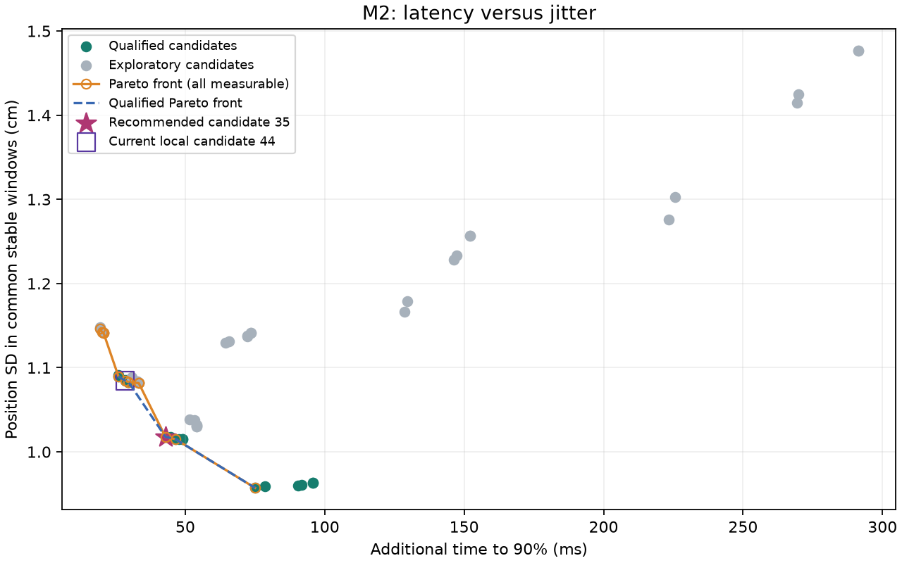

# M2 滤波调参报告

生成时间（UTC）：2026-10-20T08:02:55.309651+00:00

状态：有通过数据与质量门槛的推荐候选；主观实机试用仍未验证。

## 输入与适用范围

读取文件 3 份；可分析的完整跳点任务 3 个；跳过 0 个；计算参数组合 54 组。
推荐要求至少 3 个独立任务，每个 20 点，并满足下方覆盖/检测门槛。
只使用录制时的设备几何和校准事件，不借用当前机器的测量值或最新个人档案。A/B 不混合计算；不同设备、灰度或相机条件混合时要求分开运行。

- 文件 `20261020T074114.891823Z-61556ead.jsonl`；任务 `8e4229c4-e510-4c4d-8b51-f23603493614`；B 组；设备文件 `mbp.yaml`；SHA256 `691b321a2bddf1b9614d1ab06279f152fd3411307157fcd926432512ec74f4bc`；相机内参 `calibrated`，去畸变 `True`。
- 文件 `20261020T074149.267106Z-eb642c1b.jsonl`；任务 `b557d954-a166-49b0-91be-e309fcf0c98b`；B 组；设备文件 `mbp.yaml`；SHA256 `b45d5d49e7bcbd41b35f87f05ec848b8fe43ba1fe4e80409ec82da8662a98279`；相机内参 `calibrated`，去畸变 `True`。
- 文件 `20261020T074223.702774Z-dfea1b84.jsonl`；任务 `ec560dc5-98af-4f82-b107-3e3ea666f949`；B 组；设备文件 `mbp.yaml`；SHA256 `2f0110048d4c1cba25204ca9936b0171e8d080f1eb892d7714f30f1561e4828a`；相机内参 `calibrated`，去畸变 `True`。

算法源文件 SHA256（用于核对调参实现）：

- `gaze_core/filters.py`：`b37f5ce5b4d4ff847987d2c8f9a52ffd8aad4c80bb7e1bd4b6811626286906a0`
- `gaze_core/fixation.py`：`1122beba64ff8336d1b1993a45781d7755b1978c031534798e6444a2816889a5`
- `gaze_core/display.py`：`a5c060dadc29f949df200d827e5a3b8d0764785b125272a12727132191486c88`
- `gaze_core/evaluation.py`：`57e929d30c9fb49535d15e78ae551c2671c3d45a3aa26684a2dc703a435e7e17`
- `gaze_core/tuning.py`：`175d76515490a52037a7ca056db9810a7e2357c157f33e55be54a369ded7db41`
- `tools/tune_filter.py`：`e28c11759a22fb3a38774fe020d526bdb88dda6816a70ec58aa952528fbb3917`

## 统计定义

- 所有时间来自 browser_capture_ms，按同页浏览器时钟与 target/calibration 事件对齐；不用服务器接收或完成时刻。
- 依时间应用当时的个人矩阵；未滤波基线也是同一矩阵修正后的信号。矩阵变化、丢失跟踪或长间隔清空滤波历史。
- 主抖动指标在每个目标固定稳定窗口内，用所有有效配对帧计算 x/y 总体位置标准差（ddof=0），合成为 sqrt(SDx²+SDy²)；先目标等权、再任务等权。不会按候选检测结果删除高噪声帧。
- 厘米使用录制的实测宽高；角度在每帧 origin_m 上分别连向点及本窗口中心，计算 yaw/pitch 偏差的轴向标准差与合成标准差。缺失/非法 origin 不补值，另报覆盖；各量为抖动，不是精度。
- 另列检测注视段内的抖动、注视覆盖和段数，防止只留下很少的安静样本就得到推荐。
- 主 90%：旧、新目标各自在固定稳定窗口内，取修正后未滤波信号的二维分量中位位置作起点/终点；沿两位置的厘米方向投影。滤波与未滤波共用这一起点、终点、阈值及有效帧，不用滤波信号自己的稳定位置。到达搜索从目标切换时刻开始，逐跳相减：滤波时刻 − 未滤波时刻；保留负差，不截成 0。稳定终点使用后续帧，仅用于离线测量，不进入实时滤波。
- 小跳动：稳定位置间距离小于 min_signal_jump_snr × sqrt((旧窗口原始 cm SD² + 新窗口原始 cm SD²)/2)，或距离为零时，单独计数并从延迟覆盖分母扣除；不从抖动或检测代理中删除。默认倍率 3 是可配置的测量可辨识规则，尚非跨用户验证的阈值。稳定参考须满足最少帧、有效覆盖和最大间隔；缺失参考/无效跳动仍留在延迟覆盖分母，全部小跳动时覆盖为 0。
- 附加列保留原「旧目标→新目标」90% 定义及配对/未到达数量；其混有精度偏差，不用于主延迟推荐。
- 首个达到阈值的采样时刻作为到达时刻；hold 配置非零时还要求持续达到。没有亚帧插值，也不跨缺帧/任务边界拼接；未达到、无效跳动及配对数单列。
- 目标时间是设置位置的 requestAnimationFrame 回调，实际显示可能晚一个刷新周期；该指标比较输入时间轴上的算法响应，不包括滤波运行开销或实际屏幕呈现；不是摄像头到屏幕的端到端延迟，目标反应时间也不是真实眼跳起始标注。
- 目标切换与检测眼跳按响应窗口一对一匹配。漏检代理=未匹配目标切换/可判定切换；误检代理=未匹配检测/全部被评估检测（仅可判定跳动区间，缺帧区间的检测不计分）（FP/(TP+FP)，不是负类 FPR）。首次目标无前一目标，不用于切换延迟。
- 帕累托轴为额外延迟与统一窗口厘米抖动，越低越好。推荐仅从通过覆盖/检测门槛的前沿选取；归一化后取向理想点偏离两端连线最多的拐点候选，无明显拐点时取距理想点最近者。

## 配置与固定条件

```yaml
search_and_measurement:
  min_cutoff:
  - 0.5
  - 1.0
  - 2.0
  beta:
  - 0.0
  - 0.05
  - 0.2
  d_cutoff:
  - 1.0
  - 2.0
  angular_threshold_deg_s:
  - 45.0
  - 90.0
  - 180.0
  stable_settle_ms: 500.0
  min_stable_frames: 5
  response_window_ms: 600.0
  crossing_hold_ms: 0.0
  min_signal_jump_snr: 3.0
  min_valid_coverage: 0.8
  min_angle_coverage: 0.8
  min_fixation_coverage: 0.5
  min_transition_coverage: 0.8
  max_missed_rate: 0.3
  max_false_detection_share: 0.3
  min_tasks: 3
  expected_points: 20
  require_personal_calibration: true
detector_fixed_values:
  window_ms: 80.0
  angular_threshold_deg_s: 90.0
  fallback_threshold_norm_s: 1.5
  min_duration_ms: 100.0
  max_gap_ms: 250.0
```

## 推荐与取舍曲线

推荐候选 **35**，适用于上述输入条件；尚需主观试用：

```yaml
filter:
  min_cutoff: 1.0
  beta: 0.2
  d_cutoff: 2.0
fixation:
  angular_threshold_deg_s: 90.0
```
未滤波 → 滤波抖动：1.5012 cm → 1.0179 cm；1.8367° → 1.2519°。
90% 时间：422.8716 ms → 465.7424 ms；额外 42.8708 ms。
通过门槛 18/54 组；合格帕累托前沿候选：17, 29, 35, 38, 41, 44, 50。上述候选按统一规则归一化选择拐点，未为使数据通过而改变覆盖或检测门槛。
以上从本轮输入计算，不代表其他用户或设备；坐标速度回退阈值没有被本次角阈值搜索调优。
推荐候选覆盖：60 个有效稳定目标；主延迟配对 56/56，总切换 57，相对抖动过小 1；缺稳定参考 0，无效跳动 0。

- `20261020T074114.891823Z-61556ead.jsonl` 目标 index 1：信号位移 17.2525 cm，两窗口噪声 RMS 8.4312 cm，阈值 25.2935 cm。此处“小”是相对噪声，不能解释为绝对位移很小；仍保留该目标的抖动和检测记录。

### 当前本机探索配置对比

按本次运行实际生效的全部滤波参数及角速度阈值匹配，不只比较 min_cutoff；不回写 local.yaml 或 default.yaml。

```yaml
min_cutoff: 2.0
beta: 0.05
d_cutoff: 1.0
angular_threshold_deg_s: 90.0
```
对应候选 **44**，通过质量门槛。
抖动 1.0846 cm / 1.3319°；主 90% 额外延迟 28.4294 ms；旧目标定义额外 26.6906 ms。
推荐相对当前配置：厘米抖动变化 -0.0667 cm，角度抖动变化 -0.0799°，额外延迟变化 14.4413 ms（负值为降低）。
当前探索配置也在合格帕累托前沿，可作为偏向较低延迟的试用选项；拐点推荐偏向进一步降低抖动。差值是本轮样本均值，不表示统计显著性或亚帧精度，最终取舍需主观试用。



## 各参数组合

| 候选 | min_cutoff / beta / d_cutoff / deg·s⁻¹ | 原始→滤波 cm SD | 原始→滤波 ° SD | 主原始→滤波 90% ms | 主额外 ms | 旧目标原始→滤波 90% ms | 旧目标额外 ms | 漏检代理 | 误检代理 | 推荐资格 |
|---|---|---|---|---|---|---|---|---|---|---|
| 1 | 0.5 / 0.0 / 1.0 / 45.0 | 1.5012 → 1.0300 | 1.8367 → 1.2643 | 422.8716 → 476.8125 | 53.9408 | 415.8143 → 468.8024 | 52.9881 | 0.0000 (0/57) | 0.4300 (43/100) | false_detection_share |
| 2 | 0.5 / 0.0 / 1.0 / 90.0 | 1.5012 → 0.9629 | 1.8367 → 1.1878 | 422.8716 → 518.6976 | 95.8259 | 406.9963 → 475.9860 | 68.9897 | 0.0526 (3/57) | 0.0357 (2/56) | 通过 |
| 3 | 0.5 / 0.0 / 1.0 / 180.0 | 1.5012 → 1.4766 | 1.8367 → 1.8274 | 422.8716 → 714.1300 | 291.2584 | 385.3824 → 557.1630 | 171.7805 | 0.4035 (23/57) | 0.0000 (0/34) | missed_rate |
| 4 | 0.5 / 0.0 / 2.0 / 45.0 | 1.5012 → 1.0300 | 1.8367 → 1.2643 | 422.8716 → 476.8125 | 53.9408 | 415.8143 → 468.8024 | 52.9881 | 0.0000 (0/57) | 0.4300 (43/100) | false_detection_share |
| 5 | 0.5 / 0.0 / 2.0 / 90.0 | 1.5012 → 0.9629 | 1.8367 → 1.1878 | 422.8716 → 518.6976 | 95.8259 | 406.9963 → 475.9860 | 68.9897 | 0.0526 (3/57) | 0.0357 (2/56) | 通过 |
| 6 | 0.5 / 0.0 / 2.0 / 180.0 | 1.5012 → 1.4766 | 1.8367 → 1.8274 | 422.8716 → 714.1300 | 291.2584 | 385.3824 → 557.1630 | 171.7805 | 0.4035 (23/57) | 0.0000 (0/34) | missed_rate |
| 7 | 0.5 / 0.05 / 1.0 / 45.0 | 1.5012 → 1.0318 | 1.8367 → 1.2664 | 422.8716 → 476.8125 | 53.9408 | 415.8143 → 468.0048 | 52.1905 | 0.0000 (0/57) | 0.4300 (43/100) | false_detection_share |
| 8 | 0.5 / 0.05 / 1.0 / 90.0 | 1.5012 → 0.9609 | 1.8367 → 1.1852 | 422.8716 → 514.5128 | 91.6411 | 406.9963 → 474.1388 | 67.1425 | 0.0526 (3/57) | 0.0357 (2/56) | 通过 |
| 9 | 0.5 / 0.05 / 1.0 / 180.0 | 1.5012 → 1.4246 | 1.8367 → 1.7622 | 422.8716 → 692.8434 | 269.9717 | 385.3824 → 548.7772 | 163.3948 | 0.4035 (23/57) | 0.0000 (0/34) | missed_rate |
| 10 | 0.5 / 0.05 / 2.0 / 45.0 | 1.5012 → 1.0319 | 1.8367 → 1.2666 | 422.8716 → 476.8125 | 53.9408 | 415.8143 → 468.0048 | 52.1905 | 0.0000 (0/57) | 0.4300 (43/100) | false_detection_share |
| 11 | 0.5 / 0.05 / 2.0 / 90.0 | 1.5012 → 0.9602 | 1.8367 → 1.1842 | 422.8716 → 513.3124 | 90.4407 | 406.9963 → 474.1388 | 67.1425 | 0.0526 (3/57) | 0.0357 (2/56) | 通过 |
| 12 | 0.5 / 0.05 / 2.0 / 180.0 | 1.5012 → 1.4147 | 1.8367 → 1.7499 | 422.8716 → 692.2732 | 269.4016 | 385.3824 → 547.9080 | 162.5256 | 0.4035 (23/57) | 0.0000 (0/34) | missed_rate |
| 13 | 0.5 / 0.2 / 1.0 / 45.0 | 1.5012 → 1.0374 | 1.8367 → 1.2732 | 422.8716 → 476.2212 | 53.3496 | 415.8143 → 467.2604 | 51.4460 | 0.0000 (0/57) | 0.4300 (43/100) | false_detection_share |
| 14 | 0.5 / 0.2 / 1.0 / 90.0 | 1.5012 → 0.9586 | 1.8367 → 1.1819 | 422.8716 → 501.4248 | 78.5531 | 410.6247 → 489.5544 | 78.9297 | 0.0526 (3/57) | 0.0357 (2/56) | 通过 |
| 15 | 0.5 / 0.2 / 1.0 / 180.0 | 1.5012 → 1.3029 | 1.8367 → 1.6097 | 422.8716 → 648.4505 | 225.5788 | 408.2839 → 549.9323 | 141.6484 | 0.4035 (23/57) | 0.0000 (0/34) | missed_rate |
| 16 | 0.5 / 0.2 / 2.0 / 45.0 | 1.5012 → 1.0384 | 1.8367 → 1.2744 | 422.8716 → 474.4932 | 51.6215 | 415.8143 → 466.5115 | 50.6971 | 0.0000 (0/57) | 0.4300 (43/100) | false_detection_share |
| 17 | 0.5 / 0.2 / 2.0 / 90.0 | 1.5012 → 0.9572 | 1.8367 → 1.1798 | 422.8716 → 497.8940 | 75.0223 | 410.6247 → 488.7615 | 78.1368 | 0.0526 (3/57) | 0.0357 (2/56) | 通过 |
| 18 | 0.5 / 0.2 / 2.0 / 180.0 | 1.5012 → 1.2756 | 1.8367 → 1.5754 | 422.8716 → 646.1452 | 223.2736 | 408.2839 → 545.6266 | 137.3427 | 0.4035 (23/57) | 0.0000 (0/34) | missed_rate |
| 19 | 1.0 / 0.0 / 1.0 / 45.0 | 1.5012 → 1.0816 | 1.8367 → 1.3267 | 422.8716 → 456.1888 | 33.3172 | 415.8143 → 457.6242 | 41.8099 | 0.0000 (0/57) | 0.4300 (43/100) | false_detection_share |
| 20 | 1.0 / 0.0 / 1.0 / 90.0 | 1.5012 → 1.0150 | 1.8367 → 1.2489 | 422.8716 → 471.7817 | 48.9100 | 410.6247 → 473.6480 | 63.0233 | 0.0526 (3/57) | 0.0357 (2/56) | 通过 |
| 21 | 1.0 / 0.0 / 1.0 / 180.0 | 1.5012 → 1.2569 | 1.8367 → 1.5485 | 422.8716 → 575.0236 | 152.1519 | 410.6247 → 553.2077 | 142.5830 | 0.4035 (23/57) | 0.0000 (0/34) | missed_rate |
| 22 | 1.0 / 0.0 / 2.0 / 45.0 | 1.5012 → 1.0816 | 1.8367 → 1.3267 | 422.8716 → 456.1888 | 33.3172 | 415.8143 → 457.6242 | 41.8099 | 0.0000 (0/57) | 0.4300 (43/100) | false_detection_share |
| 23 | 1.0 / 0.0 / 2.0 / 90.0 | 1.5012 → 1.0150 | 1.8367 → 1.2489 | 422.8716 → 471.7817 | 48.9100 | 410.6247 → 473.6480 | 63.0233 | 0.0526 (3/57) | 0.0357 (2/56) | 通过 |
| 24 | 1.0 / 0.0 / 2.0 / 180.0 | 1.5012 → 1.2569 | 1.8367 → 1.5485 | 422.8716 → 575.0236 | 152.1519 | 410.6247 → 553.2077 | 142.5830 | 0.4035 (23/57) | 0.0000 (0/34) | missed_rate |
| 25 | 1.0 / 0.05 / 1.0 / 45.0 | 1.5012 → 1.0831 | 1.8367 → 1.3285 | 422.8716 → 455.6028 | 32.7312 | 415.8143 → 456.8931 | 41.0788 | 0.0000 (0/57) | 0.4300 (43/100) | false_detection_share |
| 26 | 1.0 / 0.05 / 1.0 / 90.0 | 1.5012 → 1.0153 | 1.8367 → 1.2492 | 422.8716 → 470.5735 | 47.7019 | 410.6247 → 471.9377 | 61.3130 | 0.0526 (3/57) | 0.0357 (2/56) | 通过 |
| 27 | 1.0 / 0.05 / 1.0 / 180.0 | 1.5012 → 1.2333 | 1.8367 → 1.5192 | 422.8716 → 570.2510 | 147.3793 | 410.6247 → 545.6496 | 135.0249 | 0.4035 (23/57) | 0.0000 (0/34) | missed_rate |
| 28 | 1.0 / 0.05 / 2.0 / 45.0 | 1.5012 → 1.0833 | 1.8367 → 1.3287 | 422.8716 → 455.6028 | 32.7312 | 415.8143 → 456.8931 | 41.0788 | 0.0000 (0/57) | 0.4300 (43/100) | false_detection_share |
| 29 | 1.0 / 0.05 / 2.0 / 90.0 | 1.5012 → 1.0150 | 1.8367 → 1.2488 | 422.8716 → 469.3784 | 46.5067 | 410.6247 → 471.9377 | 61.3130 | 0.0526 (3/57) | 0.0357 (2/56) | 通过 |
| 30 | 1.0 / 0.05 / 2.0 / 180.0 | 1.5012 → 1.2282 | 1.8367 → 1.5129 | 422.8716 → 569.0948 | 146.2232 | 410.6247 → 545.6496 | 135.0249 | 0.4035 (23/57) | 0.0000 (0/34) | missed_rate |
| 31 | 1.0 / 0.2 / 1.0 / 45.0 | 1.5012 → 1.0876 | 1.8367 → 1.3340 | 422.8716 → 453.7889 | 30.9173 | 415.8143 → 456.8931 | 41.0788 | 0.0000 (0/57) | 0.4300 (43/100) | false_detection_share |
| 32 | 1.0 / 0.2 / 1.0 / 90.0 | 1.5012 → 1.0180 | 1.8367 → 1.2522 | 422.8716 → 467.5561 | 44.6845 | 410.6247 → 469.5198 | 58.8951 | 0.0526 (3/57) | 0.0357 (2/56) | 通过 |
| 33 | 1.0 / 0.2 / 1.0 / 180.0 | 1.5012 → 1.1792 | 1.8367 → 1.4518 | 422.8716 → 552.5541 | 129.6825 | 410.6247 → 536.3830 | 125.7582 | 0.4035 (23/57) | 0.0000 (0/34) | missed_rate |
| 34 | 1.0 / 0.2 / 2.0 / 45.0 | 1.5012 → 1.0887 | 1.8367 → 1.3352 | 422.8716 → 453.7889 | 30.9173 | 415.8143 → 456.8931 | 41.0788 | 0.0000 (0/57) | 0.4300 (43/100) | false_detection_share |
| 35 | 1.0 / 0.2 / 2.0 / 90.0 | 1.5012 → 1.0179 | 1.8367 → 1.2519 | 422.8716 → 465.7424 | 42.8708 | 410.6247 → 469.5198 | 58.8951 | 0.0526 (3/57) | 0.0357 (2/56) | 通过 |
| 36 | 1.0 / 0.2 / 2.0 / 180.0 | 1.5012 → 1.1661 | 1.8367 → 1.4355 | 422.8716 → 551.3699 | 128.4982 | 410.6247 → 534.7491 | 124.1244 | 0.4035 (23/57) | 0.0000 (0/34) | missed_rate |
| 37 | 2.0 / 0.0 / 1.0 / 45.0 | 1.5012 → 1.1413 | 1.8367 → 1.3990 | 422.8716 → 443.5624 | 20.6907 | 415.8143 → 432.6997 | 16.8854 | 0.0000 (0/57) | 0.4300 (43/100) | false_detection_share |
| 38 | 2.0 / 0.0 / 1.0 / 90.0 | 1.5012 → 1.0829 | 1.8367 → 1.3299 | 422.8716 → 452.5127 | 29.6410 | 414.0995 → 440.7901 | 26.6906 | 0.0526 (3/57) | 0.0357 (2/56) | 通过 |
| 39 | 2.0 / 0.0 / 1.0 / 180.0 | 1.5012 → 1.1413 | 1.8367 → 1.4023 | 422.8716 → 496.2672 | 73.3955 | 410.6247 → 476.7168 | 66.0921 | 0.4035 (23/57) | 0.0000 (0/34) | missed_rate |
| 40 | 2.0 / 0.0 / 2.0 / 45.0 | 1.5012 → 1.1413 | 1.8367 → 1.3990 | 422.8716 → 443.5624 | 20.6907 | 415.8143 → 432.6997 | 16.8854 | 0.0000 (0/57) | 0.4300 (43/100) | false_detection_share |
| 41 | 2.0 / 0.0 / 2.0 / 90.0 | 1.5012 → 1.0829 | 1.8367 → 1.3299 | 422.8716 → 452.5127 | 29.6410 | 414.0995 → 440.7901 | 26.6906 | 0.0526 (3/57) | 0.0357 (2/56) | 通过 |
| 42 | 2.0 / 0.0 / 2.0 / 180.0 | 1.5012 → 1.1413 | 1.8367 → 1.4023 | 422.8716 → 496.2672 | 73.3955 | 410.6247 → 476.7168 | 66.0921 | 0.4035 (23/57) | 0.0000 (0/34) | missed_rate |
| 43 | 2.0 / 0.05 / 1.0 / 45.0 | 1.5012 → 1.1425 | 1.8367 → 1.4006 | 422.8716 → 442.9712 | 20.0995 | 415.8143 → 432.6997 | 16.8854 | 0.0000 (0/57) | 0.4300 (43/100) | false_detection_share |
| 44 | 2.0 / 0.05 / 1.0 / 90.0 | 1.5012 → 1.0846 | 1.8367 → 1.3319 | 422.8716 → 451.3011 | 28.4294 | 414.0995 → 440.7901 | 26.6906 | 0.0526 (3/57) | 0.0357 (2/56) | 通过 |
| 45 | 2.0 / 0.05 / 1.0 / 180.0 | 1.5012 → 1.1380 | 1.8367 → 1.3982 | 422.8716 → 495.0412 | 72.1696 | 410.6247 → 476.7168 | 66.0921 | 0.4035 (23/57) | 0.0000 (0/34) | missed_rate |
| 46 | 2.0 / 0.05 / 2.0 / 45.0 | 1.5012 → 1.1429 | 1.8367 → 1.4010 | 422.8716 → 442.9712 | 20.0995 | 415.8143 → 432.6997 | 16.8854 | 0.0000 (0/57) | 0.4300 (43/100) | false_detection_share |
| 47 | 2.0 / 0.05 / 2.0 / 90.0 | 1.5012 → 1.0850 | 1.8367 → 1.3324 | 422.8716 → 451.3011 | 28.4294 | 414.0995 → 440.7901 | 26.6906 | 0.0526 (3/57) | 0.0357 (2/56) | 通过 |
| 48 | 2.0 / 0.05 / 2.0 / 180.0 | 1.5012 → 1.1373 | 1.8367 → 1.3973 | 422.8716 → 495.0412 | 72.1696 | 410.6247 → 474.9989 | 64.3742 | 0.4035 (23/57) | 0.0000 (0/34) | missed_rate |
| 49 | 2.0 / 0.2 / 1.0 / 45.0 | 1.5012 → 1.1462 | 1.8367 → 1.4051 | 422.8716 → 442.3694 | 19.4978 | 415.8143 → 432.6997 | 16.8854 | 0.0000 (0/57) | 0.4300 (43/100) | false_detection_share |
| 50 | 2.0 / 0.2 / 1.0 / 90.0 | 1.5012 → 1.0896 | 1.8367 → 1.3380 | 422.8716 → 448.9058 | 26.0341 | 414.0995 → 440.7901 | 26.6906 | 0.0526 (3/57) | 0.0357 (2/56) | 通过 |
| 51 | 2.0 / 0.2 / 1.0 / 180.0 | 1.5012 → 1.1313 | 1.8367 → 1.3898 | 422.8716 → 488.5132 | 65.6415 | 414.0995 → 476.1260 | 62.0265 | 0.4035 (23/57) | 0.0000 (0/34) | missed_rate |
| 52 | 2.0 / 0.2 / 2.0 / 45.0 | 1.5012 → 1.1478 | 1.8367 → 1.4071 | 422.8716 → 442.3694 | 19.4978 | 415.8143 → 432.6997 | 16.8854 | 0.0000 (0/57) | 0.4300 (43/100) | false_detection_share |
| 53 | 2.0 / 0.2 / 2.0 / 90.0 | 1.5012 → 1.0916 | 1.8367 → 1.3403 | 422.8716 → 448.9058 | 26.0341 | 414.0995 → 440.7901 | 26.6906 | 0.0526 (3/57) | 0.0357 (2/56) | 通过 |
| 54 | 2.0 / 0.2 / 2.0 / 180.0 | 1.5012 → 1.1300 | 1.8367 → 1.3881 | 422.8716 → 487.3465 | 64.4749 | 414.0995 → 476.1260 | 62.0265 | 0.4035 (23/57) | 0.0000 (0/34) | missed_rate |

## 每轮覆盖与检测注视段

| 候选 / 任务 | 稳定目标/总目标 | 有效/总帧 | 角度帧/缺origin/非法origin | 注视覆盖 | 检测注视段 cm / ° SD（段数） | 主配对/延迟分母/总跳动 | 小跳动/缺参考/无效 | 主未到达：原始/滤波 | 旧目标配对/原始未到/滤波未到 |
|---|---|---|---|---|---|---|---|---|---|---|
| 1 / 8e4229c4-e510-4c4d-8b51-f23603493614 | 20/20 | 601/601 | 601/0/0 | 0.8303 | 0.4991 / 0.6145 (29) | 18/18/19 | 1/0/0 | 0/0 | 15/3/4 |
| 1 / b557d954-a166-49b0-91be-e309fcf0c98b | 20/20 | 602/602 | 602/0/0 | 0.8206 | 0.5301 / 0.6450 (33) | 19/19/19 | 0/0/0 | 0/0 | 14/3/5 |
| 1 / ec560dc5-98af-4f82-b107-3e3ea666f949 | 20/20 | 601/601 | 601/0/0 | 0.8985 | 0.6128 / 0.7462 (26) | 19/19/19 | 0/0/0 | 0/0 | 13/3/6 |
| 2 / 8e4229c4-e510-4c4d-8b51-f23603493614 | 20/20 | 601/601 | 601/0/0 | 0.9301 | 0.9698 / 1.1972 (23) | 18/18/19 | 1/0/0 | 0/0 | 14/3/5 |
| 2 / b557d954-a166-49b0-91be-e309fcf0c98b | 20/20 | 602/602 | 602/0/0 | 0.9585 | 1.1436 / 1.3945 (19) | 19/19/19 | 0/0/0 | 0/0 | 12/3/7 |
| 2 / ec560dc5-98af-4f82-b107-3e3ea666f949 | 20/20 | 601/601 | 601/0/0 | 0.9584 | 0.7693 / 0.9423 (21) | 19/19/19 | 0/0/0 | 0/0 | 13/3/6 |
| 3 / 8e4229c4-e510-4c4d-8b51-f23603493614 | 20/20 | 601/601 | 601/0/0 | 0.9584 | 1.8215 / 2.2570 (17) | 18/18/19 | 1/0/0 | 0/0 | 14/3/5 |
| 3 / b557d954-a166-49b0-91be-e309fcf0c98b | 20/20 | 602/602 | 602/0/0 | 0.9917 | 3.0733 / 3.8186 (12) | 19/19/19 | 0/0/0 | 0/0 | 10/3/9 |
| 3 / ec560dc5-98af-4f82-b107-3e3ea666f949 | 20/20 | 601/601 | 601/0/0 | 0.9884 | 4.4693 / 5.5236 (11) | 19/19/19 | 0/0/0 | 0/0 | 13/3/6 |
| 4 / 8e4229c4-e510-4c4d-8b51-f23603493614 | 20/20 | 601/601 | 601/0/0 | 0.8303 | 0.4991 / 0.6145 (29) | 18/18/19 | 1/0/0 | 0/0 | 15/3/4 |
| 4 / b557d954-a166-49b0-91be-e309fcf0c98b | 20/20 | 602/602 | 602/0/0 | 0.8206 | 0.5301 / 0.6450 (33) | 19/19/19 | 0/0/0 | 0/0 | 14/3/5 |
| 4 / ec560dc5-98af-4f82-b107-3e3ea666f949 | 20/20 | 601/601 | 601/0/0 | 0.8985 | 0.6128 / 0.7462 (26) | 19/19/19 | 0/0/0 | 0/0 | 13/3/6 |
| 5 / 8e4229c4-e510-4c4d-8b51-f23603493614 | 20/20 | 601/601 | 601/0/0 | 0.9301 | 0.9698 / 1.1972 (23) | 18/18/19 | 1/0/0 | 0/0 | 14/3/5 |
| 5 / b557d954-a166-49b0-91be-e309fcf0c98b | 20/20 | 602/602 | 602/0/0 | 0.9585 | 1.1436 / 1.3945 (19) | 19/19/19 | 0/0/0 | 0/0 | 12/3/7 |
| 5 / ec560dc5-98af-4f82-b107-3e3ea666f949 | 20/20 | 601/601 | 601/0/0 | 0.9584 | 0.7693 / 0.9423 (21) | 19/19/19 | 0/0/0 | 0/0 | 13/3/6 |
| 6 / 8e4229c4-e510-4c4d-8b51-f23603493614 | 20/20 | 601/601 | 601/0/0 | 0.9584 | 1.8215 / 2.2570 (17) | 18/18/19 | 1/0/0 | 0/0 | 14/3/5 |
| 6 / b557d954-a166-49b0-91be-e309fcf0c98b | 20/20 | 602/602 | 602/0/0 | 0.9917 | 3.0733 / 3.8186 (12) | 19/19/19 | 0/0/0 | 0/0 | 10/3/9 |
| 6 / ec560dc5-98af-4f82-b107-3e3ea666f949 | 20/20 | 601/601 | 601/0/0 | 0.9884 | 4.4693 / 5.5236 (11) | 19/19/19 | 0/0/0 | 0/0 | 13/3/6 |
| 7 / 8e4229c4-e510-4c4d-8b51-f23603493614 | 20/20 | 601/601 | 601/0/0 | 0.8303 | 0.5051 / 0.6219 (29) | 18/18/19 | 1/0/0 | 0/0 | 15/3/4 |
| 7 / b557d954-a166-49b0-91be-e309fcf0c98b | 20/20 | 602/602 | 602/0/0 | 0.8206 | 0.5361 / 0.6523 (33) | 19/19/19 | 0/0/0 | 0/0 | 14/3/5 |
| 7 / ec560dc5-98af-4f82-b107-3e3ea666f949 | 20/20 | 601/601 | 601/0/0 | 0.8985 | 0.6177 / 0.7522 (26) | 19/19/19 | 0/0/0 | 0/0 | 13/3/6 |
| 8 / 8e4229c4-e510-4c4d-8b51-f23603493614 | 20/20 | 601/601 | 601/0/0 | 0.9301 | 0.9810 / 1.2113 (23) | 18/18/19 | 1/0/0 | 0/0 | 14/3/5 |
| 8 / b557d954-a166-49b0-91be-e309fcf0c98b | 20/20 | 602/602 | 602/0/0 | 0.9585 | 1.1536 / 1.4067 (19) | 19/19/19 | 0/0/0 | 0/0 | 12/3/7 |
| 8 / ec560dc5-98af-4f82-b107-3e3ea666f949 | 20/20 | 601/601 | 601/0/0 | 0.9584 | 0.7733 / 0.9470 (21) | 19/19/19 | 0/0/0 | 0/0 | 13/3/6 |
| 9 / 8e4229c4-e510-4c4d-8b51-f23603493614 | 20/20 | 601/601 | 601/0/0 | 0.9584 | 1.8574 / 2.3024 (17) | 18/18/19 | 1/0/0 | 0/0 | 14/3/5 |
| 9 / b557d954-a166-49b0-91be-e309fcf0c98b | 20/20 | 602/602 | 602/0/0 | 0.9917 | 3.0969 / 3.8472 (12) | 19/19/19 | 0/0/0 | 0/0 | 10/3/9 |
| 9 / ec560dc5-98af-4f82-b107-3e3ea666f949 | 20/20 | 601/601 | 601/0/0 | 0.9884 | 4.5106 / 5.5737 (11) | 19/19/19 | 0/0/0 | 0/0 | 13/3/6 |
| 10 / 8e4229c4-e510-4c4d-8b51-f23603493614 | 20/20 | 601/601 | 601/0/0 | 0.8303 | 0.5072 / 0.6243 (29) | 18/18/19 | 1/0/0 | 0/0 | 15/3/4 |
| 10 / b557d954-a166-49b0-91be-e309fcf0c98b | 20/20 | 602/602 | 602/0/0 | 0.8206 | 0.5380 / 0.6545 (33) | 19/19/19 | 0/0/0 | 0/0 | 14/3/5 |
| 10 / ec560dc5-98af-4f82-b107-3e3ea666f949 | 20/20 | 601/601 | 601/0/0 | 0.8985 | 0.6189 / 0.7536 (26) | 19/19/19 | 0/0/0 | 0/0 | 13/3/6 |
| 11 / 8e4229c4-e510-4c4d-8b51-f23603493614 | 20/20 | 601/601 | 601/0/0 | 0.9301 | 0.9837 / 1.2145 (23) | 18/18/19 | 1/0/0 | 0/0 | 14/3/5 |
| 11 / b557d954-a166-49b0-91be-e309fcf0c98b | 20/20 | 602/602 | 602/0/0 | 0.9585 | 1.1548 / 1.4083 (19) | 19/19/19 | 0/0/0 | 0/0 | 12/3/7 |
| 11 / ec560dc5-98af-4f82-b107-3e3ea666f949 | 20/20 | 601/601 | 601/0/0 | 0.9584 | 0.7743 / 0.9482 (21) | 19/19/19 | 0/0/0 | 0/0 | 13/3/6 |
| 12 / 8e4229c4-e510-4c4d-8b51-f23603493614 | 20/20 | 601/601 | 601/0/0 | 0.9584 | 1.8634 / 2.3099 (17) | 18/18/19 | 1/0/0 | 0/0 | 14/3/5 |
| 12 / b557d954-a166-49b0-91be-e309fcf0c98b | 20/20 | 602/602 | 602/0/0 | 0.9917 | 3.1000 / 3.8509 (12) | 19/19/19 | 0/0/0 | 0/0 | 10/3/9 |
| 12 / ec560dc5-98af-4f82-b107-3e3ea666f949 | 20/20 | 601/601 | 601/0/0 | 0.9884 | 4.5121 / 5.5755 (11) | 19/19/19 | 0/0/0 | 0/0 | 13/3/6 |
| 13 / 8e4229c4-e510-4c4d-8b51-f23603493614 | 20/20 | 601/601 | 601/0/0 | 0.8303 | 0.5229 / 0.6433 (29) | 18/18/19 | 1/0/0 | 0/0 | 15/3/4 |
| 13 / b557d954-a166-49b0-91be-e309fcf0c98b | 20/20 | 602/602 | 602/0/0 | 0.8206 | 0.5537 / 0.6737 (33) | 19/19/19 | 0/0/0 | 0/0 | 14/3/5 |
| 13 / ec560dc5-98af-4f82-b107-3e3ea666f949 | 20/20 | 601/601 | 601/0/0 | 0.8985 | 0.6321 / 0.7697 (26) | 19/19/19 | 0/0/0 | 0/0 | 13/3/6 |
| 14 / 8e4229c4-e510-4c4d-8b51-f23603493614 | 20/20 | 601/601 | 601/0/0 | 0.9301 | 1.0124 / 1.2504 (23) | 18/18/19 | 1/0/0 | 0/0 | 14/3/5 |
| 14 / b557d954-a166-49b0-91be-e309fcf0c98b | 20/20 | 602/602 | 602/0/0 | 0.9585 | 1.1802 / 1.4394 (19) | 19/19/19 | 0/0/0 | 0/0 | 13/3/6 |
| 14 / ec560dc5-98af-4f82-b107-3e3ea666f949 | 20/20 | 601/601 | 601/0/0 | 0.9584 | 0.7859 / 0.9617 (21) | 19/19/19 | 0/0/0 | 0/0 | 13/3/6 |
| 15 / 8e4229c4-e510-4c4d-8b51-f23603493614 | 20/20 | 601/601 | 601/0/0 | 0.9584 | 1.9539 / 2.4241 (17) | 18/18/19 | 1/0/0 | 0/0 | 14/3/5 |
| 15 / b557d954-a166-49b0-91be-e309fcf0c98b | 20/20 | 602/602 | 602/0/0 | 0.9917 | 3.1605 / 3.9241 (12) | 19/19/19 | 0/0/0 | 0/0 | 11/3/8 |
| 15 / ec560dc5-98af-4f82-b107-3e3ea666f949 | 20/20 | 601/601 | 601/0/0 | 0.9884 | 4.6113 / 5.6960 (11) | 19/19/19 | 0/0/0 | 0/0 | 13/3/6 |
| 16 / 8e4229c4-e510-4c4d-8b51-f23603493614 | 20/20 | 601/601 | 601/0/0 | 0.8303 | 0.5308 / 0.6528 (29) | 18/18/19 | 1/0/0 | 0/0 | 15/3/4 |
| 16 / b557d954-a166-49b0-91be-e309fcf0c98b | 20/20 | 602/602 | 602/0/0 | 0.8206 | 0.5606 / 0.6820 (33) | 19/19/19 | 0/0/0 | 0/0 | 14/3/5 |
| 16 / ec560dc5-98af-4f82-b107-3e3ea666f949 | 20/20 | 601/601 | 601/0/0 | 0.8985 | 0.6364 / 0.7750 (26) | 19/19/19 | 0/0/0 | 0/0 | 13/3/6 |
| 17 / 8e4229c4-e510-4c4d-8b51-f23603493614 | 20/20 | 601/601 | 601/0/0 | 0.9301 | 1.0225 / 1.2629 (23) | 18/18/19 | 1/0/0 | 0/0 | 14/3/5 |
| 17 / b557d954-a166-49b0-91be-e309fcf0c98b | 20/20 | 602/602 | 602/0/0 | 0.9585 | 1.1857 / 1.4460 (19) | 19/19/19 | 0/0/0 | 0/0 | 13/3/6 |
| 17 / ec560dc5-98af-4f82-b107-3e3ea666f949 | 20/20 | 601/601 | 601/0/0 | 0.9584 | 0.7901 / 0.9665 (21) | 19/19/19 | 0/0/0 | 0/0 | 13/3/6 |
| 18 / 8e4229c4-e510-4c4d-8b51-f23603493614 | 20/20 | 601/601 | 601/0/0 | 0.9584 | 1.9779 / 2.4543 (17) | 18/18/19 | 1/0/0 | 0/0 | 14/3/5 |
| 18 / b557d954-a166-49b0-91be-e309fcf0c98b | 20/20 | 602/602 | 602/0/0 | 0.9917 | 3.1727 / 3.9388 (12) | 19/19/19 | 0/0/0 | 0/0 | 11/3/8 |
| 18 / ec560dc5-98af-4f82-b107-3e3ea666f949 | 20/20 | 601/601 | 601/0/0 | 0.9884 | 4.6178 / 5.7036 (11) | 19/19/19 | 0/0/0 | 0/0 | 13/3/6 |
| 19 / 8e4229c4-e510-4c4d-8b51-f23603493614 | 20/20 | 601/601 | 601/0/0 | 0.8303 | 0.6256 / 0.7678 (29) | 18/18/19 | 1/0/0 | 0/0 | 15/3/4 |
| 19 / b557d954-a166-49b0-91be-e309fcf0c98b | 20/20 | 602/602 | 602/0/0 | 0.8206 | 0.6514 / 0.7923 (33) | 19/19/19 | 0/0/0 | 0/0 | 14/3/5 |
| 19 / ec560dc5-98af-4f82-b107-3e3ea666f949 | 20/20 | 601/601 | 601/0/0 | 0.8985 | 0.7230 / 0.8801 (26) | 19/19/19 | 0/0/0 | 0/0 | 13/3/6 |
| 20 / 8e4229c4-e510-4c4d-8b51-f23603493614 | 20/20 | 601/601 | 601/0/0 | 0.9301 | 1.1094 / 1.3694 (23) | 18/18/19 | 1/0/0 | 0/0 | 14/3/5 |
| 20 / b557d954-a166-49b0-91be-e309fcf0c98b | 20/20 | 602/602 | 602/0/0 | 0.9585 | 1.2611 / 1.5377 (19) | 19/19/19 | 0/0/0 | 0/0 | 13/3/6 |
| 20 / ec560dc5-98af-4f82-b107-3e3ea666f949 | 20/20 | 601/601 | 601/0/0 | 0.9584 | 0.8598 / 1.0494 (21) | 19/19/19 | 0/0/0 | 0/0 | 13/3/6 |
| 21 / 8e4229c4-e510-4c4d-8b51-f23603493614 | 20/20 | 601/601 | 601/0/0 | 0.9584 | 2.1222 / 2.6325 (17) | 18/18/19 | 1/0/0 | 0/0 | 14/3/5 |
| 21 / b557d954-a166-49b0-91be-e309fcf0c98b | 20/20 | 602/602 | 602/0/0 | 0.9917 | 3.3172 / 4.1126 (12) | 19/19/19 | 0/0/0 | 0/0 | 13/3/6 |
| 21 / ec560dc5-98af-4f82-b107-3e3ea666f949 | 20/20 | 601/601 | 601/0/0 | 0.9884 | 4.7519 / 5.8671 (11) | 19/19/19 | 0/0/0 | 0/0 | 13/3/6 |
| 22 / 8e4229c4-e510-4c4d-8b51-f23603493614 | 20/20 | 601/601 | 601/0/0 | 0.8303 | 0.6256 / 0.7678 (29) | 18/18/19 | 1/0/0 | 0/0 | 15/3/4 |
| 22 / b557d954-a166-49b0-91be-e309fcf0c98b | 20/20 | 602/602 | 602/0/0 | 0.8206 | 0.6514 / 0.7923 (33) | 19/19/19 | 0/0/0 | 0/0 | 14/3/5 |
| 22 / ec560dc5-98af-4f82-b107-3e3ea666f949 | 20/20 | 601/601 | 601/0/0 | 0.8985 | 0.7230 / 0.8801 (26) | 19/19/19 | 0/0/0 | 0/0 | 13/3/6 |
| 23 / 8e4229c4-e510-4c4d-8b51-f23603493614 | 20/20 | 601/601 | 601/0/0 | 0.9301 | 1.1094 / 1.3694 (23) | 18/18/19 | 1/0/0 | 0/0 | 14/3/5 |
| 23 / b557d954-a166-49b0-91be-e309fcf0c98b | 20/20 | 602/602 | 602/0/0 | 0.9585 | 1.2611 / 1.5377 (19) | 19/19/19 | 0/0/0 | 0/0 | 13/3/6 |
| 23 / ec560dc5-98af-4f82-b107-3e3ea666f949 | 20/20 | 601/601 | 601/0/0 | 0.9584 | 0.8598 / 1.0494 (21) | 19/19/19 | 0/0/0 | 0/0 | 13/3/6 |
| 24 / 8e4229c4-e510-4c4d-8b51-f23603493614 | 20/20 | 601/601 | 601/0/0 | 0.9584 | 2.1222 / 2.6325 (17) | 18/18/19 | 1/0/0 | 0/0 | 14/3/5 |
| 24 / b557d954-a166-49b0-91be-e309fcf0c98b | 20/20 | 602/602 | 602/0/0 | 0.9917 | 3.3172 / 4.1126 (12) | 19/19/19 | 0/0/0 | 0/0 | 13/3/6 |
| 24 / ec560dc5-98af-4f82-b107-3e3ea666f949 | 20/20 | 601/601 | 601/0/0 | 0.9884 | 4.7519 / 5.8671 (11) | 19/19/19 | 0/0/0 | 0/0 | 13/3/6 |
| 25 / 8e4229c4-e510-4c4d-8b51-f23603493614 | 20/20 | 601/601 | 601/0/0 | 0.8303 | 0.6293 / 0.7722 (29) | 18/18/19 | 1/0/0 | 0/0 | 15/3/4 |
| 25 / b557d954-a166-49b0-91be-e309fcf0c98b | 20/20 | 602/602 | 602/0/0 | 0.8206 | 0.6549 / 0.7966 (33) | 19/19/19 | 0/0/0 | 0/0 | 14/3/5 |
| 25 / ec560dc5-98af-4f82-b107-3e3ea666f949 | 20/20 | 601/601 | 601/0/0 | 0.8985 | 0.7258 / 0.8835 (26) | 19/19/19 | 0/0/0 | 0/0 | 13/3/6 |
| 26 / 8e4229c4-e510-4c4d-8b51-f23603493614 | 20/20 | 601/601 | 601/0/0 | 0.9301 | 1.1156 / 1.3771 (23) | 18/18/19 | 1/0/0 | 0/0 | 14/3/5 |
| 26 / b557d954-a166-49b0-91be-e309fcf0c98b | 20/20 | 602/602 | 602/0/0 | 0.9585 | 1.2662 / 1.5440 (19) | 19/19/19 | 0/0/0 | 0/0 | 13/3/6 |
| 26 / ec560dc5-98af-4f82-b107-3e3ea666f949 | 20/20 | 601/601 | 601/0/0 | 0.9584 | 0.8630 / 1.0532 (21) | 19/19/19 | 0/0/0 | 0/0 | 13/3/6 |
| 27 / 8e4229c4-e510-4c4d-8b51-f23603493614 | 20/20 | 601/601 | 601/0/0 | 0.9584 | 2.1406 / 2.6559 (17) | 18/18/19 | 1/0/0 | 0/0 | 14/3/5 |
| 27 / b557d954-a166-49b0-91be-e309fcf0c98b | 20/20 | 602/602 | 602/0/0 | 0.9917 | 3.3276 / 4.1253 (12) | 19/19/19 | 0/0/0 | 0/0 | 13/3/6 |
| 27 / ec560dc5-98af-4f82-b107-3e3ea666f949 | 20/20 | 601/601 | 601/0/0 | 0.9884 | 4.7669 / 5.8852 (11) | 19/19/19 | 0/0/0 | 0/0 | 13/3/6 |
| 28 / 8e4229c4-e510-4c4d-8b51-f23603493614 | 20/20 | 601/601 | 601/0/0 | 0.8303 | 0.6306 / 0.7737 (29) | 18/18/19 | 1/0/0 | 0/0 | 15/3/4 |
| 28 / b557d954-a166-49b0-91be-e309fcf0c98b | 20/20 | 602/602 | 602/0/0 | 0.8206 | 0.6560 / 0.7979 (33) | 19/19/19 | 0/0/0 | 0/0 | 14/3/5 |
| 28 / ec560dc5-98af-4f82-b107-3e3ea666f949 | 20/20 | 601/601 | 601/0/0 | 0.8985 | 0.7263 / 0.8841 (26) | 19/19/19 | 0/0/0 | 0/0 | 13/3/6 |
| 29 / 8e4229c4-e510-4c4d-8b51-f23603493614 | 20/20 | 601/601 | 601/0/0 | 0.9301 | 1.1172 / 1.3792 (23) | 18/18/19 | 1/0/0 | 0/0 | 14/3/5 |
| 29 / b557d954-a166-49b0-91be-e309fcf0c98b | 20/20 | 602/602 | 602/0/0 | 0.9585 | 1.2673 / 1.5453 (19) | 19/19/19 | 0/0/0 | 0/0 | 13/3/6 |
| 29 / ec560dc5-98af-4f82-b107-3e3ea666f949 | 20/20 | 601/601 | 601/0/0 | 0.9584 | 0.8638 / 1.0540 (21) | 19/19/19 | 0/0/0 | 0/0 | 13/3/6 |
| 30 / 8e4229c4-e510-4c4d-8b51-f23603493614 | 20/20 | 601/601 | 601/0/0 | 0.9584 | 2.1451 / 2.6616 (17) | 18/18/19 | 1/0/0 | 0/0 | 14/3/5 |
| 30 / b557d954-a166-49b0-91be-e309fcf0c98b | 20/20 | 602/602 | 602/0/0 | 0.9917 | 3.3298 / 4.1279 (12) | 19/19/19 | 0/0/0 | 0/0 | 13/3/6 |
| 30 / ec560dc5-98af-4f82-b107-3e3ea666f949 | 20/20 | 601/601 | 601/0/0 | 0.9884 | 4.7680 / 5.8865 (11) | 19/19/19 | 0/0/0 | 0/0 | 13/3/6 |
| 31 / 8e4229c4-e510-4c4d-8b51-f23603493614 | 20/20 | 601/601 | 601/0/0 | 0.8303 | 0.6402 / 0.7853 (29) | 18/18/19 | 1/0/0 | 0/0 | 15/3/4 |
| 31 / b557d954-a166-49b0-91be-e309fcf0c98b | 20/20 | 602/602 | 602/0/0 | 0.8206 | 0.6653 / 0.8091 (33) | 19/19/19 | 0/0/0 | 0/0 | 14/3/5 |
| 31 / ec560dc5-98af-4f82-b107-3e3ea666f949 | 20/20 | 601/601 | 601/0/0 | 0.8985 | 0.7340 / 0.8936 (26) | 19/19/19 | 0/0/0 | 0/0 | 13/3/6 |
| 32 / 8e4229c4-e510-4c4d-8b51-f23603493614 | 20/20 | 601/601 | 601/0/0 | 0.9301 | 1.1333 / 1.3992 (23) | 18/18/19 | 1/0/0 | 0/0 | 14/3/5 |
| 32 / b557d954-a166-49b0-91be-e309fcf0c98b | 20/20 | 602/602 | 602/0/0 | 0.9585 | 1.2808 / 1.5618 (19) | 19/19/19 | 0/0/0 | 0/0 | 13/3/6 |
| 32 / ec560dc5-98af-4f82-b107-3e3ea666f949 | 20/20 | 601/601 | 601/0/0 | 0.9584 | 0.8726 / 1.0645 (21) | 19/19/19 | 0/0/0 | 0/0 | 13/3/6 |
| 33 / 8e4229c4-e510-4c4d-8b51-f23603493614 | 20/20 | 601/601 | 601/0/0 | 0.9584 | 2.1918 / 2.7208 (17) | 18/18/19 | 1/0/0 | 0/0 | 14/3/5 |
| 33 / b557d954-a166-49b0-91be-e309fcf0c98b | 20/20 | 602/602 | 602/0/0 | 0.9917 | 3.3573 / 4.1612 (12) | 19/19/19 | 0/0/0 | 0/0 | 13/3/6 |
| 33 / ec560dc5-98af-4f82-b107-3e3ea666f949 | 20/20 | 601/601 | 601/0/0 | 0.9884 | 4.8054 / 5.9318 (11) | 19/19/19 | 0/0/0 | 0/0 | 13/3/6 |
| 34 / 8e4229c4-e510-4c4d-8b51-f23603493614 | 20/20 | 601/601 | 601/0/0 | 0.8303 | 0.6449 / 0.7910 (29) | 18/18/19 | 1/0/0 | 0/0 | 15/3/4 |
| 34 / b557d954-a166-49b0-91be-e309fcf0c98b | 20/20 | 602/602 | 602/0/0 | 0.8206 | 0.6694 / 0.8142 (33) | 19/19/19 | 0/0/0 | 0/0 | 14/3/5 |
| 34 / ec560dc5-98af-4f82-b107-3e3ea666f949 | 20/20 | 601/601 | 601/0/0 | 0.8985 | 0.7363 / 0.8964 (26) | 19/19/19 | 0/0/0 | 0/0 | 13/3/6 |
| 35 / 8e4229c4-e510-4c4d-8b51-f23603493614 | 20/20 | 601/601 | 601/0/0 | 0.9301 | 1.1399 / 1.4075 (23) | 18/18/19 | 1/0/0 | 0/0 | 14/3/5 |
| 35 / b557d954-a166-49b0-91be-e309fcf0c98b | 20/20 | 602/602 | 602/0/0 | 0.9585 | 1.2858 / 1.5679 (19) | 19/19/19 | 0/0/0 | 0/0 | 13/3/6 |
| 35 / ec560dc5-98af-4f82-b107-3e3ea666f949 | 20/20 | 601/601 | 601/0/0 | 0.9584 | 0.8759 / 1.0683 (21) | 19/19/19 | 0/0/0 | 0/0 | 13/3/6 |
| 36 / 8e4229c4-e510-4c4d-8b51-f23603493614 | 20/20 | 601/601 | 601/0/0 | 0.9584 | 2.2100 / 2.7440 (17) | 18/18/19 | 1/0/0 | 0/0 | 14/3/5 |
| 36 / b557d954-a166-49b0-91be-e309fcf0c98b | 20/20 | 602/602 | 602/0/0 | 0.9917 | 3.3665 / 4.1725 (12) | 19/19/19 | 0/0/0 | 0/0 | 13/3/6 |
| 36 / ec560dc5-98af-4f82-b107-3e3ea666f949 | 20/20 | 601/601 | 601/0/0 | 0.9884 | 4.8103 / 5.9376 (11) | 19/19/19 | 0/0/0 | 0/0 | 13/3/6 |
| 37 / 8e4229c4-e510-4c4d-8b51-f23603493614 | 20/20 | 601/601 | 601/0/0 | 0.8303 | 0.7466 / 0.9142 (29) | 18/18/19 | 1/0/0 | 0/0 | 15/3/4 |
| 37 / b557d954-a166-49b0-91be-e309fcf0c98b | 20/20 | 602/602 | 602/0/0 | 0.8206 | 0.7668 / 0.9328 (33) | 19/19/19 | 0/0/0 | 0/0 | 14/3/5 |
| 37 / ec560dc5-98af-4f82-b107-3e3ea666f949 | 20/20 | 601/601 | 601/0/0 | 0.8985 | 0.8283 / 1.0080 (26) | 19/19/19 | 0/0/0 | 0/0 | 13/3/6 |
| 38 / 8e4229c4-e510-4c4d-8b51-f23603493614 | 20/20 | 601/601 | 601/0/0 | 0.9301 | 1.2346 / 1.5241 (23) | 18/18/19 | 1/0/0 | 0/0 | 15/3/4 |
| 38 / b557d954-a166-49b0-91be-e309fcf0c98b | 20/20 | 602/602 | 602/0/0 | 0.9585 | 1.3757 / 1.6772 (19) | 19/19/19 | 0/0/0 | 0/0 | 13/3/6 |
| 38 / ec560dc5-98af-4f82-b107-3e3ea666f949 | 20/20 | 601/601 | 601/0/0 | 0.9584 | 0.9602 / 1.1687 (21) | 19/19/19 | 0/0/0 | 0/0 | 13/3/6 |
| 39 / 8e4229c4-e510-4c4d-8b51-f23603493614 | 20/20 | 601/601 | 601/0/0 | 0.9584 | 2.3553 / 2.9266 (17) | 18/18/19 | 1/0/0 | 0/0 | 14/3/5 |
| 39 / b557d954-a166-49b0-91be-e309fcf0c98b | 20/20 | 602/602 | 602/0/0 | 0.9917 | 3.4974 / 4.3306 (12) | 19/19/19 | 0/0/0 | 0/0 | 13/3/6 |
| 39 / ec560dc5-98af-4f82-b107-3e3ea666f949 | 20/20 | 601/601 | 601/0/0 | 0.9884 | 4.9010 / 6.0474 (11) | 19/19/19 | 0/0/0 | 0/0 | 13/3/6 |
| 40 / 8e4229c4-e510-4c4d-8b51-f23603493614 | 20/20 | 601/601 | 601/0/0 | 0.8303 | 0.7466 / 0.9142 (29) | 18/18/19 | 1/0/0 | 0/0 | 15/3/4 |
| 40 / b557d954-a166-49b0-91be-e309fcf0c98b | 20/20 | 602/602 | 602/0/0 | 0.8206 | 0.7668 / 0.9328 (33) | 19/19/19 | 0/0/0 | 0/0 | 14/3/5 |
| 40 / ec560dc5-98af-4f82-b107-3e3ea666f949 | 20/20 | 601/601 | 601/0/0 | 0.8985 | 0.8283 / 1.0080 (26) | 19/19/19 | 0/0/0 | 0/0 | 13/3/6 |
| 41 / 8e4229c4-e510-4c4d-8b51-f23603493614 | 20/20 | 601/601 | 601/0/0 | 0.9301 | 1.2346 / 1.5241 (23) | 18/18/19 | 1/0/0 | 0/0 | 15/3/4 |
| 41 / b557d954-a166-49b0-91be-e309fcf0c98b | 20/20 | 602/602 | 602/0/0 | 0.9585 | 1.3757 / 1.6772 (19) | 19/19/19 | 0/0/0 | 0/0 | 13/3/6 |
| 41 / ec560dc5-98af-4f82-b107-3e3ea666f949 | 20/20 | 601/601 | 601/0/0 | 0.9584 | 0.9602 / 1.1687 (21) | 19/19/19 | 0/0/0 | 0/0 | 13/3/6 |
| 42 / 8e4229c4-e510-4c4d-8b51-f23603493614 | 20/20 | 601/601 | 601/0/0 | 0.9584 | 2.3553 / 2.9266 (17) | 18/18/19 | 1/0/0 | 0/0 | 14/3/5 |
| 42 / b557d954-a166-49b0-91be-e309fcf0c98b | 20/20 | 602/602 | 602/0/0 | 0.9917 | 3.4974 / 4.3306 (12) | 19/19/19 | 0/0/0 | 0/0 | 13/3/6 |
| 42 / ec560dc5-98af-4f82-b107-3e3ea666f949 | 20/20 | 601/601 | 601/0/0 | 0.9884 | 4.9010 / 6.0474 (11) | 19/19/19 | 0/0/0 | 0/0 | 13/3/6 |
| 43 / 8e4229c4-e510-4c4d-8b51-f23603493614 | 20/20 | 601/601 | 601/0/0 | 0.8303 | 0.7486 / 0.9166 (29) | 18/18/19 | 1/0/0 | 0/0 | 15/3/4 |
| 43 / b557d954-a166-49b0-91be-e309fcf0c98b | 20/20 | 602/602 | 602/0/0 | 0.8206 | 0.7687 / 0.9352 (33) | 19/19/19 | 0/0/0 | 0/0 | 14/3/5 |
| 43 / ec560dc5-98af-4f82-b107-3e3ea666f949 | 20/20 | 601/601 | 601/0/0 | 0.8985 | 0.8299 / 1.0099 (26) | 19/19/19 | 0/0/0 | 0/0 | 13/3/6 |
| 44 / 8e4229c4-e510-4c4d-8b51-f23603493614 | 20/20 | 601/601 | 601/0/0 | 0.9301 | 1.2380 / 1.5284 (23) | 18/18/19 | 1/0/0 | 0/0 | 15/3/4 |
| 44 / b557d954-a166-49b0-91be-e309fcf0c98b | 20/20 | 602/602 | 602/0/0 | 0.9585 | 1.3789 / 1.6811 (19) | 19/19/19 | 0/0/0 | 0/0 | 13/3/6 |
| 44 / ec560dc5-98af-4f82-b107-3e3ea666f949 | 20/20 | 601/601 | 601/0/0 | 0.9584 | 0.9625 / 1.1714 (21) | 19/19/19 | 0/0/0 | 0/0 | 13/3/6 |
| 45 / 8e4229c4-e510-4c4d-8b51-f23603493614 | 20/20 | 601/601 | 601/0/0 | 0.9584 | 2.3650 / 2.9391 (17) | 18/18/19 | 1/0/0 | 0/0 | 14/3/5 |
| 45 / b557d954-a166-49b0-91be-e309fcf0c98b | 20/20 | 602/602 | 602/0/0 | 0.9917 | 3.5029 / 4.3373 (12) | 19/19/19 | 0/0/0 | 0/0 | 13/3/6 |
| 45 / ec560dc5-98af-4f82-b107-3e3ea666f949 | 20/20 | 601/601 | 601/0/0 | 0.9884 | 4.9067 / 6.0543 (11) | 19/19/19 | 0/0/0 | 0/0 | 13/3/6 |
| 46 / 8e4229c4-e510-4c4d-8b51-f23603493614 | 20/20 | 601/601 | 601/0/0 | 0.8303 | 0.7493 / 0.9175 (29) | 18/18/19 | 1/0/0 | 0/0 | 15/3/4 |
| 46 / b557d954-a166-49b0-91be-e309fcf0c98b | 20/20 | 602/602 | 602/0/0 | 0.8206 | 0.7695 / 0.9361 (33) | 19/19/19 | 0/0/0 | 0/0 | 14/3/5 |
| 46 / ec560dc5-98af-4f82-b107-3e3ea666f949 | 20/20 | 601/601 | 601/0/0 | 0.8985 | 0.8304 / 1.0105 (26) | 19/19/19 | 0/0/0 | 0/0 | 13/3/6 |
| 47 / 8e4229c4-e510-4c4d-8b51-f23603493614 | 20/20 | 601/601 | 601/0/0 | 0.9301 | 1.2393 / 1.5300 (23) | 18/18/19 | 1/0/0 | 0/0 | 15/3/4 |
| 47 / b557d954-a166-49b0-91be-e309fcf0c98b | 20/20 | 602/602 | 602/0/0 | 0.9585 | 1.3801 / 1.6826 (19) | 19/19/19 | 0/0/0 | 0/0 | 13/3/6 |
| 47 / ec560dc5-98af-4f82-b107-3e3ea666f949 | 20/20 | 601/601 | 601/0/0 | 0.9584 | 0.9633 / 1.1724 (21) | 19/19/19 | 0/0/0 | 0/0 | 13/3/6 |
| 48 / 8e4229c4-e510-4c4d-8b51-f23603493614 | 20/20 | 601/601 | 601/0/0 | 0.9584 | 2.3689 / 2.9441 (17) | 18/18/19 | 1/0/0 | 0/0 | 14/3/5 |
| 48 / b557d954-a166-49b0-91be-e309fcf0c98b | 20/20 | 602/602 | 602/0/0 | 0.9917 | 3.5051 / 4.3400 (12) | 19/19/19 | 0/0/0 | 0/0 | 13/3/6 |
| 48 / ec560dc5-98af-4f82-b107-3e3ea666f949 | 20/20 | 601/601 | 601/0/0 | 0.9884 | 4.9080 / 6.0559 (11) | 19/19/19 | 0/0/0 | 0/0 | 13/3/6 |
| 49 / 8e4229c4-e510-4c4d-8b51-f23603493614 | 20/20 | 601/601 | 601/0/0 | 0.8303 | 0.7545 / 0.9238 (29) | 18/18/19 | 1/0/0 | 0/0 | 15/3/4 |
| 49 / b557d954-a166-49b0-91be-e309fcf0c98b | 20/20 | 602/602 | 602/0/0 | 0.8206 | 0.7745 / 0.9422 (33) | 19/19/19 | 0/0/0 | 0/0 | 14/3/5 |
| 49 / ec560dc5-98af-4f82-b107-3e3ea666f949 | 20/20 | 601/601 | 601/0/0 | 0.8985 | 0.8347 / 1.0158 (26) | 19/19/19 | 0/0/0 | 0/0 | 13/3/6 |
| 50 / 8e4229c4-e510-4c4d-8b51-f23603493614 | 20/20 | 601/601 | 601/0/0 | 0.9301 | 1.2481 / 1.5410 (23) | 18/18/19 | 1/0/0 | 0/0 | 15/3/4 |
| 50 / b557d954-a166-49b0-91be-e309fcf0c98b | 20/20 | 602/602 | 602/0/0 | 0.9585 | 1.3881 / 1.6924 (19) | 19/19/19 | 0/0/0 | 0/0 | 13/3/6 |
| 50 / ec560dc5-98af-4f82-b107-3e3ea666f949 | 20/20 | 601/601 | 601/0/0 | 0.9584 | 0.9692 / 1.1795 (21) | 19/19/19 | 0/0/0 | 0/0 | 13/3/6 |
| 51 / 8e4229c4-e510-4c4d-8b51-f23603493614 | 20/20 | 601/601 | 601/0/0 | 0.9584 | 2.3929 / 2.9745 (17) | 18/18/19 | 1/0/0 | 0/0 | 15/3/4 |
| 51 / b557d954-a166-49b0-91be-e309fcf0c98b | 20/20 | 602/602 | 602/0/0 | 0.9917 | 3.5189 / 4.3568 (12) | 19/19/19 | 0/0/0 | 0/0 | 13/3/6 |
| 51 / ec560dc5-98af-4f82-b107-3e3ea666f949 | 20/20 | 601/601 | 601/0/0 | 0.9884 | 4.9224 / 6.0734 (11) | 19/19/19 | 0/0/0 | 0/0 | 13/3/6 |
| 52 / 8e4229c4-e510-4c4d-8b51-f23603493614 | 20/20 | 601/601 | 601/0/0 | 0.8303 | 0.7575 / 0.9274 (29) | 18/18/19 | 1/0/0 | 0/0 | 15/3/4 |
| 52 / b557d954-a166-49b0-91be-e309fcf0c98b | 20/20 | 602/602 | 602/0/0 | 0.8206 | 0.7774 / 0.9457 (33) | 19/19/19 | 0/0/0 | 0/0 | 14/3/5 |
| 52 / ec560dc5-98af-4f82-b107-3e3ea666f949 | 20/20 | 601/601 | 601/0/0 | 0.8985 | 0.8366 / 1.0181 (26) | 19/19/19 | 0/0/0 | 0/0 | 13/3/6 |
| 53 / 8e4229c4-e510-4c4d-8b51-f23603493614 | 20/20 | 601/601 | 601/0/0 | 0.9301 | 1.2531 / 1.5472 (23) | 18/18/19 | 1/0/0 | 0/0 | 15/3/4 |
| 53 / b557d954-a166-49b0-91be-e309fcf0c98b | 20/20 | 602/602 | 602/0/0 | 0.9585 | 1.3932 / 1.6986 (19) | 19/19/19 | 0/0/0 | 0/0 | 13/3/6 |
| 53 / ec560dc5-98af-4f82-b107-3e3ea666f949 | 20/20 | 601/601 | 601/0/0 | 0.9584 | 0.9723 / 1.1831 (21) | 19/19/19 | 0/0/0 | 0/0 | 13/3/6 |
| 54 / 8e4229c4-e510-4c4d-8b51-f23603493614 | 20/20 | 601/601 | 601/0/0 | 0.9584 | 2.4079 / 2.9938 (17) | 18/18/19 | 1/0/0 | 0/0 | 15/3/4 |
| 54 / b557d954-a166-49b0-91be-e309fcf0c98b | 20/20 | 602/602 | 602/0/0 | 0.9917 | 3.5273 / 4.3673 (12) | 19/19/19 | 0/0/0 | 0/0 | 13/3/6 |
| 54 / ec560dc5-98af-4f82-b107-3e3ea666f949 | 20/20 | 601/601 | 601/0/0 | 0.9884 | 4.9274 / 6.0795 (11) | 19/19/19 | 0/0/0 | 0/0 | 13/3/6 |

## 待实机主观验证

- 使用推荐候选在 config/local.yaml 覆盖 filter/fixation，重启本地服务；重新九点校准或明确加载匹配档案。
- 默认关闭的「对比显示」可显示绿=滤波、橙=修正后未滤波；记录稳定注视抖动、看向新位置的跟随感、停顿和异常跳动。
- Mac 主观试用未验证；Windows 实机未验证。大纲中额外 2–3 人试用仍需真实反馈，不由本报告代填。
