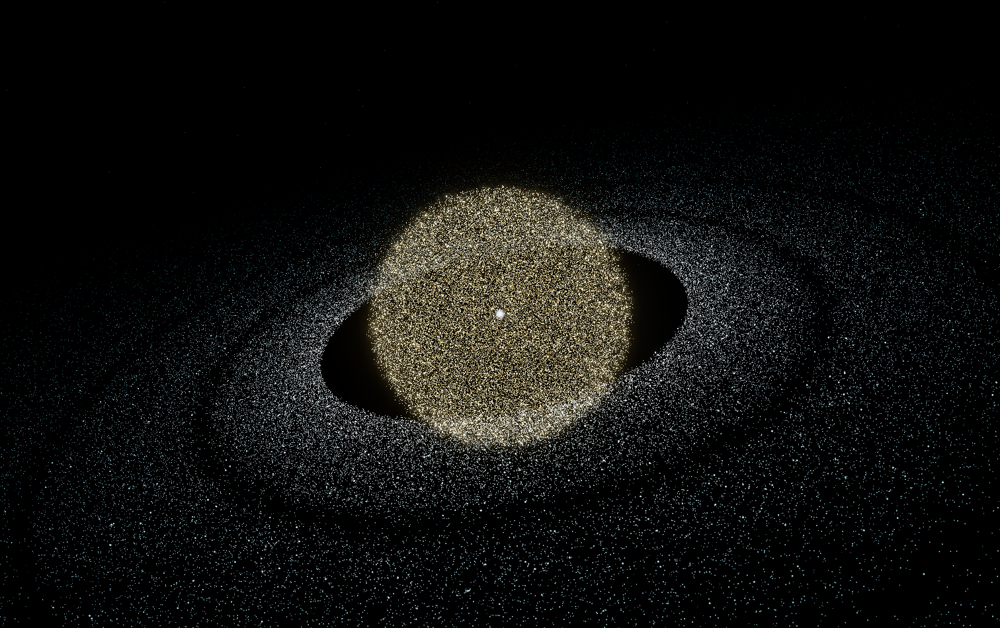

# 05 · 验收与证据

只收录已经核查的非敏感程序画面及公开聚合结果索引；不上传摄像头、人脸、个人桌面截图、原始注视/点击轨迹或个人会话。合成画面不是精度/性能证据。

## 程序画面

`images/particle-planet.png`来自M8b开发期`data/reference/render_check.png`的直接复制，仅选本项目生成的粒子行星画面，不包含参考视频拼图。当前归档日期2026-11-05；原文件生成时间不是本次新实测，画面不证明120FPS或精度。本次核查没有人脸、摄像头、桌面或文字个人信息。[生成/对照工具](../../tools/render_planet_check.py)，复现可能因浏览器/GPU不同而不同。

[早期网页界面截图](../../界面预览.jpg)为v0.1.0页面，摄像头尚未开启、预览为空；不把它冒充当前桌面功能截图。

## 真正的验收依据

- [原验证记录](../../验证记录.md)：系统、条件、分组、数值、历次失败与待测。
- [验收入口](../../docs/验收入口.md)：Mac单用户B核对、M5独立核对及M9四轮波动。
- [M9预注册](../../docs/m9-acceptance.md)：不改门槛；第四轮同次验收通过，前三轮失败边界保留。
- [真实PR与版本对照](../06-版本历史/README.md)：提交和讨论可追溯。

个人真实数据与自窗口测试原PNG留本机data，不为增加“证据数量”公开。未来示例报告只使用明确标记的合成海报；当前Pages和报告预览尚未发布。
